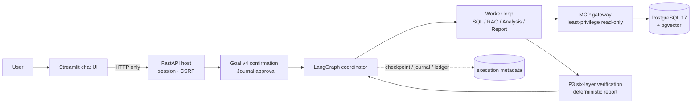

# DataPilot Pro — English Overview

On November 7, 2026, P7 passed formal business quality acceptance. The sealed 455-file v4 candidate and DeepSeek Flash 48k configuration scored **60/60** on both the strict and business measures, with **42/42** boundary cases under both measures. Acceptance covers synthetic SaaS tasks within host-reviewed scopes. See the [acceptance report](docs/research/p7-formal60-48k-acceptance.md) and [current status](docs/current-status.md).

> An evidence-driven AI agent for SaaS business analytics. The model may plan and choose tools, but it cannot grant data access, approve a business contract, or prove a conclusion by itself.

The Chinese [README](README.md) is the primary document; this page is a concise English overview for GitHub reviewers.

## Status

| Dimension | State |
|---|---|
| Engineering Demo Candidate | **ACCEPTED** (local single-user, synthetic data, scripted worker) |
| Python 3.11 / 3.13 full CI | **PASS** ([Actions #28](https://github.com/zouradiant-dev/datapilot-pro/actions/runs/41299832252), commit `b06cc52`) |
| Independent Business Quality | **PASS** (formal 60-case set, 455-file v4 candidate) |
| DeepSeek Live Gate | **PASS** (48k, strict 60/60, business 60/60) |
| Independent human semantic review | **NOT_VERIFIED** |

Branch: `p7-engineering-candidate-v1`.

## What it solves

SaaS analytics is less about generating SQL and more about making a number **defensible**:

- one question can map to several definitions (paid-invoice revenue vs MRR, customer churn vs subscription churn, half-open windows, CNY minor units);
- every published figure must answer *where it came from, which version, who confirmed it, and whether it can be recomputed*;
- documents are often mistaken for numeric proof, and correlation for causation;
- long agent runs mix model calls, tool calls and state commits across transactions, so naive retries duplicate spend or hide unknown outcomes.

DataPilot Pro encodes these constraints in types, permissions and verifiers rather than in prompts.

## Why an agent

A single text-to-SQL call cannot handle multi-source questions with dependencies, structured feedback, explicit approval and crash recovery. The agent plans a task DAG, runs a bounded tool loop, and keeps every step inside host-enforced boundaries.



Full diagrams (layers, dual loop, end-to-end sequence, trust boundaries, recovery) are in [docs/architecture-overview.md](docs/architecture-overview.md); the long-form design is [docs/architecture.md](docs/architecture.md).

## Implemented vs pending

Implemented: chat-first UI and versioned `/api/v1` host; CSV/XLSX preview, confirmation and restricted ingestion; versioned dataset/semantic/metric registry; SQL MCP with SQLGlot AST whitelist, read-only roles and quotas; P3 six-layer metric verification with independent recomputation; scoped TXT/Markdown ingestion with fixed BGE embeddings and pgvector search; cross-source reports with claims, chart specs and four business-completion states; Goal v4 finite-scope confirmation and separate execution approval; durable LangGraph execution with official PostgreSQL checkpoints, journal, atomic budget ledger, artifacts and conservative unknown-outcome handling; maintenance/retention CLI.

The formal DeepSeek business gate passed across 54 Runtime runs and six host refusals. The optional Qwen3 profile still has separate validation requirements, and BGE 512/ONNX remains the default. Multi-tenancy, RLS, production authentication, remote Langfuse, HNSW/ANN, and the P11 cache and degradation engine remain outside this delivery.

## Verification evidence

CI (Actions #28, per Python version): **1336** non-integration tests passed, **325** PostgreSQL/MCP integration tests passed, **63** legitimate skips (Qwen/CUDA and live-model opt-in), **0** failed/errors. Planned scope is 1724 = 1336 + 388; 388 integration = 325 passed + 63 skipped. Both JUnit artifacts were parsed directly; the run and both jobs concluded `success` on attempt 1 for commit `b06cc52`. The sanitized summary is [p7-actions-28-junit-summary.json](docs/research/p7-actions-28-junit-summary.json).

Engineering demo (five real runs, real PostgreSQL 17/pgvector, MCP, BGE, P3 and durable execution; scripted/Fake model decisions): three `completed`, one `unavailable` (missing document fact, no fabrication), one `blocked` with `RECOVERY_UNCERTAIN` (no automatic re-send). The SQL and SQL+RAG runs publish **1432.25 CNY** bound to P3 Evidence/Verification; the combined report cites an authorized document chunk without claiming causation. API/UI restarts reproduce identical run signatures; revoking the RAG contract makes the report return `403 GOAL_REVOKED`. The **1432.25 CNY** figure belongs to the P7 demo's own synthetic dataset (2026-06 window); the **300 CNY** figure in the local quickstart is a different first-deployment sample (2025-10). They must not be compared or reused across datasets.

Real-model status: intent holdout 59 cases (Rule-only 46/59, LLM-only 58/59, Hybrid 57/59); business holdout stopped safely at case `bh2-031` after a budget-reservation failure — 31 observed, 25 strictly correct, 6 incorrect, 29 `not_run`; 61 real calls fully settled with no unknown outcome. This is a fixed-order prefix sample, not an unbiased success rate.

## Run the demo locally (synthetic data)

Requires Python 3.11–3.13, [uv](https://docs.astral.sh/uv/) and Docker Desktop (WSL 2 / Linux containers on Windows).

```powershell
$env:PYTHONUTF8 = '1'
uv sync --locked --python 3.11
uv run --locked python scripts/configure_local.py
docker compose up -d --wait
uv run --locked datapilot db-init
uv run --locked datapilot migrate
uv run --locked datapilot runtime-init   # official Saver/checkpoint metadata (explicit ops step)
uv run --locked datapilot seed
uv run --locked datapilot health
.\scripts\start_demo.ps1
```

Open <http://127.0.0.1:8501/> (API on `127.0.0.1:8000`). Load the synthetic SaaS sample, confirm the schema, import, confirm the mapping and `paid_invoice_revenue`, ask a question, confirm the finite scope, then approve execution separately. The first-deployment sample (October 2025) revenue is **300 CNY**; it is separate from the P7 demo's 1432.25 CNY dataset. Fake mode replaces only model decisions; PostgreSQL, MCP, computation and verification really execute. Never run `docker compose down -v` or reset the database.

## Documentation map

- [Architecture overview](docs/architecture-overview.md) (Mermaid, current implementation)
- [Orchestration](docs/orchestration.md) · [Semantic metrics](docs/semantic-metrics.md) · [RAG pipeline](docs/rag-pipeline.md) · [Cross-source report](docs/cross-source-report.md) · [Recovery](docs/recovery.md)
- [Chat-first UI](docs/chat-first-ui.md) · [ADR-015](docs/adr/0015-chat-first-conversation.md) · [ADR-018](docs/adr/0018-trusted-goal-scope.md) · [ADR-019](docs/adr/0019-web-goal-confirmation.md)
- [P7 release index](docs/releases/p7-engineering-candidate-v1/README.md) · [Demo acceptance](docs/releases/p7-engineering-candidate-v1/frozen/p7-demo-acceptance.md) · [Evaluation status](docs/evaluation.md)
- [Career showcase](docs/showcase.md) · [Engineering history](docs/engineering-history.md) · [API contract](docs/api-v1.md)
- [Project constraints and Chinese agent guidelines](AGENTS.md) · [English agent guidelines](AGENTS.en.md)

## Development guidelines

Collaboration follows direct communication, continued execution of authorized work, the smallest correct change and factual delivery. Lead with the conclusion, keep investigating, implementing and verifying until the task is complete, focus code changes on the actual problem, and report what changed and what was checked.

Let errors surface where they should. Required configuration and internal contract errors must not be hidden behind defaults, empty results or layers of fallbacks. Keep the project's required input validation, authorization checks, timeouts, recovery protocols and handling of demonstrated failures.

The full guidelines are in [AGENTS.md](AGENTS.md) (project-specific constraints and Chinese general guidelines) and [AGENTS.en.md](AGENTS.en.md) (English general guidelines). Adapt the general sections to the project's needs, keep the relevant Chinese and English guidance aligned, and preserve the project-specific constraints and stage records.

## Boundaries

The first release targets a trusted local single user. `dataset_id` is not tenant isolation; there is no production authentication, RLS, SLA, remote Langfuse or HNSW. Model credentials live only in an ignored `.env` or the host environment; MCP subprocesses never inherit admin, owner, seed, registry or model secrets. Historical failures, STOP records, `NOT_VERIFIED` and `not_run` entries are preserved as-is.
