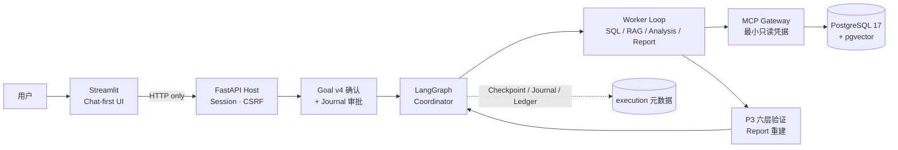

# DataPilot Pro

2026-11-07，P7 正式业务质量验收通过。455 文件 v4 候选在封存的 DeepSeek Flash 48k 正式 60 题上，严格分和业务分均为 **60/60**，边界均为 **42/42**。适用范围为本地可信 SaaS 合成业务与宿主审阅范围。详见 [正式验收与交付记录](docs/research/p7-formal60-48k-acceptance.md)和 [当前状态](docs/current-status.md)。

> 面向 SaaS 经营分析场景的 **Evidence-driven AI Agent**：模型可以参与规划与工具决策，但不能自行授予数据访问权限、批准业务合同或证明业务结论。

| 验收维度 | 当前状态 |
|---|---|
| Engineering Demo Candidate | **ACCEPTED**（本地单用户、合成数据、脚本 Worker） |
| Python 3.11 / 3.13 完整 CI | **PASS**（[Actions #28](https://github.com/zouradiant-dev/datapilot-pro/actions/runs/41299832252)，提交 `b06cc52`） |
| Independent Business Quality | **PASS**（正式 60 题，455 文件 v4 候选） |
| DeepSeek Live Gate | **PASS**（48k，严格 60/60，业务 60/60） |
| 独立人工合同语义审查 | **NOT_VERIFIED** |

分支：`p7-engineering-candidate-v1`。公开交付索引见 [P7 工程候选](docs/releases/p7-engineering-candidate-v1/README.md)；架构速览见 [architecture-overview.md](docs/architecture-overview.md)；面试材料见 [showcase.md](docs/showcase.md)；英文概览见 [README.en.md](README.en.md)。

## 30 秒了解

- **输入**：CSV/XLSX 业务数据 + 用户确认的语义/指标口径 + 经授权的 TXT/Markdown 文档。
- **过程**：对话把问题收敛为**可信有限合同** → 用户确认 → 独立执行审批 → LangGraph 双环执行 → 业务查询只走 MCP → P3 六层验证 → 报告独立重建引用。
- **输出**：带 Evidence/Verification 引用的精确数字、文档引述与显式缺口（`completed` / `partial` / `unavailable` / `blocked`），而不是一段无法复核的"分析文字"。

与传统 Text-to-SQL 的核心区别：

1. **授权在宿主，不在模型**：Dataset/version、指标口径、RAG 范围、执行批准都由服务端可信入口绑定；模型参数不能扩权。
2. **数字必须独立复算**：P3 用另一条原始列投影在 Python 中重算，六层验证全过才发布；模型不参与心算。
3. **长流程可恢复且不重复花钱**：官方 PG Checkpoint + Journal + 原子预算账本；未知结果保守计账并阻断自动重发。

## 它解决什么问题

SaaS 经营分析的真实难点不是"写出 SQL"，而是：

- 同一句话可能有多种口径（paid 账单收入 vs MRR、客户流失 vs 订阅流失、右开区间、CNY 分）；
- 数字要能回答"从哪来、按什么版本、谁确认的、能否复算"；
- 文档背景常被误当成数字证明，相关性被误写成因果；
- 长链路里模型调用、工具调用与状态提交不在同一事务，失败后容易重复扣费或掩盖未知。

DataPilot Pro 把这些约束写进类型、权限和验证层，而不是写进 Prompt。

## 为什么需要 Agent

单次 Text-to-SQL 无法处理"多源 + 多步 + 失败分支 + 人工审批 + 崩溃恢复"的组合：

- 需要**规划**：把复合问题拆成有依赖的 SQL / RAG / Analysis / Report 任务；
- 需要**工具循环**：模型观察结构化反馈后修正，而不是一次性生成；
- 需要**边界**：每一步都要校验身份、能力、预算与证据，模型不能自己放宽；
- 需要**恢复**：跨进程恢复时重放已完成调用、阻断未知调用，而不是"再跑一次"。

Agent 的价值在这里是**编排与约束**，不是让模型自由发挥。

## 工作原理



- 外层 `planner → scheduler → worker → verifier → replan → finish`，内层 `decide → tools → decide` 子图；模型只提供 Plan 数据。
- 业务数据只经独立 MCP 子进程读取；SQL 走 AST 白名单 + 只读角色 + 超时/行数/输出配额。
- 组合报告只用经 scoped MCP 重读并核对的 P3 verified 数值；文档引述另验原件/跨度/版本/hash。

四张分层图（总览、双环、端到端时序、信任边界与恢复）见 [docs/architecture-overview.md](docs/architecture-overview.md)；完整设计见 [docs/architecture.md](docs/architecture.md)。

## 当前已实现 / 仍待验证

| 能力 | 状态 | 说明 |
|---|---|---|
| Chat-first 对话、有界候选、追问新 Run | ✅ 已实现 | 会话只是索引，不是权限或 Checkpoint |
| CSV/XLSX 解析、预览、确认、受限入库 | ✅ 已实现 | 动态表只由受限 Ingestion 服务创建 |
| 版本化 Dataset / Semantic / Metric Registry | ✅ 已实现 | 人工确认 + append-only 版本 |
| SQL MCP、AST 白名单、只读角色与配额 | ✅ 已实现 | 模型无 DDL/文件/Shell 工具 |
| P3 六层验证与 Evidence/Verification | ✅ 已实现 | 独立复算 + 引用读回 |
| 授权 TXT/MD + 固定 BGE + pgvector 检索 | ✅ 已实现 | 同实例精确 cosine，无独立向量服务 |
| 跨来源报告（claims / 图表 / 四态完成） | ✅ 已实现 | 文档只作背景，不证明因果 |
| Goal v4 有限范围确认 + 独立执行审批 | ✅ 已实现 | 确认 ≠ 批准执行 |
| Durable / Checkpoint / Journal / Ledger / 恢复 | ✅ 已实现 | unknown-outcome 阻断重发 |
| 维护与保留 CLI | ✅ 已实现 | 默认 dry-run、整 Run 原子清理 |
| Qwen3 Embedding | 🟡 可选 opt-in | 默认仍是 BGE 512/ONNX；CUDA/生产切换未验收 |
| 真实 DeepSeek 业务质量 | ✅ 正式 Gate 通过 | Flash 48k，宿主审阅的有限范围 |
| 正式 60 条独立合成业务题 | ✅ 已完成 | 54 个 Runtime、6 项宿主拒绝，未运行 0 |
| 多租户 / RLS / 生产认证 / 远程 Langfuse / HNSW | ❌ 未实现 | 明确不在这版范围 |

## 可信工程验收（截至 `b06cc52`）

### 完整 CI（Actions #28，双版本）

| Python | 非集成 | PG/MCP 集成 | 合法 skip | failed / errors |
|---|---:|---:|---:|---:|
| 3.11 | **1336 passed** | **325 passed** | 63 | **0** |
| 3.13 | **1336 passed** | **325 passed** | 63 | **0** |

计划范围 1724 项 = 非集成 1336 + 集成 388；集成 388 = 通过 325 + 合法 skip 63（Qwen/CUDA 62 项 + Live 1 项，逐条来自 JUnit）。上述数字由两版本下载的 JUnit 工件直接解析：unit 1336 / 0 failed / 0 errors / 0 skipped，integration 388 = 325 passed + 63 skipped；Run 与两个 Job 结论均为 `success`（attempt 1，HEAD `b06cc52`）。脱敏摘要见 [p7-actions-28-junit-summary.json](docs/research/p7-actions-28-junit-summary.json)；原始 Run API 快照、job 日志与 JUnit 工件仍为 local-only（`artifacts/p7/full-ci-actions-v1/`），不随仓库上传。workflow 与范围声明见 [`.github/workflows/test.yml`](.github/workflows/test.yml)，恢复记录见 [full CI recovery](docs/research/p7-full-ci-recovery.md)。

### 工程 Demo（五个真实 Run，2026-10-31）

| 场景 | 终态 | 证明的事实 |
|---|---|---|
| SQL-only | completed | **1432.25 CNY**（P7 Demo 独立合成数据集），P3 六层 verified |
| RAG-only | completed（随后撤回） | 撤回后报告 `403 GOAL_REVOKED` |
| SQL+RAG | completed | 精确数值 + 授权 Chunk 引述，不推导因果 |
| 证据不足 | unavailable | 文档无该事实时明确缺失，不编造 |
| 合成未知调用 | blocked / RECOVERY_UNCERTAIN | 禁止自动恢复/重发，预算保守保留 |

真实执行：PostgreSQL 17/pgvector、MCP、BGE、P3、Durable；API/UI 真正重启后五个 Run 签名一致。模型决策为 Fake/脚本（10 次调用、150 Mock Token；另 1 次 unknown 保守计账 3375），Provider 实际调用为 0。详见 [Demo 验收](docs/releases/p7-engineering-candidate-v1/frozen/p7-demo-acceptance.md)。

**数字归属（勿混用）**：**1432.25 CNY** 属于 P7 工程 Demo 的独立合成数据集（新建隔离数据库、窗口 `[2026-06-01, 2026-07-01)`，两条 paid/CNY 账单）；**300 CNY** 属于首次部署“加载合成 SaaS 样例”的另一套数据（2025-10 窗口）。两组数字来自不同 Dataset，不可互相引用、对比或当作同一份数据的结果。

### 历史真实模型与业务评测

- 意图：59 条 Holdout 上 Rule-only 46/59、LLM-only 58/59、Hybrid 57/59（67 次真实调用 / 59,640 Token）。
- 业务：60 条计划中观测 31 条、严格通过 25、未通过 6、`not_run` 29；因 `bh2-031` 预算预留失败安全停止，61 次真实调用全部结算、无 unknown。这是**固定顺序的前缀样本**，不能当无偏成功率。见 [Gate 2B Live](docs/p7-gate2b-live.md)。
- 50 条开发目标在脚本决策 + 真实 PG/MCP 下为 48/50，不是真实模型成绩。

本节记录各自候选上的工程链、权限、证据和恢复结果。当前正式业务质量见 [48k 验收](docs/research/p7-formal60-48k-acceptance.md)。

## 本地运行（安全合成数据）

要求：Python 3.11–3.13、[uv](https://docs.astral.sh/uv/)、Docker Desktop（Windows 使用 WSL 2 / Linux containers）。以下 PowerShell 命令在仓库根目录执行；`PYTHONUTF8=1` 用于保留中文输出。

```powershell
$env:PYTHONUTF8 = '1'
uv sync --locked --python 3.11
uv run --locked python scripts/configure_local.py   # 生成被忽略的 .env，独立随机密码，拒绝覆盖
docker compose up -d --wait                          # PostgreSQL 17 + pgvector，绑定 127.0.0.1:55432
uv run --locked datapilot db-init                    # 管理员创建角色/扩展
uv run --locked datapilot migrate                    # Owner 执行 Alembic 并精确授权
uv run --locked datapilot runtime-init               # 官方 Saver/Checkpoint 元数据初始化（显式运维）
uv run --locked datapilot seed                       # 仅 INSERT；非空库拒绝
uv run --locked datapilot health                     # Reader 检查版本/扩展/权限/种子
.\scripts\start_demo.ps1                             # Fake 模式启动 API 与 UI
```

打开 [Streamlit](http://127.0.0.1:8501/)，API 为 `127.0.0.1:8000`（`/api/v1/docs` 需要宿主会话）。

演示步骤（全部使用仓库合成 fixture，无需 API Key）：

1. 加载合成 SaaS 样例 → 审阅 Schema → 确认 → 受限入库；
2. 在数据管理页确认业务映射与 `paid_invoice_revenue` 指标；
3. 在对话中提问，审阅候选卡片后确认合同，再单独点击执行审批；
4. 刷新查看真实状态与报告：首次部署样例 `[2025-10-01, 2025-11-01)` 收入为 **300 CNY**（独立于 P7 Demo 的 1432.25 CNY 数据集），保留 P3 Evidence/Verification 引用。

可选项：

```powershell
uv run --locked datapilot rag model-fetch            # 仅使用 RAG 时需要：拉取并校验固定 BGE 权重
.\scripts\start_demo.ps1 -Mode live                  # 真实模型：需在忽略的 .env 配置 Key，会消耗额度
```

默认 Fake 只替代模型决策，PG/MCP/业务计算/验证均真实执行；Fake 的 RAG 完成策略保守，可能返回 `partial`，不代表真实模型语义质量。已有数据库只做增量升级（例如 `--add-web-roles`、`runtime-init`），不要重新 Seed、不要 `docker compose down -v`、不要清库。详细命令与排障见 [product-demo.md](docs/product-demo.md)、[recovery.md](docs/recovery.md)、[rag-pipeline.md](docs/rag-pipeline.md)。

## 文档地图

| 文档 | 内容 |
|---|---|
| [architecture-overview.md](docs/architecture-overview.md) | 当前实现的 Mermaid 架构图、模块对照、明确不存在的组件 |
| [architecture.md](docs/architecture.md) | 完整技术设计与各阶段边界（历史设计，保留原文） |
| [orchestration.md](docs/orchestration.md) | 双环执行、任务契约、预算/取消/Trace |
| [semantic-metrics.md](docs/semantic-metrics.md) | P3 指标口径、六层验证与复算 |
| [rag-pipeline.md](docs/rag-pipeline.md) | 文档摄取、固定 BGE、pgvector 检索与引用 |
| [cross-source-report.md](docs/cross-source-report.md) | 跨来源报告与四态业务完成 |
| [recovery.md](docs/recovery.md) | Checkpoint / Journal / 预算与未知结果协议 |
| [chat-first-ui.md](docs/chat-first-ui.md) | 对话优先 UI、候选/确认/审批的验收记录 |
| [ADR-015](docs/adr/0015-chat-first-conversation.md) · [ADR-018](docs/adr/0018-trusted-goal-scope.md) · [ADR-019](docs/adr/0019-web-goal-confirmation.md) | 会话索引、Goal v4、Web 确认的关键决策 |
| [releases/p7-engineering-candidate-v1](docs/releases/p7-engineering-candidate-v1/README.md) | 公开交付索引、冻结与不可复现边界 |
| [evaluation.md](docs/evaluation.md) | P7 评测状态索引（含未通过项） |
| [roadmap-v2.md](docs/roadmap-v2.md) · [planning-audit-v2.md](docs/planning-audit-v2.md) | v2 Gate 路线图与代码审计（历史规划） |
| [day1-delivery.md](docs/day1-delivery.md) | Day 1 历史验收记录 |
| [showcase.md](docs/showcase.md) | 求职展示：亮点、难点、演示脚本、限制 |
| [engineering-history.md](docs/engineering-history.md) | 分阶段实现、复现命令与历史验收（原 README 详版） |
| [api-v1.md](docs/api-v1.md) · [api-v1-openapi.json](docs/api-v1-openapi.json) | 版本化 HTTP 契约 |
| [product-demo.md](docs/product-demo.md) | Windows/Docker 部署、实际操作与验收 |
| [AGENTS.md](AGENTS.md) · [AGENTS.en.md](AGENTS.en.md) | 项目开发约束、阶段边界与智能体协作规范 |

## 开发协作约定

项目采用直接表达、持续完成已授权任务、最小正确改动和如实交付的协作方式：回答结论先行，减少套话；调查、实现和验证持续推进到任务完成；代码修改聚焦实际问题，避免无关重构；交付时说明实际改动与验证结果。

错误处理应暴露真实问题，不用默认值、空结果或多层兜底掩盖必需配置缺失和内部契约错误。项目已有的输入校验、授权检查、超时、恢复协议和针对已证实故障的处理继续保留。

完整约定见 [AGENTS.md](AGENTS.md)（项目约束与中文通用规范）和 [AGENTS.en.md](AGENTS.en.md)（英文通用规范）。通用部分可按项目需要调整，调整时同步相关中英文说明，并保留项目专属约束与阶段记录。

## 自动化验证

```powershell
# 纯生成器、AST、模型 HTTP Mock、Worker/Graph Mock、真实 MCP 无数据库协议
uv run --locked pytest -m 'not integration and not live' -q

# 需先启动、初始化、迁移并 seed 真实 PostgreSQL 17 + pgvector
$env:DATAPILOT_RUN_DB_TESTS = '1'
uv run --locked pytest -m 'integration and not live' -q

# 真实模型 + MCP + PG：显式 opt-in，消耗 API Token
$env:DATAPILOT_RUN_LIVE_TESTS = '1'
uv run --locked pytest -m live -q

uv run --locked ruff check .
uv run --locked ruff format --check .
```

没有 `DATAPILOT_RUN_DB_TESTS=1` 时数据库测试明确 skip；一旦开启，连接或权限失败必须 fail。本地通过不等于远端 CI 通过，配置存在也不等于 CI 已执行。

## 安全边界与设计取向

- 业务数据库唯一入口是 MCP：SaaS 会话只有 `datapilot_reader`，上传会话只有 `datapilot_upload_reader`，RAG 只有 `rag_reader`；模型拿不到管理员、Owner、Seed、Ingest、Registry 或维护凭据。
- AST 白名单与数据库授权**互相独立**：即使 AST 被绕过，Reader grants 仍拒绝写入；即使角色配置漂移，AST 仍限制语句、表、函数与 schema。
- 运行期业务访问与执行元数据分开：Checkpoint/预算元数据是独立的非模型基础设施通道，不能借此直连业务表。
- 首版是本地单用户/可信演示：`dataset_id` 不是生产租户隔离；认证、租户传播、RLS、远程 Langfuse、HNSW 与生产 SLA 均未实现。
- `.env` 只在本机、已被忽略；不提交数据库、缓存、模型权重或原始业务数据。`docker compose stop` 只暂停数据库，`docker compose start` 恢复；**不要**执行带 `-v` 的 down 或自动清库脚本。
- 更完整的约束见 [AGENTS.md](AGENTS.md) 与 [ADR 目录](docs/adr/)；早期架构决策见 [双层 Runtime](docs/adr/0001-runtime-harness.md)、[导入权限](docs/adr/0002-ingestion-permissions.md)、[单用户边界](docs/adr/0003-local-single-user.md)、[指标/证据](docs/adr/0004-metrics-evidence-domain.md)。

## English overview

See [README.en.md](README.en.md) for a concise English project overview. The technical documentation is Chinese-first by design.

## 历史与声明

- 历史失败、STOP、`NOT_VERIFIED` 与 `not_run` 记录全部保留，不因展示需要而修改或美化。
- 本仓库公开的是可复核摘要与脱敏副本；原始日志、签名包、模型权重与数据库留在本地，不随代码上传。
- 旧研究报告中的 `artifacts/...` 引用属于 **local-only**，GitHub 上不可访问；公开索引提供聚合摘要与原件 SHA。
- 项目使用合成数据与固定种子；不包含真实企业经营数据。
- 原 README 的分阶段技术说明、复现命令与历史引用已完整归档到 [engineering-history.md](docs/engineering-history.md)，未删除失败或 STOP 记录。
