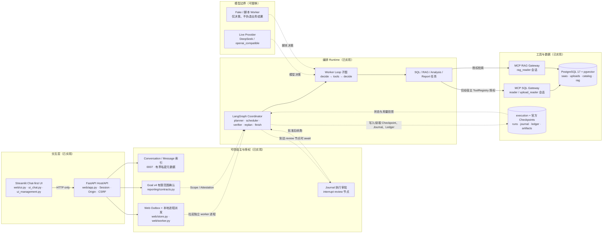
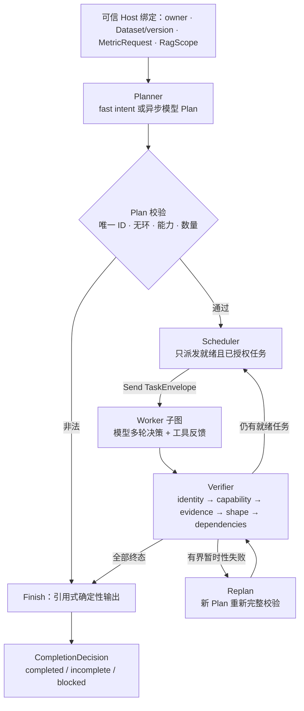
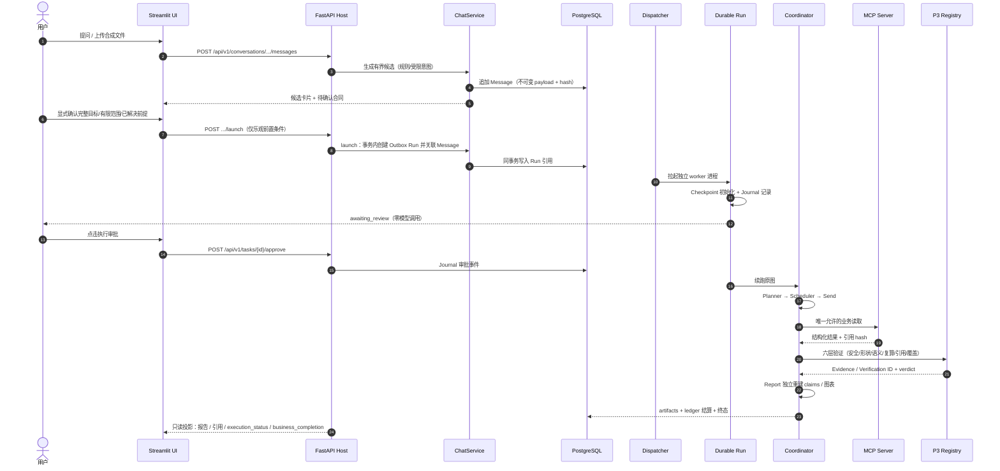
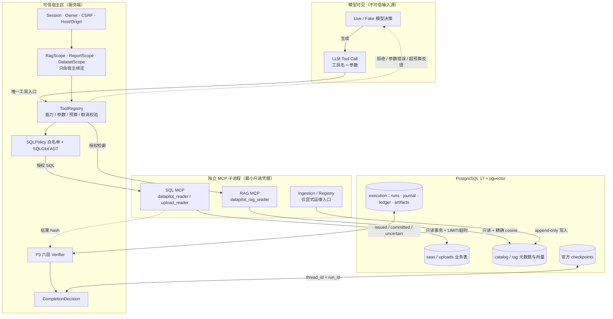

# DataPilot Pro 架构概览（可维护 Mermaid 源）

本页是面向 GitHub 读者与面试官的**当前实现**架构速览；详细设计、阶段边界与历史演进仍以 [architecture.md](architecture.md) 为准。两者冲突时，以源码、冻结验收记录和最新已验收证据为准。

阅读顺序建议：本页图 1 → 图 3 → [README 快速开始](../README.md#本地运行安全合成数据) → [一次可信证据链](showcase.md)。

> 图例：`实线` = 数据/调用流；`虚线` = 控制/审批/状态流；`子图分界` = 信任边界（身份与授权在边界处校验）。图中所有组件均在 `src/datapilot/` 中存在对应实现；未实现能力集中列在本页末节，不画进已实现链路。

## 图 1：系统总览（分层、数据流与控制流）

要点：

- 模型不直连数据库；所有业务读取经独立 MCP 子进程，凭据按用途隔离（见 [图 4](#图-4信任边界持久化与恢复)）。
- UI 只通过 `/api/v1` 调用 Host，不导入 Runtime/MCP/Repository；`session_state`、`run_id`、客户端 owner 都不是授权。
- Conversation/Message 只是有界交互索引，不是 Checkpoint、Memory 或权限来源。

## 图 2：双环执行（外层 DAG 与内层 Worker Loop）

内层 Loop 的不变量（实现见 `orchestration/tools.py`、`orchestration/loop.py`）：

- 每条 assistant `tool_call` 必须有唯一匹配反馈，包括权限拒绝、异常、预算终止与取消；JSON 解析失败不允许退化为空参数。
- 工具契约、宿主能力、已绑定 MCP 句柄、取消、超时、输出校验、完整工件与 Trace 统一由 `ToolRegistry.invoke` 收敛。
- 模型最终只返回本次实际取得的工件引用；数值由 SQL/Decimal 计算，模型不参与心算。

## 图 3：一次可信分析端到端时序

关键分离：

- **任务确认**（Goal v4 有限范围）与**执行审批**（Journal）是两个独立动作：确认不等于批准执行，批准也不扩大数据范围。
- **execution_status**（执行状态）与 **business_completion**（业务完成）分开；部分结果不能冒充完整分析。
- 报告只使用经 scoped MCP 重新读取并核对的 P3 verified 数值；文档引用另验原件/跨度/版本/hash，不把相关性写成因果。

## 图 4：信任边界、持久化与恢复

模型不持有 MCP 地址、DSN 或可直接调用的工具句柄；它只能生成 `tool call`，由宿主 `ToolRegistry` 完成能力、参数、预算与取消校验后，才转成对独立 MCP 子进程的调用。**工具 Schema 展示不等于授权**，图中不存在模型到 MCP 的直达边。

持久化与恢复的三条硬规则（详见 [recovery.md](recovery.md)）：

1. 官方 Saver 独占 `checkpoints` 及其迁移；`runtime-init` 是显式运维入口，请求内从不 setup。
2. Journal 区分 `issued` / `committed` / `uncertain`；已发出但结果未知的调用保守计账并阻断自动重发，不假定外部操作未执行。
3. 恢复由可信宿主重新提供身份与 scope，并重查 Dataset/version、Metric/Semantic、source hash 与原 P3 verdict；摘要、Memory、Checkpoint 不能自授予权限。

## 模块对照（当前源码）

| 层 | 目录/模块 | 职责 | 边界 |
|---|---|---|---|
| 交互 | `web/ui.py`、`web/ui_chat.py`、`web/ui_management.py`、`web/ui_components.py` | Chat-first 工作台与管理页；只渲染 HTTP 结果 | 不导入 Runtime/MCP/Repository |
| Host/API | `web/app.py`、`web/chat_routes.py`、`web/body_limit.py` | 版本化 `/api/v1`；Host/Origin/Session/CSRF；请求体限制 | 只回环监听；无模型工具可调用的维护端点 |
| 会话与确认 | `web/chat.py`、`web/chat_contracts.py`、`web/goal_confirmation.py`、`web/intent.py` | 有界候选、Goal v4 确认事件、追问新 Run | 消息不存业务原始行/文档正文/Prompt |
| 派发 | `web/store.py`、`web/worker.py` | PG Outbox、幂等、宿主进程槽、看门狗 | 不实现第二套 Scheduler/Checkpoint |
| 编排 | `orchestration/coordinator.py`、`orchestration/loop.py`、`orchestration/contracts.py` | StateGraph、Send、Verifier、有界 Replan | 模型只产出 Plan 数据 |
| Worker | `agents/sql.py`、`orchestration/tools.py`、`reporting/adapter.py` | SQL/RAG/Analysis/Report 任务与工具注册表 | 能力最小化，空能力即空 |
| 工具网关 | `runtime/mcp_server.py`、`runtime/mcp_client.py`、`tools/sql.py` | 真实 MCP、AST、白名单、只读事务、配额 | 模型无 DSN、无 DDL、无文件/Shell 工具 |
| 指标 | `semantics/service.py`、`semantics/recipes.py`、`semantics/recompute.py`、`harness/metric_verification.py` | 封闭配方、独立复算、六层验证 | 不训练模型；不猜 MRR 或账单口径 |
| RAG | `rag/parsing.py`、`rag/models.py`、`rag/storage.py`、`rag/mcp.py` | 授权 TXT/MD、固定 BGE ONNX、pgvector 精确检索 | 不自动下载模型；不接受任意路径/URL |
| 报告 | `reporting/service.py`、`reporting/contracts.py`、`reporting/adapter.py` | MetricBridge、claims、图表、跨来源状态 | 只投影已验证证据 |
| 持久化 | `persistence/session.py`、`persistence/journal.py`、`persistence/backend.py`、`persistence/management.py` | 官方 Checkpoint、Journal、Ledger、Artifact | 元数据通道不向模型暴露 |
| 模型 | `llm/provider.py`、`llm/client.py`、`orchestration/model.py`、`llm/fake.py` | 异步 NativeTransport、profile 工厂、Fake 决策 | Fake 不返回业务结果 |
| 数据 | `db/schema.py`、`db/catalog.py`、`db/management.py`、`ingestion/service.py` | 固定结构与受限上传入库 | 上传 DDL 只由 ingest 服务执行 |

## 明确不存在的组件

以下能力未实现，不得在文档、演示或面试中描述为已有：

- 远程 Langfuse 集成（仅有默认关闭的本地 OTel 投影，且不含 Prompt/SQL/业务行）。
- HNSW/ANN 近似检索、独立向量服务（FAISS/Qdrant）；当前是同实例 pgvector 精确 cosine。
- 生产多租户、RLS、KMS、跨主机认证或生产级 SLA。
- DeepSeek 自主完成业务质量验收；Live Business Gate 仍为 PENDING。
- 主动 Agent、通用 Scheduler 或第二套恢复引擎、P11 缓存/降级引擎。
- Qwen3 Embedding 的 CUDA/生产切换验收；默认仍是 BGE 512/ONNX。
