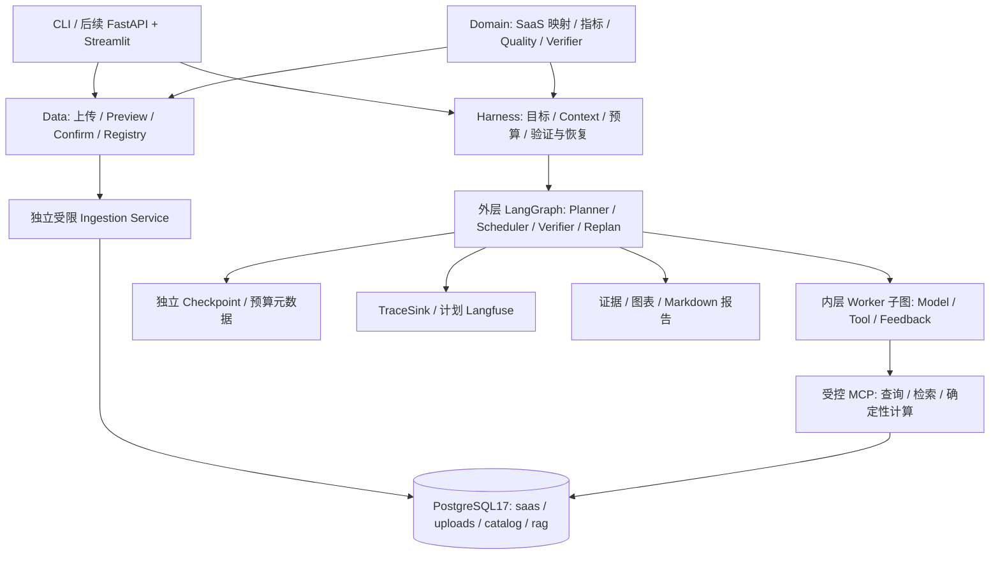

# DataPilot Pro v2 架构：Day 1 基线与目标设计

## 1. 目标、阶段边界与技术决策

面向 SaaS 企业的、证据可验证的经营分析系统。业务目标、技术方案、重大架构决策与验收标准由用户掌握。Day 1 实现 Supervisor + SQL Worker 的真实查询闭环；随后 P0 完成规划审计，当前 P1 实现本地 CSV/XLSX 解析、画像与确认配置。不宣称完成五 Agent 系统或动态数据库导入。

第 2–9 节记录当前基线；第 10 节起是 v2 目标设计。完整现状/缺口见 [代码审计](planning-audit-v2.md)，实施依赖与验收见 [v2 路线图](roadmap-v2.md)。旧七天计划已废止；工作单元不绑定日期。SaaS 是唯一首发主业务，干洗店通过后续 Domain Pack 扩展。

2026-10-20 根据用户修订：从 Day 1 使用 **PostgreSQL 17 + pgvector**，Docker Compose 部署；SQLAlchemy 2 + psycopg 3 访问；Alembic 管理 Schema；真实 MCP SDK stdio 统一运行期数据库访问；RAG 后续使用同实例 pgvector，不引入 FAISS。此前 SQLite 草稿已删除，不作为备用实现。


Supervisor 根据结构化 route=sql/unsupported 委派，Worker 通过 MCP 探索 Schema 后生成 SQL。MCP Server 执行安全校验和数据库查询，将结果契约返回。Supervisor 校验 task_id、结构与终态，再以确定性表格回答。查询数据不发回 LLM，减少无依据数字解读；Answer 并非 Report Agent。

后续：Supervisor 生成带依赖 DAG，LangGraph Send 并发就绪任务；SQL 与 RAG 可并发，Analysis 依赖 SQL 数据，Report 依赖验证过的计算/文档证据。RAG 只调用检索，Analysis 只调用受控确定性计算，Report 只读证据。不同 Worker 不共享任意工具全集。

## 2. 推荐并实际采用的目录

```text
datapilot-pro/
  AGENTS.md  README.md  pyproject.toml  uv.lock  .env.example
  compose.yaml  alembic.ini  .github/workflows/test.yml
  docs/architecture.md  docs/day1-delivery.md
  docs/roadmap-v2.md  docs/planning-audit-v2.md  docs/adr/
  migrations/env.py  migrations/versions/0001_business_and_vectors.py
  scripts/configure_local.py
  src/datapilot/
    config.py  contracts.py  state.py  graph.py  cli.py
    agents/supervisor.py  agents/sql.py
    llm/client.py  llm/fake.py
    db/schema.py  db/management.py  db/health.py
    data/generator.py
    tools/sql.py
    runtime/mcp_client.py  runtime/mcp_server.py
    harness/budget.py  harness/context.py  harness/verification.py
    ingestion/ # P1 实际模块，不包含 DDL/数据库/模型
      contracts.py  common.py  parser.py  xlsx.py  types.py
      profiling.py  confirmation.py  cli.py
  tests/ # data / policy / models / Worker+Graph / MCP / PostgreSQL / live model
```

Ingestion 当前仅解析/画像/预览/确认。受限入库、RAG、Analysis、Report、Catalog/Domain、API、UI、Langfuse/evals 为后续实现，不预建空壳。

## 3. LangGraph State Schema

GraphState 为 TypedDict，委派/结果边界由 Pydantic 严格校验。

| 字段 | 类型 | 含义 |
|---|---|---|
| run_id, question | str | 身份与用户问题 |
| status | pending/running/succeeded/failed/unsupported | 显式任务生命周期 |
| task | SQLTask / null | 当前委派 |
| result | SQLAgentResult / null | Worker 的成功证据或错误 |
| error | AgentError / null | code/message/retryable |
| steps | int | 有界图执行计数 |
| answer | str | 确定性最终 Markdown |

模型客户端、MCP 会话、预算对象、数据库连接和秘密不进入 State。每次运行独立预算，当前没有并发共享与恢复。Gate C 计划使用 LangGraph checkpointer 与持久预算，记录崩溃窗口的未知调用状态，不能承诺供应商 exactly-once 计费；当前不声称可回放/断点续跑。

## 4. Supervisor ↔ Worker 交互契约与上下文

- RouteDecision={route: sql|unsupported}。Supervisor 只看问题、可用能力与输出 Schema，不看业务行。
- SQLTask={task_id, worker: sql, question}。Worker 不接收整个 State/其他 Worker 历史/路由推理；只获取当前任务、真实表/列/FK 与指标定义。
- SQLProposal={sql}。Pydantic 禁止额外字段。生成器不接受模型传入连接信息或表权限。
- QueryResult={columns, rows, row_count, truncated, elapsed_ms}。校验列名唯一、行宽、类型、有限数值、行数；DATE 用 ISO 文本，NUMERIC 用精确十进制字符串，不用浮点表示金额。
- SQLAgentResult={task_id,status,sql?,result?,error?,attempts}。成功必须有 SQL/结果且无 error；失败必须有 error、无结果。完成时核对 task_id。
- MCP 只公开 health（协议状态）、database_schema、query_database；Client 固定工具白名单、超时和输出校验。Server 独立执行完整 SQL 策略，不能依靠 Client 校验。

上下文按字符上限拒绝，不静默裁剪安全策略/Schema。后续 TaskEnvelope 扩展 dependencies/context_refs/output_contract；Evidence 包含 source_id/locator；Report 的事实须映射证据，推测单列。

## 5. PostgreSQL 安全与权限边界

| 凭据 | 允许范围 | 加载位置 |
|---|---|---|
| admin | 创建角色、Schema、pgvector、撤销默认权限 | 显式 db-init CLI |
| datapilot_owner | saas/rag Schema 迁移与精确授权 | Alembic / migrate |
| datapilot_seed | 仅业务表和 seed_runs SELECT+INSERT | 显式 Seed CLI |
| datapilot_reader | 五张业务表 SELECT；无 rag/seed_runs 权限 | MCP 子进程 |

撤销 PUBLIC 数据库权限（特别 TEMP）与 public Schema CREATE，Reader 无角色成员关系、超级权限、继承权限、Schema CREATE 或业务写权限；Server 每次连接验证。事务显式 READ ONLY，角色默认只读，服务端 statement_timeout/lock_timeout。**只读默认值可以被用户修改，实际 SELECT-only grants 是独立防线**。

SQLGlot 使用 postgres 方言解析单 SELECT/set operation，拒绝数据修改 CTE、SELECT INTO、FOR UPDATE、COPY、SET、任意 schema、文件/大对象/副作用函数、递归、参数和未知 cast。使用 scope 解析 CTE/真实表，将允许的物理表限定为 saas 五表；固定 pg_catalog,saas search_path，函数白名单阻止 pg_sleep/pg_read_file/set_config。执行规范化后 SQL；外层 LIMIT max_rows+1 约束传输与截断标记，限制单元格和总输出体积。AST 不是完整资源沙箱，数据库管理员仍属信任边界。

MCP 子进程只注入 reader DSN 与资源配置，不加载 .env，不传递 API Key/管理员/Owner/Seed 凭据。Agent 仅能调用 MCP 接口，禁止直接调用数据库驱动。开发机器上的 stdio 子进程不等同于恶意宿主 OS 沙箱；部署隔离和远程 MCP 身份认证在后续 Gate D 验证。

## 6. Harness 模块及恢复

| 模块 | Day 1 实现 | 后续 |
|---|---|---|
| orchestration | 条件路由、委派、review、终态、步数上限 | DAG 并发、局部重规划 |
| context | 独立 DTO、最小 Schema、字符上限 | Token 感知摘要/引用 |
| tool runtime | 真 MCP SDK stdio、权限白名单、契约、超时 | 检索/计算工具与身份隔离 |
| verification | AST、数据库权限、结果形状、任务身份/状态 | 指标重算、跨证据一致性 |
| recovery | 可修复 SQL 编译错误最多一次；安全拒绝不重试 | 超时分级重试、重规划 |
| budget | 模型调用数、保守预留 Token、输出限制 | 并发/持久预算 |
| observability | 节点路径/时延/错误、模型调用数/Token | Langfuse，经 TraceSink 隔离；工具 spans、回放 |

模型 SDK 自动重试关闭。输入 UTF-8 字节数加框架余量保守估算输入 Token，并预留最大输出；有供应商 usage 时结算实际值，无 usage 保留估算并标记不完整。该预算是应用限制，不能保证不可信供应商的账单上限。SQL 修复只看到当前问题、Schema、失败 SQL 与已清理的编译器错误，不含连接信息/业务行。MODEL_ERROR 等错误只返回安全消息，不暴露原始 Provider/DB 异常。

## 7. 数据、迁移和向量存储

固定 seed=42、2025-01-01 至 2026-01-01（右开区间），默认 240 客户。五表 customers/subscriptions/invoices/usage_events/customer_feedback，FK 和日期/金额约束；订阅降级结束旧记录并新建 starter，流失 status=churned。小型零售客户下半年使用量下降并出现负面反馈；这些是合成相关现象，不证明因果。

收入口径为 invoice_date 当月、status=paid 的 CNY 整数分合计，不等同 MRR 或会计确认收入。新增订阅按 start_date（包括套餐变更），新增客户按 created_at；时间区间 start<=date<end。

纯生成器产出行集合与 SHA256 manifest；Seed 独立事务插入、advisory lock 互斥，非空库拒绝。Schema 由冻结的 0001 Alembic 迁移创建。db-init→migrate→seed→health 分步执行；Compose pg_isready 只代表进程可连接，应用 health 另验版本、扩展、只读权限和数据。

rag.document_chunks 从 Day 1 预留 source_uri/content/embedding_model/embedding_dim/embedding vector。当前向量维度不限，check 校验实际维度，SQL Reader 无权限。Gate C 选定 Embedding 模型后按模型/维度过滤，并迁移固定维度列/表达式索引；当前不建立 HNSW，不声称已经实现 RAG。集成测试只验证真实向量存储与距离运算。

## 8. 技术选型依据与锁定

- [LangGraph Graph API](https://docs.langchain.com/oss/python/langgraph/graph-api)：StateGraph/条件边承担状态执行，后续复用持久化机制。
- [LangChain ChatOpenAI](https://docs.langchain.com/oss/python/integrations/chat/openai)：单一 base_url/model 适配接口，JSON 文本+Pydantic 避免依赖各供应商原生 tool calling；Qwen/DeepSeek 仍需真实凭据验证。
- [PostgreSQL 17](https://www.postgresql.org/docs/17/runtime-config-client.html)：SQL 权限、只读事务、服务端超时是可靠执行基础。
- [SQLAlchemy psycopg](https://docs.sqlalchemy.org/en/20/dialects/postgresql.html#module-sqlalchemy.dialects.postgresql.psycopg)、[Alembic](https://alembic.sqlalchemy.org/en/latest/tutorial.html)：统一连接/事务与可审计迁移。
- [pgvector](https://github.com/pgvector/pgvector)：业务与 RAG 证据位于同一受控数据库。Compose 与 CI 使用 0.8.6-pg17，并锁定实际拉取验证过的 sha256 镜像 digest。
- [MCP Python SDK](https://github.com/modelcontextprotocol/python-sdk/tree/v1.x)：当前锁定 SDK 1.x，统一使用 FastMCP/ClientSession/stdio_client，不混用 2.x 接口。
- uv.lock 锁完整依赖图与哈希；Python 3.11–3.13，当前本机 3.11.16。CI 配置覆盖 3.11/3.13，配置存在不代表已经在 GitHub 执行。

## 9. 修订版 Day 1 验收标准

1. Docker Compose 启动真实 PostgreSQL **17** + pgvector；独立初始化角色、Alembic upgrade head、Seed、应用健康检查全部成功。
2. 同 seed 逻辑内容/摘要相同；真实表 FK、金额/日期约束与流失/降级/使用量变化存在；拒绝覆盖非空库。
3. Supervisor→SQL Worker→真实 MCP Server/Client→真实 PostgreSQL→review→Answer。
4. 客户总数、指定月收入、区间新增订阅、JOIN，均由独立 SQL 查询核对结果。
5. 危险 SQL、系统表、向量表越权、写入、超时、截断得到明确状态；role grants 独立拒绝写入。
6. 不存在字段返回明确 SQL_EXECUTION_ERROR；有限修复成功与耗尽失败均测试。
7. pytest 区分 Mock、protocol、integration、live；真实集成不能用替代数据库。无 API 时只承诺 Fake 模型+真实数据库路径，不承诺真实模型 E2E。
8. 锁定环境、pytest、ruff、CLI 示例真实运行；如环境阻塞则明确保留未验收项，不伪造通过。

## 10. v2 分层目标架构（未实现）



| 层 | 主要职责 | 实施边界 |
|---|---|---|
| Data Platform | 安全解析/画像/确认、事务导入、Dataset/版本/关系、原件保管、Evidence 存储 | 不让模型控制 DDL；不把预览当全部数据 |
| Domain | 指标/实体映射、质量与验证规则、独立业务评测 | saas 首发；drycleaning 后置，不特化 Runtime |
| Harness | 上下文、工具契约/能力、预算、业务完成判定/反馈、任务就绪策略 | 不重建通用调度/检查点引擎 |
| LangGraph Runtime | 执行/状态/channel、Send 并发、Command、Checkpoint/interrupt/resume | 先原版公开机制，不预设需要 Fork |
| Workers | SQL/RAG/Analysis/Report 独立契约和工具 | 必要时自主循环，数值经确定性计算 |

参考 [ADR-001](adr/0001-runtime-harness.md)。源码已核查官方 `1.2.16` 与 Mini 固定提交，详见 [研究](framework-research.md) 和 [源码索引](source-reference-index.md)。5 项内存探针仅证明单进程公开 API 行为，不代表业务 Runtime 或 PG 持久化已实现。

### 10.1 双层循环和目标 State

外层：用户目标→Planner→DAG 校验（唯一 ID/无环/依赖/能力/数量）→Scheduler 取就绪任务→Send 最小输入→合并/Verifier→完成、局部 Recovery 或有限 Replan。DAG 是状态数据，编译节点可复用。独立任务才能并发，简单 SQL 不强制经过四 Worker。

内层：TaskEnvelope→模型决策→契约/能力/预算检查→MCP→确定性反馈校验→有限修复或 TaskResult。SQL/RAG 可用 Worker 子图；确定性 Analysis 不必增加模型轮次。子图继承父 checkpoint，但状态适配不得传入无关父历史。采用 async 模型 adapter，修复当前同步 invoke 的并发阻塞。

目标 RunState 包括 run_id/status、任务 DAG/plan_version、按任务版本合并的结果、证据/产物引用、replan_count、错误与预算引用；WorkerState 仅 task/phase/attempt/proposal/feedback/refs。连接/会话/密钥不入 State。重复相同结果幂等接受，冲突拒绝，过期版本不能悄悄覆盖。

模型辅助 Goal Judge 仅可提供建议，最终完成需六层 Verifier 和显式无法回答状态。允许直接复用 Mini 的子 Agent/内部权限模式/局部预算实现，所有调用仍经共享预算入口与 MCP 硬权限。SDK/Loop/图各层重试指定唯一所有者；Command 不覆盖静态边，interrupt 前行为可重放。

## 11. 数据导入、版本与动态表权限设计

完整接口、安全配额、确认 hash、原件/DB 事务边界与角色矩阵见 [ADR-002](adr/0002-ingestion-permissions.md)。首发路径为 CSV/XLSX→Preview/Confirm→uploads 事务入库→Catalog ready 版本→动态 MCP；不执行公式、宏或外部内容，ID/金额/日期不得静默改写。

固定 saas/rag/catalog 结构由新 Alembic 迁移管理，历史 0001 冻结；uploads 动态表由独立受限 ingest 创建/插入/发布，不能为每个文件生成迁移或授予模型 DDL。原 datapilot_reader 继续仅有 saas profile；上传查询使用独立只读 profile 与服务端 QueryScope。版本元数据、表数据与发布授权事务一致；文件系统保管另有失败状态，不虚称跨存储原子性。

| 目标工具 | 可信服务端行为 | 返回 |
|---|---|---|
| list_datasets | 取本地主体授权范围 | 数据集摘要/版本/状态 |
| get_dataset_schema | 校验 scope、ready、固定版本 | 实际表/列/映射/关系/指标/质量限制 |
| query_dataset | 精确物理表 Policy + AST + DB grants + READ ONLY + 超时/LIMIT/体积 | 类型、行数/截断、dataset/version、SQL 与 Evidence/Artifact ID |

初版优先同 Dataset 多表 JOIN，跨源需明确绑定 scope。upload_reader 的库权限限定已发布表，选中 Dataset/version 由服务端/AST进一步约束；这不代表生产逐租户数据库隔离。健康检查/CLI 写死 0001 是新迁移的必要改造点，P0 不修改代码。

## 12. SaaS 语义、证据与业务域接口

详细契约见 [ADR-004](adr/0004-metrics-evidence-domain.md)。Semantic Catalog 管字段/实体/关系及业务确认；Metric Registry 管时间/粒度/过滤/单位/空值政策及版本；Evidence Registry 管数据版本、查询/文档定位、计算与结果 hash、产物与实际验证结果；Data Quality 标出缺值/重复/异常/映射疑点。

- TaskEnvelope：task_id/type/deps、plan_version、可信 dataset_scope、input_refs、output_schema、budget_ref。
- Evidence：evidence_id、dataset/source_version、metric/domain_version、SQL 或文档 locator、computation、result_hash、artifact_ref、完整性与 verification_refs。
- VerificationResult：passed/layer、failure_type、missing_evidence、retryable、反馈与规则版本；不接受模型自报已验证。
- TaskResult：task/plan_version、status、evidence_refs/artifacts、error、usage_refs。

验证顺序：安全→结构→指标语义→独立复算→引用→目标覆盖。缺证据定点补任务，列错误局部修复，缺数据说明不可计算，未授权不重试/绕路。账单收入非 MRR，客户流失非订阅流失；JOIN 基数、时间右开、单位/币种与历史活跃状态必须明确。报告区分事实、解释和假说，不声称已识别因果。

DomainPack 契约：domain_id/version、canonical_entities、field_aliases/entity_mappings、metric_definitions、quality_rules、verification_rules、evaluation_cases，可绑定 connector 类型；只加载服务端可信配置与确认映射，不执行上传的规则代码。

SourceConnector 契约：source_type/capabilities、extract_snapshot、schema_mapping、provenance、watermark（可空）、错误；产物带 source_system、batch/hash、external_record_id（若有）、提取/映射/数据版本。首发只落文件快照，不凭空实现 API。

SaaS 首发。后续 drycleaning 只增加领域映射/指标/验证/评测，不复制引擎；POS 品牌/API/字段仍未知。订单实收、退款、会员充值/消费不双计；成本/交付记录缺失时不能给准确利润/超期率。

## 13. 部署、Checkpoint 与观测边界

首版本地单用户/可信 Demo，dataset_id 不是租户授权；生产认证、可信 tenant 传播、RLS/隔离、审计/限流另行设计，见 [ADR-003](adr/0003-local-single-user.md)。真实经营数据授权/脱敏后才使用，原件与原始个人资料不进 Git，模型/Trace 默认最小化。

Checkpoint/预算是独立元数据角色与非模型通道，业务查询仍走 MCP。共享预算先预留再结算，未知 usage/请求结果记录不确定性；取消不保证外部请求未执行，Saver 与预算也非天然同一事务。

官方 PG Saver 尚未安装/验证，setup 自带迁移与 Alembic 的所有权在 Gate C 前单独决策；本轮不自动建表。Trace 计划 Langfuse，经 TraceSink 隔离，记录 run/task/attempt/tool/usage/latency/verdict，默认不发完整含敏感值 SQL/Prompt 或原始行。

## 14. 验收路线与当前状态

Gate A 动态数据闭环→Gate B 语义/证据→Gate C 多 Agent/跨来源/持久恢复→Gate D 产品/独立评测。可选 Gate E 为 Fork 对照，Gate F 为干洗店。未来五个工作包、每阶段风险/验收、P1 停止点见 [路线图](roadmap-v2.md)，不依赖日期承诺。

SaaS 核心评测至少 50 个独立 E2E 任务；与已有 60 个 pytest 用例严格区分。消融固定模型/数据/预算，Claude Code 产品比较披露工具/模型/人工差异，Fork 比较同 Harness；没有真实结果不宣称领先。Fork 先遵循 [研究门槛](langgraph-fork-research-plan.md)，复用保留 [许可证与归属](third-party-references.md)。

P0 当时原测试分类合计 59 passed、1 live skipped，真实 PG 健康且为 240 客户；详细命令/结果见 [审计记录](planning-audit-v2.md)。P1 新增解析/画像/确认与回归结果见 [交付记录](p1-delivery.md)，其他目标能力尚未实现。

## 15. P1 已实现的文件边界

真实 CLI/API：parse_file/parse_bytes→ParsedDataset→propose_schema→SchemaProposal→confirm_file→SchemaConfirmation。六项核心 DTO 在独立 ingestion/contracts.py；本地读取命令不需要 Settings、DB 或模型凭据，未注册为模型工具。

openpyxl 3.1.5 + defusedxml 0.7.1 锁定使用；读取前验证 ZIP/XML 全包资源、外部关系/活动内容、坐标与格式，read_only 且不计算公式。CSV 支持 BOM、显式旧编码、分隔符/表头策略；原始标量保留，XLSX 数值从 XML 保留精度。建议采样后全量检查，歧义类型留 TEXT，日期格式/主键/关系的用户覆盖重新全列验证。

预览/确认绑定文件、解析内容、选表/表头/限额和解析版本 hash；确认从原件重算，不信任预览样本或模型自报。字段类型/ID/金额不静默截断，预览裁剪明确标志；原始大结果不写进 State。当前 Confirmation 是配置，不是授权或数据库迁移。

配额、错误码、原始行号、画像/候选键/关系、合成 fixture 与完整使用见 [文件解析说明](data-ingestion.md)。期限是协作式检查，不宣称 OS 沙箱或完整 Excel 兼容。P2 的受限 DDL、Dataset Registry 和动态 Query MCP 尚未实现，Gate A 尚未完成。
