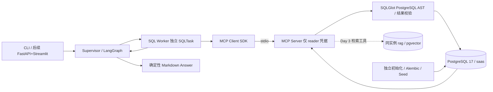

# DataPilot Pro 架构（PostgreSQL 修订版）

## 1. 目标、阶段边界与技术决策

面向 SaaS 企业的、证据可验证的经营分析系统。业务目标、技术方案、重大架构决策与验收标准由用户掌握。当前 Day 1 实现 Supervisor + SQL Worker 的真实查询闭环；不宣称完成五 Agent 系统。

2026-10-20 根据用户修订：从 Day 1 使用 **PostgreSQL 17 + pgvector**，Docker Compose 部署；SQLAlchemy 2 + psycopg 3 访问；Alembic 管理 Schema；真实 MCP SDK stdio 统一运行期数据库访问；RAG 后续使用同实例 pgvector，不引入 FAISS。此前 SQLite 草稿已删除，不作为备用实现。



Supervisor 根据结构化 route=sql/unsupported 委派，Worker 通过 MCP 探索 Schema 后生成 SQL。MCP Server 执行安全校验和数据库查询，将结果契约返回。Supervisor 校验 task_id、结构与终态，再以确定性表格回答。查询数据不发回 LLM，减少无依据数字解读；Answer 并非 Report Agent。

后续：Supervisor 生成带依赖 DAG，LangGraph Send 并发就绪任务；SQL 与 RAG 可并发，Analysis 依赖 SQL 数据，Report 依赖验证过的计算/文档证据。RAG 只调用检索，Analysis 只调用受控确定性计算，Report 只读证据。不会让五个 Worker 共享一个任意工具全集。

## 2. 推荐并实际采用的目录

```text
datapilot-pro/
  AGENTS.md  README.md  pyproject.toml  uv.lock  .env.example
  compose.yaml  alembic.ini  .github/workflows/test.yml
  docs/architecture.md  docs/day1-delivery.md
  migrations/env.py  migrations/versions/0001_business_and_vectors.py
  scripts/configure_local.py
  src/datapilot/
    config.py  contracts.py  state.py  graph.py  cli.py
    agents/supervisor.py  agents/sql.py
    llm/client.py  llm/fake.py
    db/schema.py  db/management.py  db/health.py
    data/generator.py
    tools/sql.py
    runtime/mcp_client.py  runtime/mcp_server.py
    harness/budget.py  harness/context.py  harness/verification.py
  tests/ # data / policy / models / Worker+Graph / MCP / PostgreSQL / live model
```

RAG、Analysis、Report、API、UI、OTel/evals 为后续实现，不预建空壳。

## 3. LangGraph State Schema

GraphState 为 TypedDict，委派/结果边界由 Pydantic 严格校验。

| 字段 | 类型 | 含义 |
|---|---|---|
| run_id, question | str | 身份与用户问题 |
| status | pending/running/succeeded/failed/unsupported | 显式任务生命周期 |
| task | SQLTask / null | 当前委派 |
| result | SQLAgentResult / null | Worker 的成功证据或错误 |
| error | AgentError / null | code/message/retryable |
| steps | int | 有界图执行计数 |
| answer | str | 确定性最终 Markdown |

模型客户端、MCP 会话、预算对象、数据库连接和秘密不进入 State。每次运行独立预算，当前没有并发共享与恢复。Day 4 将使用 LangGraph checkpointer，恢复需持久预算和防止重复收费；当前不声称可回放/断点续跑。

## 4. Supervisor ↔ Worker 交互契约与上下文

- RouteDecision={route: sql|unsupported}。Supervisor 只看问题、可用能力与输出 Schema，不看业务行。
- SQLTask={task_id, worker: sql, question}。Worker 不接收整个 State/其他 Worker 历史/路由推理；只获取当前任务、真实表/列/FK 与指标定义。
- SQLProposal={sql}。Pydantic 禁止额外字段。生成器不接受模型传入连接信息或表权限。
- QueryResult={columns, rows, row_count, truncated, elapsed_ms}。校验列名唯一、行宽、类型、有限数值、行数；DATE 用 ISO 文本，NUMERIC 用精确十进制字符串，不用浮点表示金额。
- SQLAgentResult={task_id,status,sql?,result?,error?,attempts}。成功必须有 SQL/结果且无 error；失败必须有 error、无结果。完成时核对 task_id。
- MCP 只公开 health（协议状态）、database_schema、query_database；Client 固定工具白名单、超时和输出校验。Server 独立执行完整 SQL 策略，不能依靠 Client 校验。

上下文按字符上限拒绝，不静默裁剪安全策略/Schema。后续 TaskEnvelope 扩展 dependencies/context_refs/output_contract；Evidence 包含 source_id/locator；Report 的事实须映射证据，推测单列。

## 5. PostgreSQL 安全与权限边界

| 凭据 | 允许范围 | 加载位置 |
|---|---|---|
| admin | 创建角色、Schema、pgvector、撤销默认权限 | 显式 db-init CLI |
| datapilot_owner | saas/rag Schema 迁移与精确授权 | Alembic / migrate |
| datapilot_seed | 仅业务表和 seed_runs SELECT+INSERT | 显式 Seed CLI |
| datapilot_reader | 五张业务表 SELECT；无 rag/seed_runs 权限 | MCP 子进程 |

撤销 PUBLIC 数据库权限（特别 TEMP）与 public Schema CREATE，Reader 无角色成员关系、超级权限、继承权限、Schema CREATE 或业务写权限；Server 每次连接验证。事务显式 READ ONLY，角色默认只读，服务端 statement_timeout/lock_timeout。**只读默认值可以被用户修改，实际 SELECT-only grants 是独立防线**。

SQLGlot 使用 postgres 方言解析单 SELECT/set operation，拒绝数据修改 CTE、SELECT INTO、FOR UPDATE、COPY、SET、任意 schema、文件/大对象/副作用函数、递归、参数和未知 cast。使用 scope 解析 CTE/真实表，将允许的物理表限定为 saas 五表；固定 pg_catalog,saas search_path，函数白名单阻止 pg_sleep/pg_read_file/set_config。执行规范化后 SQL；外层 LIMIT max_rows+1 约束传输与截断标记，限制单元格和总输出体积。AST 不是完整资源沙箱，数据库管理员仍属信任边界。

MCP 子进程只注入 reader DSN 与资源配置，不加载 .env，不传递 API Key/管理员/Owner/Seed 凭据。Agent 仅能调用 MCP 接口，禁止直接调用数据库驱动。开发机器上的 stdio 子进程不等同于恶意宿主 OS 沙箱；部署隔离和远程 MCP 身份认证留待 Day 5。

## 6. Harness 模块及恢复

| 模块 | Day 1 实现 | 后续 |
|---|---|---|
| orchestration | 条件路由、委派、review、终态、步数上限 | DAG 并发、局部重规划 |
| context | 独立 DTO、最小 Schema、字符上限 | Token 感知摘要/引用 |
| tool runtime | 真 MCP SDK stdio、权限白名单、契约、超时 | 检索/计算工具与身份隔离 |
| verification | AST、数据库权限、结果形状、任务身份/状态 | 指标重算、跨证据一致性 |
| recovery | 可修复 SQL 编译错误最多一次；安全拒绝不重试 | 超时分级重试、重规划 |
| budget | 模型调用数、保守预留 Token、输出限制 | 并发/持久预算 |
| observability | 节点路径/时延/错误、模型调用数/Token | OTel 或 LangSmith、工具 spans、回放 |

模型 SDK 自动重试关闭。输入 UTF-8 字节数加框架余量保守估算输入 Token，并预留最大输出；有供应商 usage 时结算实际值，无 usage 保留估算并标记不完整。该预算是应用限制，不能保证不可信供应商的账单上限。SQL 修复只看到当前问题、Schema、失败 SQL 与已清理的编译器错误，不含连接信息/业务行。MODEL_ERROR 等错误只返回安全消息，不暴露原始 Provider/DB 异常。

## 7. 数据、迁移和向量存储

固定 seed=42、2025-01-01 至 2026-01-01（右开区间），默认 240 客户。五表 customers/subscriptions/invoices/usage_events/customer_feedback，FK 和日期/金额约束；订阅降级结束旧记录并新建 starter，流失 status=churned。小型零售客户下半年使用量下降并出现负面反馈；这些是合成相关现象，不证明因果。

收入口径为 invoice_date 当月、status=paid 的 CNY 整数分合计，不等同 MRR 或会计确认收入。新增订阅按 start_date（包括套餐变更），新增客户按 created_at；时间区间 start<=date<end。

纯生成器产出行集合与 SHA256 manifest；Seed 独立事务插入、advisory lock 互斥，非空库拒绝。Schema 由冻结的 0001 Alembic 迁移创建。db-init→migrate→seed→health 分步执行；Compose pg_isready 只代表进程可连接，应用 health 另验版本、扩展、只读权限和数据。

rag.document_chunks 从 Day 1 预留 source_uri/content/embedding_model/embedding_dim/embedding vector。当前向量维度不限，check 校验实际维度，SQL Reader 无权限。Day 3 选定 Embedding 模型后按模型/维度过滤，并迁移固定维度列/表达式索引；当前不建立 HNSW，不声称已经实现 RAG。集成测试只验证真实向量存储与距离运算。

## 8. 技术选型依据与锁定

- [LangGraph Graph API](https://docs.langchain.com/oss/python/langgraph/graph-api)：StateGraph/条件边承担状态执行，后续复用持久化机制。
- [LangChain ChatOpenAI](https://docs.langchain.com/oss/python/integrations/chat/openai)：单一 base_url/model 适配接口，JSON 文本+Pydantic 避免依赖各供应商原生 tool calling；Qwen/DeepSeek 仍需真实凭据验证。
- [PostgreSQL 17](https://www.postgresql.org/docs/17/runtime-config-client.html)：SQL 权限、只读事务、服务端超时是可靠执行基础。
- [SQLAlchemy psycopg](https://docs.sqlalchemy.org/en/20/dialects/postgresql.html#module-sqlalchemy.dialects.postgresql.psycopg)、[Alembic](https://alembic.sqlalchemy.org/en/latest/tutorial.html)：统一连接/事务与可审计迁移。
- [pgvector](https://github.com/pgvector/pgvector)：业务与 RAG 证据位于同一受控数据库。Compose 与 CI 使用 0.8.6-pg17，并锁定实际拉取验证过的 sha256 镜像 digest。
- [MCP Python SDK](https://github.com/modelcontextprotocol/python-sdk/tree/v1.x)：当前锁定 SDK 1.x，统一使用 FastMCP/ClientSession/stdio_client，不混用 2.x 接口。
- uv.lock 锁完整依赖图与哈希；Python 3.11–3.13，当前本机 3.11.16。CI 配置覆盖 3.11/3.13，配置存在不代表已经在 GitHub 执行。

## 9. 修订版 Day 1 验收标准

1. Docker Compose 启动真实 PostgreSQL **17** + pgvector；独立初始化角色、Alembic upgrade head、Seed、应用健康检查全部成功。
2. 同 seed 逻辑内容/摘要相同；真实表 FK、金额/日期约束与流失/降级/使用量变化存在；拒绝覆盖非空库。
3. Supervisor→SQL Worker→真实 MCP Server/Client→真实 PostgreSQL→review→Answer。
4. 客户总数、指定月收入、区间新增订阅、JOIN，均由独立 SQL 查询核对结果。
5. 危险 SQL、系统表、向量表越权、写入、超时、截断得到明确状态；role grants 独立拒绝写入。
6. 不存在字段返回明确 SQL_EXECUTION_ERROR；有限修复成功与耗尽失败均测试。
7. pytest 区分 Mock、protocol、integration、live；真实集成不能用替代数据库。无 API 时只承诺 Fake 模型+真实数据库路径，不承诺真实模型 E2E。
8. 锁定环境、pytest、ruff、CLI 示例真实运行；如环境阻塞则明确保留未验收项，不伪造通过。

## 10. 修订版七天计划

| 天 | 交付与验收 |
|---|---|
| Day 1 | 基础工程、PG17/pgvector Compose、权限初始化、Alembic、Seed/health、真实 MCP、LLM API、Supervisor+SQL、真实 PG 集成 |
| Day 2 | 四 Worker 的职责/契约与动态任务 DAG、依赖、LangGraph 并发；不能只增加四个 Prompt |
| Day 3 | PostgreSQL+pgvector 文档摄取/Embedding/检索 MCP、来源引用；按模型/维度索引；跨结构化/非结构化查询 |
| Day 4 | Harness 上下文隔离、确定性指标/证据校验、局部修复/重规划、LangGraph Checkpoint 与恢复预算 |
| Day 5 | FastAPI/Streamlit、应用容器 Compose、部署权限/秘密隔离、OTel 或 LangSmith |
| Day 6 | 30–50 独立任务评测，任务正确性/证据/恢复/成本，Trace 与失败分析 |
| Day 7 | 联调、Bug 修复、README/架构图、Demo、开源交付与安全审查 |

日期是目标安排，必要测试不因日期跳过；当前只执行 Day 1。
