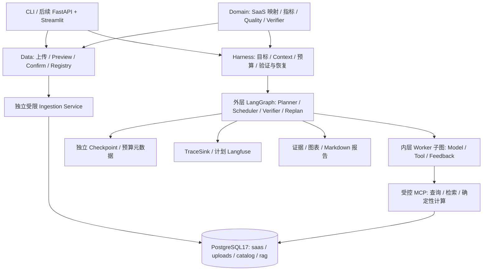
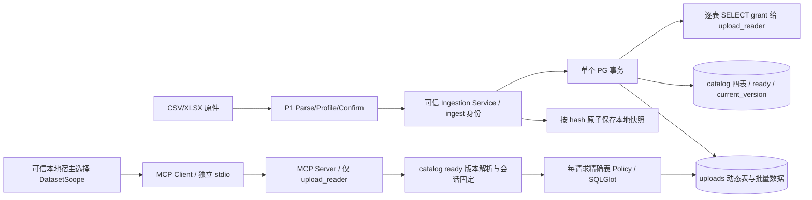
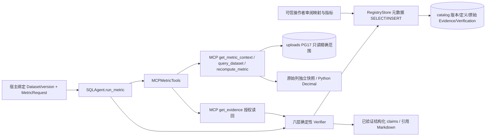
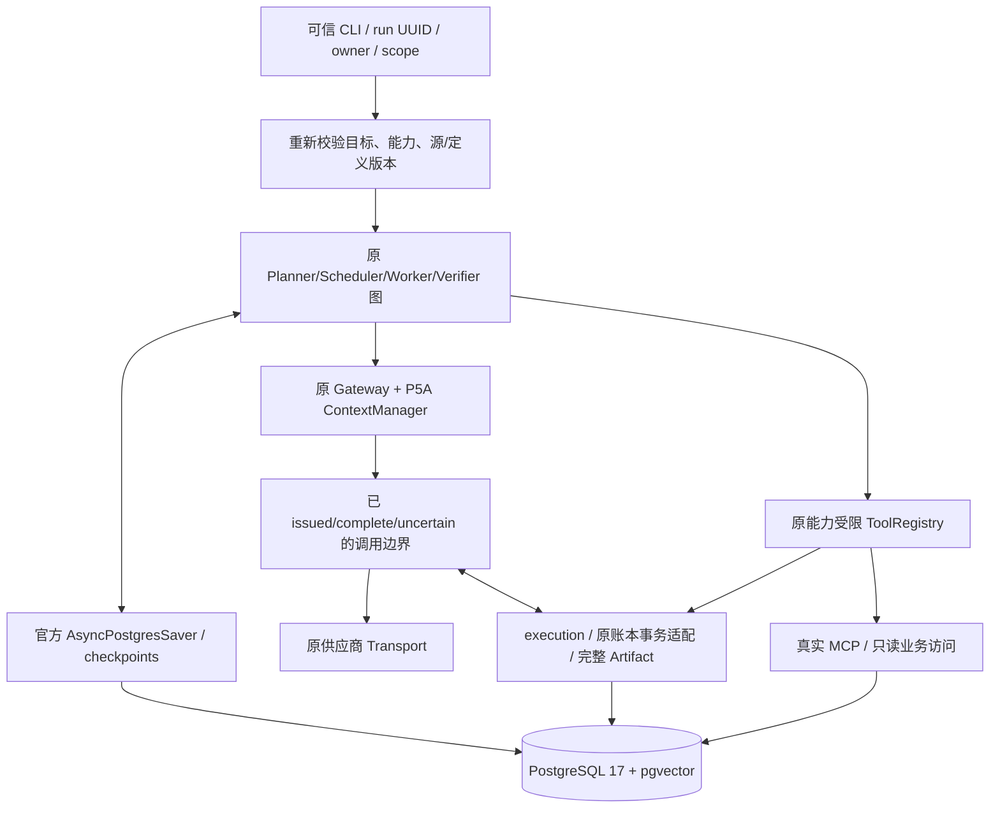

# DataPilot Pro v2 架构：Day 1 基线与目标设计

## 1. 目标、阶段边界与技术决策

面向 SaaS 企业的、证据可验证的经营分析系统。业务目标、技术方案、重大架构决策与验收标准由用户掌握。当前 P0–P6A 与 P6B 可信报告桥接已实现；各节保留历史阶段边界，最新实现见文末 P6B 节。不宣称生产多租户、因果验证或真实模型完整业务基准已完成。

第 2–9 节记录 Day 1 历史基线；第 10 节起是 v2 目标设计，第 15–18 节更新各阶段实现。完整现状/缺口见 [代码审计](planning-audit-v2.md)，实施依赖与验收见 [v2 路线图](roadmap-v2.md)。旧七天计划已废止；工作单元不绑定日期。SaaS 是唯一首发主业务，干洗店通过后续 Domain Pack 扩展。

2026-10-20 根据用户修订：从 Day 1 使用 **PostgreSQL 17 + pgvector**，Docker Compose 部署；SQLAlchemy 2 + psycopg 3 访问；Alembic 管理 Schema；真实 MCP SDK stdio 统一运行期数据库访问；RAG 后续使用同实例 pgvector，不引入 FAISS。此前 SQLite 草稿已删除，不作为备用实现。


Supervisor 根据结构化 route=sql/unsupported 委派，Worker 通过 MCP 探索 Schema 后生成 SQL。MCP Server 执行安全校验和数据库查询，将结果契约返回。Supervisor 校验 task_id、结构与终态，再以确定性表格回答。查询数据不发回 LLM，减少无依据数字解读；Answer 并非 Report Agent。

后续：Supervisor 生成带依赖 DAG，LangGraph Send 并发就绪任务；SQL 与 RAG 可并发，Analysis 依赖 SQL 数据，Report 依赖验证过的计算/文档证据。RAG 只调用检索，Analysis 只调用受控确定性计算，Report 只读证据。不同 Worker 不共享任意工具全集。

## 2. 推荐并实际采用的目录

```text
datapilot-pro/
  AGENTS.md  README.md  pyproject.toml  uv.lock  .env.example
  compose.yaml  alembic.ini  .github/workflows/test.yml
  docs/architecture.md  docs/day1-delivery.md
  docs/roadmap-v2.md  docs/planning-audit-v2.md  docs/adr/
  migrations/env.py  migrations/versions/0001_business_and_vectors.py
  scripts/configure_local.py
  src/datapilot/
    config.py  contracts.py  state.py  graph.py  cli.py
    agents/supervisor.py  agents/sql.py
    llm/client.py  llm/fake.py
    db/schema.py  db/management.py  db/health.py
    data/generator.py
    tools/sql.py
    runtime/mcp_client.py  runtime/mcp_server.py
    harness/budget.py  harness/context.py  harness/verification.py
    ingestion/ # P1 实际模块，不包含 DDL/数据库/模型
      contracts.py  common.py  parser.py  xlsx.py  types.py
      profiling.py  confirmation.py  cli.py
  tests/ # data / policy / models / Worker+Graph / MCP / PostgreSQL / live model
```

上面目录为 Day 1/P1 基线；P2 新增 datasets/、db/catalog.py 与 ingestion/service.py；P3 新增 semantics/、db/semantic_schema.py、harness/metric_verification.py，固定迁移到 0003。受限入库与封闭 SaaS 指标已实现；RAG、Analysis/Report Agent、API/UI、Langfuse/evals 为后续实现，不预建空壳。

## 3. LangGraph State Schema

GraphState 为 TypedDict，委派/结果边界由 Pydantic 严格校验。

| 字段 | 类型 | 含义 |
|---|---|---|
| run_id, question | str | 身份与用户问题 |
| status | pending/running/succeeded/failed/unsupported | 显式任务生命周期 |
| task | SQLTask / null | 当前委派 |
| result | SQLAgentResult / null | Worker 的成功证据或错误 |
| error | AgentError / null | code/message/retryable |
| steps | int | 有界图执行计数 |
| answer | str | 确定性最终 Markdown |

模型客户端、MCP 会话、预算对象、数据库连接和秘密不进入 State。每次运行独立预算，当前没有并发共享与恢复。Gate C 计划使用 LangGraph checkpointer 与持久预算，记录崩溃窗口的未知调用状态，不能承诺供应商 exactly-once 计费；当前不声称可回放/断点续跑。

## 4. Supervisor ↔ Worker 交互契约与上下文

- RouteDecision={route: sql|unsupported}。Supervisor 只看问题、可用能力与输出 Schema，不看业务行。
- SQLTask={task_id, worker: sql, question}。Worker 不接收整个 State/其他 Worker 历史/路由推理；只获取当前任务、真实表/列/FK 与指标定义。
- SQLProposal={sql}。Pydantic 禁止额外字段。生成器不接受模型传入连接信息或表权限。
- QueryResult={columns, rows, row_count, truncated, elapsed_ms}。校验列名唯一、行宽、类型、有限数值、行数；DATE 用 ISO 文本，NUMERIC 用精确十进制字符串，不用浮点表示金额。
- SQLAgentResult={task_id,status,sql?,result?,error?,attempts}。成功必须有 SQL/结果且无 error；失败必须有 error、无结果。完成时核对 task_id。
- MCP 只公开 health（协议状态）、database_schema、query_database；Client 固定工具白名单、超时和输出校验。Server 独立执行完整 SQL 策略，不能依靠 Client 校验。

上下文按字符上限拒绝，不静默裁剪安全策略/Schema。后续 TaskEnvelope 扩展 dependencies/context_refs/output_contract；Evidence 包含 source_id/locator；Report 的事实须映射证据，推测单列。

## 5. PostgreSQL 安全与权限边界

| 凭据 | 允许范围 | 加载位置 |
|---|---|---|
| admin | 创建角色、Schema、pgvector、撤销默认权限 | 显式 db-init CLI |
| datapilot_owner | saas/rag Schema 迁移与精确授权 | Alembic / migrate |
| datapilot_seed | 仅业务表和 seed_runs SELECT+INSERT | 显式 Seed CLI |
| datapilot_reader | 五张业务表 SELECT；无 rag/seed_runs 权限 | MCP 子进程 |

撤销 PUBLIC 数据库权限（特别 TEMP）与 public Schema CREATE，Reader 无角色成员关系、超级权限、继承权限、Schema CREATE 或业务写权限；Server 每次连接验证。事务显式 READ ONLY，角色默认只读，服务端 statement_timeout/lock_timeout。**只读默认值可以被用户修改，实际 SELECT-only grants 是独立防线**。

SQLGlot 使用 postgres 方言解析单 SELECT/set operation，拒绝数据修改 CTE、SELECT INTO、FOR UPDATE、COPY、SET、任意 schema、文件/大对象/副作用函数、递归、参数和未知 cast。使用 scope 解析 CTE/真实表，将允许的物理表限定为 saas 五表；固定 pg_catalog,saas search_path，函数白名单阻止 pg_sleep/pg_read_file/set_config。执行规范化后 SQL；外层 LIMIT max_rows+1 约束传输与截断标记，限制单元格和总输出体积。AST 不是完整资源沙箱，数据库管理员仍属信任边界。

MCP 子进程只注入 reader DSN 与资源配置，不加载 .env，不传递 API Key/管理员/Owner/Seed 凭据。Agent 仅能调用 MCP 接口，禁止直接调用数据库驱动。开发机器上的 stdio 子进程不等同于恶意宿主 OS 沙箱；部署隔离和远程 MCP 身份认证在后续 Gate D 验证。

## 6. Harness 模块及恢复

| 模块 | Day 1 实现 | 后续 |
|---|---|---|
| orchestration | 条件路由、委派、review、终态、步数上限 | DAG 并发、局部重规划 |
| context | 独立 DTO、最小 Schema、字符上限 | Token 感知摘要/引用 |
| tool runtime | 真 MCP SDK stdio、权限白名单、契约、超时 | 检索/计算工具与身份隔离 |
| verification | AST、数据库权限、结果形状、任务身份/状态 | 指标重算、跨证据一致性 |
| recovery | 可修复 SQL 编译错误最多一次；安全拒绝不重试 | 超时分级重试、重规划 |
| budget | 模型调用数、保守预留 Token、输出限制 | 并发/持久预算 |
| observability | 节点路径/时延/错误、模型调用数/Token | Langfuse，经 TraceSink 隔离；工具 spans、回放 |

模型 SDK 自动重试关闭。输入 UTF-8 字节数加框架余量保守估算输入 Token，并预留最大输出；有供应商 usage 时结算实际值，无 usage 保留估算并标记不完整。该预算是应用限制，不能保证不可信供应商的账单上限。SQL 修复只看到当前问题、Schema、失败 SQL 与已清理的编译器错误，不含连接信息/业务行。MODEL_ERROR 等错误只返回安全消息，不暴露原始 Provider/DB 异常。

## 7. 数据、迁移和向量存储

固定 seed=42、2025-01-01 至 2026-01-01（右开区间），默认 240 客户。五表 customers/subscriptions/invoices/usage_events/customer_feedback，FK 和日期/金额约束；订阅降级结束旧记录并新建 starter，流失 status=churned。小型零售客户下半年使用量下降并出现负面反馈；这些是合成相关现象，不证明因果。

收入口径为 invoice_date 当月、status=paid 的 CNY 整数分合计，不等同 MRR 或会计确认收入。新增订阅按 start_date（包括套餐变更），新增客户按 created_at；时间区间 start<=date<end。

纯生成器产出行集合与 SHA256 manifest；Seed 独立事务插入、advisory lock 互斥，非空库拒绝。Schema 由冻结的 0001 Alembic 迁移创建。db-init→migrate→seed→health 分步执行；Compose pg_isready 只代表进程可连接，应用 health 另验版本、扩展、只读权限和数据。

rag.document_chunks 从 Day 1 预留 source_uri/content/embedding_model/embedding_dim/embedding vector。当前向量维度不限，check 校验实际维度，SQL Reader 无权限。Gate C 选定 Embedding 模型后按模型/维度过滤，并迁移固定维度列/表达式索引；当前不建立 HNSW，不声称已经实现 RAG。集成测试只验证真实向量存储与距离运算。

## 8. 技术选型依据与锁定

- [LangGraph Graph API](https://docs.langchain.com/oss/python/langgraph/graph-api)：StateGraph/条件边承担状态执行，后续复用持久化机制。
- [LangChain ChatOpenAI](https://docs.langchain.com/oss/python/integrations/chat/openai)：单一 base_url/model 适配接口，JSON 文本+Pydantic 避免依赖各供应商原生 tool calling；Qwen/DeepSeek 仍需真实凭据验证。
- [PostgreSQL 17](https://www.postgresql.org/docs/17/runtime-config-client.html)：SQL 权限、只读事务、服务端超时是可靠执行基础。
- [SQLAlchemy psycopg](https://docs.sqlalchemy.org/en/20/dialects/postgresql.html#module-sqlalchemy.dialects.postgresql.psycopg)、[Alembic](https://alembic.sqlalchemy.org/en/latest/tutorial.html)：统一连接/事务与可审计迁移。
- [pgvector](https://github.com/pgvector/pgvector)：业务与 RAG 证据位于同一受控数据库。Compose 与 CI 使用 0.8.6-pg17，并锁定实际拉取验证过的 sha256 镜像 digest。
- [MCP Python SDK](https://github.com/modelcontextprotocol/python-sdk/tree/v1.x)：当前锁定 SDK 1.x，统一使用 FastMCP/ClientSession/stdio_client，不混用 2.x 接口。
- uv.lock 锁完整依赖图与哈希；Python 3.11–3.13，当前本机 3.11.16。CI 配置覆盖 3.11/3.13，配置存在不代表已经在 GitHub 执行。

## 9. 修订版 Day 1 验收标准

1. Docker Compose 启动真实 PostgreSQL **17** + pgvector；独立初始化角色、Alembic upgrade head、Seed、应用健康检查全部成功。
2. 同 seed 逻辑内容/摘要相同；真实表 FK、金额/日期约束与流失/降级/使用量变化存在；拒绝覆盖非空库。
3. Supervisor→SQL Worker→真实 MCP Server/Client→真实 PostgreSQL→review→Answer。
4. 客户总数、指定月收入、区间新增订阅、JOIN，均由独立 SQL 查询核对结果。
5. 危险 SQL、系统表、向量表越权、写入、超时、截断得到明确状态；role grants 独立拒绝写入。
6. 不存在字段返回明确 SQL_EXECUTION_ERROR；有限修复成功与耗尽失败均测试。
7. pytest 区分 Mock、protocol、integration、live；真实集成不能用替代数据库。无 API 时只承诺 Fake 模型+真实数据库路径，不承诺真实模型 E2E。
8. 锁定环境、pytest、ruff、CLI 示例真实运行；如环境阻塞则明确保留未验收项，不伪造通过。

## 10. v2 分层目标架构（部分实现；持久恢复尚未实现）



| 层 | 主要职责 | 实施边界 |
|---|---|---|
| Data Platform | 安全解析/画像/确认、事务导入、Dataset/版本/关系、原件保管、Evidence 存储 | 不让模型控制 DDL；不把预览当全部数据 |
| Domain | 指标/实体映射、质量与验证规则、独立业务评测 | saas 首发；drycleaning 后置，不特化 Runtime |
| Harness | 上下文、工具契约/能力、预算、业务完成判定/反馈、任务就绪策略 | 不重建通用调度/检查点引擎 |
| LangGraph Runtime | 执行/状态/channel、Send 并发、Command、Checkpoint/interrupt/resume | 先原版公开机制，不预设需要 Fork |
| Workers | SQL/RAG/Analysis/Report 独立契约和工具 | 必要时自主循环，数值经确定性计算 |

参考 [ADR-001](adr/0001-runtime-harness.md)。源码已核查官方 `1.2.16` 与 Mini 固定提交，详见 [研究](framework-research.md) 和 [源码索引](source-reference-index.md)。5 项内存探针仅证明单进程公开 API 行为，不代表业务 Runtime 或 PG 持久化已实现。

### 10.1 双层循环和目标 State

外层：用户目标→Planner→DAG 校验（唯一 ID/无环/依赖/能力/数量）→Scheduler 取就绪任务→Send 最小输入→合并/Verifier→完成、局部 Recovery 或有限 Replan。DAG 是状态数据，编译节点可复用。独立任务才能并发，简单 SQL 不强制经过四 Worker。

内层：TaskEnvelope→模型决策→契约/能力/预算检查→MCP→确定性反馈校验→有限修复或 TaskResult。SQL/RAG 可用 Worker 子图；确定性 Analysis 不必增加模型轮次。子图继承父 checkpoint，但状态适配不得传入无关父历史。采用 async 模型 adapter，修复当前同步 invoke 的并发阻塞。

目标 RunState 包括 run_id/status、任务 DAG/plan_version、按任务版本合并的结果、证据/产物引用、replan_count、错误与预算引用；WorkerState 仅 task/phase/attempt/proposal/feedback/refs。连接/会话/密钥不入 State。重复相同结果幂等接受，冲突拒绝，过期版本不能悄悄覆盖。

模型辅助 Goal Judge 仅可提供建议，最终完成需六层 Verifier 和显式无法回答状态。允许直接复用 Mini 的子 Agent/内部权限模式/局部预算实现，所有调用仍经共享预算入口与 MCP 硬权限。SDK/Loop/图各层重试指定唯一所有者；Command 不覆盖静态边，interrupt 前行为可重放。

## 11. 数据导入、版本与动态表权限设计

完整接口、安全配额、确认 hash、原件/DB 事务边界与角色矩阵见 [ADR-002](adr/0002-ingestion-permissions.md)。首发路径为 CSV/XLSX→Preview/Confirm→uploads 事务入库→Catalog ready 版本→动态 MCP；不执行公式、宏或外部内容，ID/金额/日期不得静默改写。

固定 saas/rag/catalog 结构由新 Alembic 迁移管理，历史 0001 冻结；uploads 动态表由独立受限 ingest 创建/插入/发布，不能为每个文件生成迁移或授予模型 DDL。原 datapilot_reader 继续仅有 saas profile；上传查询使用独立只读 profile 与服务端 QueryScope。版本元数据、表数据与发布授权事务一致；文件系统保管另有失败状态，不虚称跨存储原子性。

| 目标工具 | 可信服务端行为 | 返回 |
|---|---|---|
| list_datasets | 取本地主体授权范围 | 数据集摘要/版本/状态 |
| get_dataset_schema | 校验 scope、ready、固定版本 | 实际表/列/映射/关系/指标/质量限制 |
| query_dataset | 精确物理表 Policy + AST + DB grants + READ ONLY + 超时/LIMIT/体积 | 类型、行数/截断、dataset/version、SQL 与 Evidence/Artifact ID |

初版优先同 Dataset 多表 JOIN，跨源需明确绑定 scope。upload_reader 的库权限限定已发布表，选中 Dataset/version 由服务端/AST进一步约束；这不代表生产逐租户数据库隔离。健康检查/CLI 写死 0001 是新迁移的必要改造点，P0 不修改代码。

## 12. SaaS 语义、证据与业务域接口

详细契约见 [ADR-004](adr/0004-metrics-evidence-domain.md)。Semantic Catalog 管字段/实体/关系及业务确认；Metric Registry 管时间/粒度/过滤/单位/空值政策及版本；Evidence Registry 管数据版本、查询/文档定位、计算与结果 hash、产物与实际验证结果；Data Quality 标出缺值/重复/异常/映射疑点。

- TaskEnvelope：task_id/type/deps、plan_version、可信 dataset_scope、input_refs、output_schema、budget_ref。
- Evidence：evidence_id、dataset/source_version、metric/domain_version、SQL 或文档 locator、computation、result_hash、artifact_ref、完整性与 verification_refs。
- VerificationResult：passed/layer、failure_type、missing_evidence、retryable、反馈与规则版本；不接受模型自报已验证。
- TaskResult：task/plan_version、status、evidence_refs/artifacts、error、usage_refs。

验证顺序：安全→结构→指标语义→独立复算→引用→目标覆盖。缺证据定点补任务，列错误局部修复，缺数据说明不可计算，未授权不重试/绕路。账单收入非 MRR，客户流失非订阅流失；JOIN 基数、时间右开、单位/币种与历史活跃状态必须明确。报告区分事实、解释和假说，不声称已识别因果。

DomainPack 契约：domain_id/version、canonical_entities、field_aliases/entity_mappings、metric_definitions、quality_rules、verification_rules、evaluation_cases，可绑定 connector 类型；只加载服务端可信配置与确认映射，不执行上传的规则代码。

SourceConnector 契约：source_type/capabilities、extract_snapshot、schema_mapping、provenance、watermark（可空）、错误；产物带 source_system、batch/hash、external_record_id（若有）、提取/映射/数据版本。首发只落文件快照，不凭空实现 API。

SaaS 首发。后续 drycleaning 只增加领域映射/指标/验证/评测，不复制引擎；POS 品牌/API/字段仍未知。订单实收、退款、会员充值/消费不双计；成本/交付记录缺失时不能给准确利润/超期率。

## 13. 部署、Checkpoint 与观测边界

首版本地单用户/可信 Demo，dataset_id 不是租户授权；生产认证、可信 tenant 传播、RLS/隔离、审计/限流另行设计，见 [ADR-003](adr/0003-local-single-user.md)。真实经营数据授权/脱敏后才使用，原件与原始个人资料不进 Git，模型/Trace 默认最小化。

Checkpoint/预算是独立元数据角色与非模型通道，业务查询仍走 MCP。共享预算先预留再结算，未知 usage/请求结果记录不确定性；取消不保证外部请求未执行，Saver 与预算也非天然同一事务。

官方 PG Saver 尚未安装/验证，setup 自带迁移与 Alembic 的所有权在 Gate C 前单独决策；本轮不自动建表。Trace 计划 Langfuse，经 TraceSink 隔离，记录 run/task/attempt/tool/usage/latency/verdict，默认不发完整含敏感值 SQL/Prompt 或原始行。

## 14. 验收路线与当前状态

Gate A 动态数据闭环→Gate B 语义/证据→Gate C 多 Agent/跨来源/持久恢复→Gate D 产品/独立评测。可选 Gate E 为 Fork 对照，Gate F 为干洗店。未来五个工作包、每阶段风险/验收、P1 停止点见 [路线图](roadmap-v2.md)，不依赖日期承诺。

SaaS 核心评测至少 50 个独立 E2E 任务；与已有 60 个 pytest 用例严格区分。消融固定模型/数据/预算，Claude Code 产品比较披露工具/模型/人工差异，Fork 比较同 Harness；没有真实结果不宣称领先。Fork 先遵循 [研究门槛](langgraph-fork-research-plan.md)，复用保留 [许可证与归属](third-party-references.md)。

P0 当时原测试分类合计 59 passed、1 live skipped，真实 PG 健康且为 240 客户；详细命令/结果见 [审计记录](planning-audit-v2.md)。P1/P2/P3 的真实回归分别见对应交付记录；历史计数不当作当前验证。当前在 Gate B 停止，动态 Runtime 等目标能力尚未实现。

## 15. P1 已实现的文件边界

真实 CLI/API：parse_file/parse_bytes→ParsedDataset→propose_schema→SchemaProposal→confirm_file→SchemaConfirmation。六项核心 DTO 在独立 ingestion/contracts.py；本地读取命令不需要 Settings、DB 或模型凭据，未注册为模型工具。

openpyxl 3.1.5 + defusedxml 0.7.1 锁定使用；读取前验证 ZIP/XML 全包资源、外部关系/活动内容、坐标与格式，read_only 且不计算公式。CSV 支持 BOM、显式旧编码、分隔符/表头策略；原始标量保留，XLSX 数值从 XML 保留精度。建议采样后全量检查，歧义类型留 TEXT，日期格式/主键/关系的用户覆盖重新全列验证。

预览/确认绑定文件、解析内容、选表/表头/限额和解析版本 hash；确认从原件重算，不信任预览样本或模型自报。字段类型/ID/金额不静默截断，预览裁剪明确标志；原始大结果不写进 State。当前 Confirmation 是配置，不是授权或数据库迁移。

配额、错误码、原始行号、画像/候选键/关系、合成 fixture 与完整使用见 [文件解析说明](data-ingestion.md)。期限是协作式检查，不宣称 OS 沙箱或完整 Excel 兼容。P2 的受限 DDL、Dataset Registry 和动态 Query MCP 尚未实现，Gate A 尚未完成。

## 16. P2 已实现：受限导入与版本化查询

第 15 节末尾为 P1 停止时的历史边界；本节更新当前状态。P2 实现 Gate A 的文件→确认→真实 PostgreSQL→真实 MCP 查询，不推进 Gate B。



- `db/catalog.py` 为固定元数据；新 `0002` 是独立冻结快照。catalog 属于 Owner，uploads 属于 ingest；初始化不借给模型 DB CREATE、DDL 或 ingest 身份。健康检查按 Alembic 当前 head 验证，并可检查 upload_reader/catalog 权限。
- `ingestion/service.py` 从一次有界读取重新生成完整确认，验证原件/内容/策略/映射/类型/关系/hash；动态类型仅来自确定性白名单，标识符由服务端生成或经过 Name 校验并严格引用。中文/空/重复原名存为参数化元数据，原始文件保存在忽略目录。
- `catalog.datasets` 保存稳定 ID/名称/current_version；`versions` 保存文件与确认 hash、source_ref、完整确认、ready 状态和总行数；`tables` 记录各 Sheet/物理表/行数/确认主键；`columns` 记录原名/source_column/规范名/类型。关系候选保存在确认 JSON 中，尚不创建 FK、Semantic Catalog 或 Evidence Registry。
- 同名 Dataset 在本地单用户命名空间中稳定；事务 advisory lock 串行同 Dataset 并发，相同确认幂等返回原版本，新内容/映射创建新物理表。建表、参数化批量插入、catalog 和 SELECT grant 同事务，失败整体回滚；旧版本保留。可信 CLI 可激活历史 ready 版本。
- `datasets/repository.py` 只解析宿主 DatasetScope 指定的 ready Dataset；首次访问固定实际版本并在并发下加锁。模型参数只有 dataset_id/sql，没有授权、version、物理表列表；即使会话选择两个 Dataset，每次 SQL 仍只允许一个 Dataset 版本内 JOIN。
- `tools/sql.py` 增加不可变 SQLPolicy，每请求设置 uploads 精确表集合，SaaS 默认策略仍是原五表；SQLGlot、角色检查、真 SELECT grants、READ ONLY、pg_catalog search_path、statement/lock timeout、外层 LIMIT/体积限制同时生效。`database_session` 与 `dataset_session` 不互传 Reader 凭据，也不继承 Admin/Owner/Seed/Ingest/模型密钥。
- 新工具 `list_datasets/get_dataset_schema/query_dataset` 与原三个工具共存，客户端能力分别受限；无导入、激活、文件/Shell 工具。查询结果包含实际 Dataset/version、源 hash、规范 SQL hash 和结果 hash；客户端检查形状/hash/作用域版本，尚不等于业务语义正确性证明。

原件发布与数据库不是同一事务：快照通过同目录临时文件+原子独占硬链接发布，失败保留快照，可按 catalog.source_ref 对账。崩溃残留/累计空间/保留策略需显式运维处理；不自动清理用户数据。发布版本是应用层不可变；可信 ingest 仍拥有物理表，不能声称数据库 WORM。单用户 upload_reader 可读全部已发布上传表，逐 Dataset 边界由服务器 scope+AST 强制，尚无生产逐租户 RLS。

操作与精确边界见 [P2 使用说明](dataset-ingestion.md)，真实命令/结果见 [P2 验收](p2-delivery.md)。原 `ask` 继续面向固定 SaaS 数据；上传数据目前通过显式 Dataset SQL 查询。

## 17. P3 已实现：SaaS Semantic/Metric/Evidence 与六层验证

本节更新 D6–D8 当前状态，不扩大为新的多 Agent 系统。实现及配额/公式见 [P3 使用说明](semantic-metrics.md)，权衡见 [ADR-005](adr/0005-semantic-registry-verifier.md)，真实回归见 [P3 交付](p3-delivery.md)。



- **Data**：0003 仅追加 semantic_versions/metric_versions/evidence/verification_runs；P2 Dataset 版本作为外键根。新增 metadata-only Registry 角色，不读业务表、不修改历史、不建表；Owner/ingest/reader 权限保持隔离。Registry 写入是非模型基础设施通道，运行期业务读取仍由 MCP。
- **Domain**：saas-1 EntityMapping、saas_metrics_v1 封闭政策；用户分别确认字段/粒度/金额单位/观测范围/合同历史及 paid/churn/feature。五类指标可计算；MRR 只有版本化登记与明确缺失说明，无执行配方。原 Seed 最终 status 不自动当合同历史。
- **Harness**：安全、形状、语义、独立复算、引用、目标覆盖；Evidence raw 与验证终态分离。指标 worker 仅获得必要列；无原始行进入模型。每个已发布数值绑定 Evidence、Verification 与源/口径版本，因果请求拒绝无依据回答。
- **Runtime**：原 LangGraph 图、原 SQLTask 路径保留；新增显式版本化 MetricRequest 入口，不改造成 DAG。deterministic CLI 不调用模型；可选注入已有预算化 ModelClient 的提议也必须通过保守配方 AST 校验，未作真实 LLM 验收。

独立复算以 PostgreSQL REPEATABLE READ/READ ONLY 快照分页读取必要列，每页保留原 SQL 安全与结果限制；Python 使用独立队列/过滤算法。20,000 行/256 页/协作时限超限、重复记录/null/错误有效区间、零分母、未确认语义均不给验证数字。跨工具不是同一事务，主查询与复算不一致时拒绝。CNY/DATE、单 Dataset 的封闭配方是明确产品边界，不是通用语义证明或生产多租户。

## 18. P4 已实现：D9–D10 双层执行

旧固定四节点图见前文历史基线；当前 `ask` 进入 `graph.py → Coordinator` 的固定 Planner/Scheduler/Worker/Verifier/Replan/Finish 拓扑。每次逻辑 Run 编译外图和共享子图各一次，计划变化不编译新图。Planner 位于 agents/supervisor.py；严格 TaskSpec/Plan/TaskEnvelope/TaskResult/VerificationResult 位于 orchestration/contracts.py；RunState 使用版本/task reducer。

外层 Send 只派发就绪、已授权任务，并行结果按 superstep 合并；新计划最多有界重规划，复用已验证且定义未变的源任务。内层 SQL/RAG 使用独立消息/ToolRegistry，原生异步模型工具协议保持 assistant/tool ID 一一对应；拒绝/错误/取消也闭合反馈。Analysis 固定 Decimal 算法，Report 当前只做确定性证据汇总。

父子预算统一通过 P4 Gateway/BudgetLedger 原子预留和结算，取消共享，未知 usage 保留保守收费。预算/上下文/SQL 尝试/轮次/并发/Trace/工件均有界，权限拒绝不能触发重规划扩权。原 P3 指标入口独立保留；P4 的任务验证不替代 P3 六层业务指标验证。

完整公式与状态边界见 [编排说明](orchestration.md) 和 [ADR-006](adr/0006-two-level-orchestration.md)，真实执行见 [交付记录](p4-delivery.md)。RAG 组件替身与真实 SQL/MCP 明确区分；没有新迁移/依赖/Fork。持久账本、PG Saver、Memory 和真实跨来源业务闭环仍属后续 P5/P6，不预建空壳。

## 19. P4.1 增量加固（历史边界；当前增量见第 20 节）

沿用 P4 固定图、Worker 子图、ToolRegistry 和父子账本。工具校验/授权/取消/尝试上限/超时/输出验证/工件/Trace 收敛到现有 `ToolRegistry.invoke`，Loop 负责反馈配对与唯一重试责任；不提供外部 Hook 或授权覆盖入口。DatasetScope 仍由真实 MCP 宿主会话固定，工具参数不能注入 scope；没有把 P2 上传查询扩大成自主 Agent。

Gateway 在预留模型预算前计算消息/工具 Schema 字符、UTF-8 字节、保守输入 Token、输出预留和工具反馈体积。完整合法输出先保存为内存工件，再生成有界 L0 模型视图。原始 Schema 和安全消息不裁剪，不能容纳则明确失败；L1–L4/Memory/跨进程存储不属于本阶段。

Finish 生成独立 `CompletionDecision(completed/incomplete/blocked)`：重新验证全部必需任务、五层验证记录、真实工件 hash/依赖及截断状态。旧 `status` 是执行状态，不能替代 completion。业务指标没有 P3 verified Evidence 桥接时必须 blocked，原 P3 独立入口保留。本原型不证明任意自然语言目标被计划完整表达；保守关键词保护也不等同于业务语义分类器。详见 [ADR-007](adr/0007-p4-hardening.md)、[交付与风险](p4-hardening.md)。

## 20. P5A：权威状态与可压缩视图

RunState/TaskEnvelope、独立预算与取消服务、P3 Registry、完整 Worker transcript 和 SHA 工件继续承担权威职责；ContextManager 不修改这些对象。AuthoritySnapshot 只保存宿主任务/授权范围的副本、源版本和必要业务定义/引用，序列化后固定哈希；摘要与 Memory 不能重新授权或修改 verified 结论。

Gateway 按账户选择独立 ContextManager。L0 完整源工件先存，L1/L2 减少旧观察/重复引用，L3 把完整已闭合轮次投影为可读归档引用，L4 才调用同一预算入口的受限摘取式摘要。完整消息留在 Worker 原状态，所有视图保持 provider 配对。原始安全/目标/Schema 前缀不可裁剪；有界只读 read_context 仅允许本任务归档/Schema/RAG 文档，不暴露 SQL 行、路径、其他 Worker 或数据库管理通道。

MemoryStore 是偏好/术语与决策引用的接口，不是执行 Checkpoint 或证据库；当前只实现有容量限制的内存存储及审阅/失效/新鲜度校验。无新增迁移/依赖/Fork，未实施 PG Saver/持久账本/进程恢复。完整策略、来源、实测与风险见 [上下文工程](context-engineering.md)、[ADR-008](adr/0008-context-authority-memory.md)。

## 21. DeepSeek Flash 兼容增量

`llm/provider.py` 统一构建异步 NativeTransport 与旧同步 JSONModelClient 的 ChatOpenAI 实例；新增显式 `model_provider=deepseek` profile，保留默认通用 profile。复用 LangChain/OpenAI SDK 的公开 `extra_body`，显式发送 `thinking.type=disabled` 与受配置限制的原生 `max_tokens`，不同时发送 SDK 重命名的 `max_completion_tokens`，并固定走 Chat Completions。无需新依赖、Runtime、迁移或私有 SDK hook。

这是非思考模式的最小接入，不实现 reasoning_content 的保留/压缩/回传；默认思考行为不能直接开启。Gateway、ContextManager、Ledger、取消、ToolRegistry、SQL/MCP 权限全部复用原实现。供应商错误继续脱敏且保守结算，SDK retry=0。详情与真实验证边界见 [DeepSeek 接入](deepseek-transport.md)，不进入 P5B/P6。

## 22. P5B 已实现：官方 Checkpoint 与持久领域状态

前面各节的未实现边界保留历史属性。本节为当前状态，P5B 完成后停止，不进入 P6/P7；Gate C 仍需后续真实 RAG/报告闭环。



- **Runtime**：官方父/子图 Saver 是唯一执行状态机，`thread_id=run_id`、sync durability、Send/Command/interrupt 继续使用公开 API。Plan 历史和 Reuse 来源写入原 RunState，Coordinator 的缓存从图状态重建；不序列化 Engine、客户端或凭据。
- **Harness**：原模型预算算法通过事务行锁持久化；预留/issued 原子，响应/usage/settle 原子。原始 canonical 输入作为模型幂等键；完成响应恢复后不重发或再次压缩。工件全量存储与 P5A 模型视图分离；未确认执行保守计费并停止，不假设外部调用未执行。
- **Data**：Alembic 0004 管 execution；官方 setup 在专属 checkpoints 中独立部署，不修改旧迁移。runtime 角色无 DDL/业务权限，checkpoint_owner 仅显式运维使用，MCP 无元数据 DSN。TTL 拒绝过期访问，但不自动删记录。
- **Domain**：恢复重新验证 Dataset/Metric/Semantic/source hash 和原 P3 verified 引用，不能从 Memory/摘要授予权限；原指标计算与工具白名单不变，没有新增 P3→P4 报告桥接。

同 Run advisory lock 排除同时恢复；已取消、源变化、hash 损坏、预算不一致、未知调用均失败关闭。数据库断连后只允许从持久日志判断，不能从内存预算继续执行。本地单用户身份与版本校验不等于生产 RLS 或所有业务行的长期快照。完整审计、部署、恢复协议和限制见 [恢复说明](recovery.md)、[ADR-009](adr/0009-durable-execution.md)、[交付记录](p5b-delivery.md)。

## 23. P6A：真实文档检索

在上述 Runtime/Harness 上增加受限 Data 基础设施，复用现有 RAG Worker/ToolRegistry/Loop，不创建第二套 Agent 或调度器。固定 BGE 中文 ONNX CPU 推理（512 维、模型/tokenizer 文件 SHA）、原件/精确 Unicode 与行号跨度、ModelSpec/chunker/index 版本共同形成不可变索引清单。新 Alembic 0005 管 rag 四表；rag_ingest 仅追加、rag_reader 仅读取，和 SQL/Upload/Runtime 角色隔离。

可信 RagScope/显式 DatasetScope 决定全部可检索原件与版本；MCP 只接 query/top_k，独立进程不继承 SQL/写入/模型密钥。受限精确 pgvector cosine 排序后复核原件、span、chunk、向量 hash；客户端和原 Verifier 重新检查出处，score 不能晋升为 P3 verified。完整结果先存原 Artifact，再产生 L0 预览/引用，L1–L4 不改。

索引重建保留旧版，恢复身份新增显式授权的 RAG/index/source pin；普通 SaaS 恢复保持兼容。只支持纯文本 TXT/Markdown，不执行外部内容、不解析 PDF/HTML；未知 MCP 结果沿用 P5B 保守停止。详见 [RAG 协议与验收](rag-pipeline.md)、[ADR-010](adr/0010-scoped-rag.md)。本阶段不做指标报告桥接/UI/多租户；Gate C 仍缺 P6B。

## 24. P6A 定向补强：完成控制与恢复

真实 RAG 保留模型自主 Loop，以本地 submit_rag_result 申请结束，宿主复用原 Verifier 核对并持久化收据；普通文本/可修复协议错误共用一次 Stop Hook 纠正。检索满两次后宿主精确收缩工具权限，保留 read/submit；无有效收据不自动成功。SQL 与旧 fixture 不改交付协议。

检索成功、非空不足、业务结论未验证分开：原文定位和绑定宿主原始目标的语义相关证据均可满足检索任务，但授权/版本/原件跨度/hash/数量要求仍须通过。收据永不自授 P3 verified；因果/指标结论留给外层及后续 P6B。不是只凭非空或向量分数完成。

沿用官方 Saver/原 Journal/父子预算；修复直接进入 Tools 的跨进程重放授权重建，完成收据绑定已提交原生模型响应与工具参数。已提交幂等复用；未知结果继续阻断，旧真实 RAG 协议不兼容时安全拒绝。没有新增迁移/框架/Fork，L0–L4 压缩算法和 Memory 契约不变。详见 [交付与测试](rag-completion-repair.md)、[ADR-011](adr/0011-rag-completion-gate.md)。

## 25. P6B：P3/P4 桥接与跨来源报告

实际链路、桥接 DTO 和验证记录见 [cross-source-report](cross-source-report.md)、[ADR-012](adr/0012-cross-source-report.md)。可信 ReportScope 绑定原始问题、owner、显式 Dataset/version、已经确认的 MetricRequest 和文档目标关联；Planner 通过原 Gateway 只安排这些源任务和 report。没有另建 Runtime、Agent Loop、ToolRegistry 或业务 Verifier。SQL/Decimal 分析复用原 P3 analyze 与封闭配方；RAG 继续原独立 Worker Loop，Report 是确定性证据投影。

新增 MetricBridge 保存最小 Context、Source/Semantic/Metric/query/result hash、时间窗口/单位/过滤与 P3 Evidence/Verification ID/hash/原 verdict。MCP 新增受原 DatasetScope 限制的 get_verification，只读且不改变 grants。可信宿主的 Registry 写操作不是模型工具；原 ask 未配置 ReportScope 时仍不把普通 SQL/Artifact 当作 P3 verified。报告/图表仅使用经 scoped MCP 重新核对的 verified 数值，文档另验原件引用/相关性/指标关联，不建立因果事实。

报告依赖可在源任务终态后执行，以显式显示缺失/不可用；P4 依赖检查仍核对状态和授权，不能升级失败源。源任务安全局部重试复用已验证/明确不可用的原源结果，Report 重新投影，不做全量模型 Replan。已提交 P3 操作/报告工件沿用 Journal 幂等重放，P3 已持久化而 Journal 未提交的未知窗口阻断重发；恢复重新核对 P3 refs/verdict 和 RAG source/index/chunk。

原 status/completion 保持兼容；仅报告模式增加版本化 execution_status、business_completion、结构化 claims/charts，明确 completed/partial/unavailable/blocked、缺证据与未确认结论。可复用事实契约记录授权、快照、P3/RAG 引用、业务定义、时间/单位/过滤和验证观察时间；不是缓存命中、降级或 SLA 实现。本阶段停止在 P6B，不进入 P6C/P7/P11。
