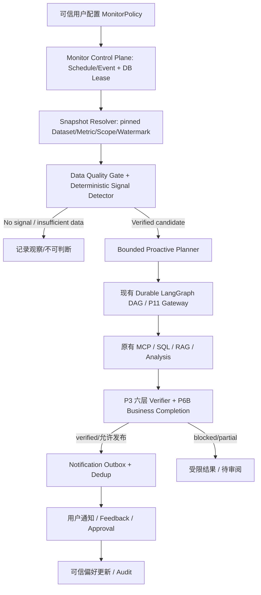

# DataPilot Pro v2.5 — 主动式 Agent 扩展路线图与 Codex Prompt 包

> **版本日期**：2026-10-22  
> **项目**：https://github.com/zouradiant-dev/datapilot-pro  
> **上游基线**：`docs/codex-prompts-v2.4.md`（P4.1–P11D）与 `docs/roadmap-v2.md`、`AGENTS.md`。  
> **版本策略**：**v2.5 是对 v2.4 的增量扩展，不覆盖 v2.4，也不重写 P4.1–P11D 的原始详细 Prompt。** 执行旧阶段时继续使用 v2.4 的完整对应段落和通用前缀；执行新增阶段时使用本文通用前缀与单阶段 Prompt。  
> **审计时点**：2026-10-22，仓库 `main` 的 README 与 roadmap 声明已完成 P6B，P6C/P7/P11 尚未完成。v2.4 文件头部关于“P6A 正在开发/P5B 最新”的历史状态已经过期，**不能作为现状**。每轮以本地 HEAD、GitHub CI 与实际测试重新核验。  
> **目标**：在原有可靠、可验证的 SaaS 分析能力与 P11 Gateway 高可用基础上，新增持续监测、异常发现、有限自主调查、可信通知、审批反馈与可复现主动性评测；首发仍是 SaaS，不把干洗店作为前置依赖。

## 0. 版本差异：v2.4 → v2.5

| 范围 | v2.4 | v2.5 处理 |
|---|---|---|
| P4.1/P5A/P5B | 工具、Context、PG Durable 历史阶段 | 完整沿用，不重造 |
| P6A/P6B | RAG 与跨来源 Verified Report | main 已声明 P6B 交付，转为已实现基线；保留独立验收局限 |
| P6C/P7 | API/UI/观测与独立业务评测 | **继续原 v2.4 Prompt**，不改范围 |
| P8/P9 | 可选 Fork / 干洗店试点 | 保持可选，不阻塞主动 Agent |
| P10A/B/C | 多租户、安全运维、可选长期 Memory | 保持独立；多租户商用需先过 P10A/B，单用户主动原型不必等待 |
| P11A–D | 模型路由、熔断、降级/缓存、SLO/SLA | **继续原 v2.4 Prompt**，不放松 Journal/Evidence 边界 |
| **P12–P16** | 未定义 | **新增**主动调度、信号检测、主动调查、通知审批、长期运行评测 |

### 执行顺序与启动门槛

```text
已完成基线：P1–P6B（以仓库当次验收为准）
    ↓
P6C（API/UI/观测） → P7（≥50 个独立 Reactive E2E 与故障基线）
    ↓
P11A → P11B → P11C → P11D（按 v2.4，逐个授权；D 的商业 SLA 部分依赖 P10）
    ↓
P12 → P13 → P14 → P15 → P16（本 v2.5 新主线）

可选、独立：P8 Fork；P9 干洗店；P10A/B 生产多租户及安全；P10C 持久长期 Memory。
```

**建议顺序**：按用户计划在完成并验收 P11 后开始 P12；若 P11D 合同 SLA 因 P10 商用前置未完成，则允许仅完成其本地 SLO 评测部分，之后进入 P12 单用户原型，绝不将它描述为商业 SLA 已交付。P12–P16 每阶段独立授权，绝不因有路线图而自动开工。P16 可实现主动反馈记忆，但若 P10C 未做，只允许新建最小、受审阅的监测偏好记录，不冒充通用持久 Memory。

## 1. 新功能边界与非目标

**两种入口，一套业务引擎**：Reactive（用户发起）与 Proactive（可信 Scheduler/事件发起）均通过同一个受控 Durable Agent 服务入口、预算、LangGraph DAG、MCP Scope、P3 Verifier、P6B Report 和 P11 Gateway。

新增：MonitorPolicy、MonitorScheduler/Trigger、SignalDetector、ProactivePlanner Adapter、Notification/Outbox、Approval/Feedback、Monitor Evaluation。不得实现第二个通用 Agent Scheduler、第二个 Checkpointer 或把事件 Payload 直接当用户授权。

第一版只做 SaaS **只读经营预警 + 站内通知**。不自动修改价格、订单、账单；不默认发客户营销消息、电子邮件；不做任意 Shell/文件执行、自动外部浏览或自增长目标。用户显式配置目标、指标、频率、预算及通知策略。模型只决定受约束的调查顺序，不决定权限、数值真伪或是否存在合同 SLA。

## 2. 目标架构与不变量



**不可破坏**：

1. 运行开始时固定 owner/tenant（若有）、Dataset/source 版本、Metric/Semantic 版本、窗口、单位、scope、策略版本；新数据只能产生新 Run，不在旧 Run 中偷偷替换。
2. `execution_status=succeeded` 不等于 `business_completion=completed`；未通过 P3 六层验证的数值不可发布为已核验经营事实；文档只能作带来源背景，不能证明因果。
3. 主动触发本身不授予能力。MonitorPolicy 必须由可信用户/服务端审阅并启用；LLM、Webhook、文档、客户端 Header、缓存都不能升级 owner/tenant、业务授权或服务等级。
4. 统一 P5B Journal、Checkpoint、预算、取消和 P11 的 `issued/complete/uncertain` 语义；不对未知结果盲目重发或跨模型切换。
5. 监测元数据可以使用隔离的非模型管理通道；任何**业务表**查询仍走现有真实只读 MCP；不能用调度服务账号直连业务表以绕过授权。
6. 通知的“数据库提交”与外部渠道发送不是天然原子；Outbox 保证可恢复的投递尝试，不声称第三方 exactly-once。
7. 数据新鲜度不等于数据版本号：必须检查可信 source watermark、覆盖窗口、导入完成性及迟到数据政策。
8. 模型无法改变已确认 Metric/Domain 口径，无法自行批准假设、根因、金钱相关行动。
9. 关闭总开关、禁用单个 Policy、耗尽预算或取消时不得产生新的自主业务副作用；已发出未知结果按已有保守恢复规则处理。
10. 所有主动分析必须可追溯到 trigger → policy → signal → pinned snapshot → run → evidence → notification/approval。

## 3. 建议的数据契约（概念性，实际复用已有类）

```python
class MonitorPolicy:
    policy_id: str
    owner_scope_ref: str
    metric_refs: list[str]
    dataset_version_resolution: str   # approved_latest | fixed_version
    schedule_spec: str                 # trusted validated schedule
    detector_config_ref: str
    budget_policy_ref: str
    notification_policy_ref: str
    version: int
    enabled: bool

class MonitorRun:
    run_id: str
    policy_id: str
    policy_version: int
    trigger_key: str
    pinned_snapshot_ref: str
    status: str
    durable_agent_run_id: str | None

class SignalEvent:
    signal_id: str
    monitor_run_id: str
    metric_ref: str
    window_ref: str
    baseline_ref: str
    evidence_refs: list[str]
    signal_type: str
    severity: str
    detector_version: str
    dedupe_key: str
    verified: bool

class NotificationOutbox:
    event_id: str
    signal_id: str
    report_ref: str
    destination_ref: str
    idempotency_key: str
    state: str  # pending/claimed/sent/uncertain/dead_letter
```

上面是**接口草案**而非要求 Codex 按原样照搬 Pydantic 类型。正式落地必须优先复用现有 P3 MetricContext、P6B ReportScope、P5B Journal 与 P11 Route/Cache 决策契约。不要暴露原始业务行、凭据、完整 Prompt、敏感邮件地址到公共 Trace。

## 4. 所有新增阶段共用 Codex 前缀

```text
你是 DataPilot Pro 的高级 Agent Runtime / SaaS 可靠性工程师。本轮只执行用户明确指定的 P12/P13/P14/P15/P16 之一。

先读取 git status、HEAD、当前分支与未提交改动；再读 README.md、AGENTS.md、docs/roadmap-v2.md、docs/codex-prompts-v2.4.md、本 v2.5、docs/cross-source-report.md、docs/recovery.md、P7/P11 已有交付与对应 ADR/源码。若用户正在改动同一文件，不覆盖或重置。先输出“已实现 / 待做 / 冲突 / 拟修改文件 / Gate”矩阵。

只复用现有 Gateway、P5B Durable、P11 Router、LangGraph、MCP、P3/P6B 验证、PG17/pgvector。禁止第二套通用任务引擎、任意 Shell/DDL 工具、重写 Agent Loop。业务访问一律用只读 MCP；管理元数据独立角色和新 Alembic 迁移；冻结历史 migration 和官方 Saver schema。绝不删库、重 Seed、docker compose down -v。

模型/外部输入不能批准 scope、业务指标、租户、服务等级、审批或缓存复用。用户长期目标必须是宿主确认的版本化 Policy；未授权写操作禁止执行。模型调用遵守 Gateway/父子预算，未知外部结果保留 uncertain，不能靠重试/切 Provider/缓存绕过。

单用户 Demo 与生产多租户严格区分。无 P10A/B 不能承诺生产多租户和商业 SLA。真实 API 测试必须 opt-in；Mock、真实 PG/MCP、真实模型 E2E、独立业务评测分别报告。不得编造成功率或 SLA。

测试至少覆盖正常、反例、并发、故障、取消、版本变更、权限和成本；不得用修改断言/跳过失败来获取全绿。Python 3.11/3.13、uv.lock、Ruff 与已有 CI 全回归保留。

先给出设计/ADR 和变更清单，再开始本轮代码；遇到数据权限、迁移所有权、未知执行结算等关键冲突时先停在 ADR，不强行绕过。

阶段交付：变更文件、接口/状态、不变量、测试命令与真实结果、Mock/Live 区分、失败与安全反例、覆盖缺口、回退策略、文档与下一阶段候选。不得未经用户明确授权自动 commit/push 或进入下一阶段。
```

---

## 5. P12 — Reliable Proactive Control Plane：调度与持久监测

**目标**：不调用 LLM 也能可靠地执行经确认的监测任务，并记录状态。**本阶段不做异常检测、不触发业务 Agent、不发通知**。

**交付**：MonitorPolicy CRUD/校验、策略版本与禁用、时间/事件触发、基于数据库的 durable trigger/run、原子领取/Lease/Fencing、并发限制、超时/取消、幂等与恢复；可做 CLI/内部 API，优先依附 P6C 已有产品入口。APScheduler 只是本地调度唤醒器，Postgres 是事实源。默认不引入 Kafka/Redis/Celery。

**候选幂等键**：`(policy_id, policy_version, schedule_slot or event_id)`；数据快照单独 pinned，不把相同任务的重复唤醒当作新事件。允许明确配置 missed-run catch-up 上限，禁止停机一周后瞬间补跑海量任务。

### 发给 Codex：P12

```text
本轮只授权 P12 — Reliable Proactive Control Plane；P11 本地验收完成（或用户单独确认例外）后开始。
1. 审计 P5B checkpoint/journal、P6C API、P11 admission/budget 和持久化元数据角色，提出 MonitorPolicy、TriggerEvent、MonitorRun 的最小 schema/DTO。先 ADR 列出状态图、数据库权限、租约/fencing 与事务边界。
2. 实现可信策略创建/启停/版本、定时 schedule 与手动合成事件触发；数据库唯一约束去重、原子 claim、带 lease expiry/fencing token 的 worker、有限并发/积压预算、取消和死信/人工干预路径。
3. 任务只写入 monitoring 元数据；不得直接查询业务表或启动 LLM、不得产生通知。实现全局 kill switch；策略撤销后旧待执行任务不能再启动。
4. 使用真实 PostgreSQL 测试双 Worker 并发领取、时钟偏差、重复事件、进程崩溃在 claim 前/后、租约超时接管、旧 worker 迟到提交、漏执行 catch-up、策略禁用与预算拒绝。
5. 交付 docs/proactive-control-plane.md、新 ADR、可复现 CLI demo、所有回归与状态机/DB 断言；到 P12 Gate 停止。
```

**P12 Gate**：一次逻辑触发最多生成一个有效 Run；并发 Worker 不同时持有可提交的有效 lease；崩溃可恢复、禁止后的任务不启动；无新增业务写入或模型调用。注意数据库幂等仅证明内部状态，不声明外部 exactly-once。

## 6. P13 — Evidence-Grounded Signal Detection：数据质量与异常信号

**目标**：使用可信、已确认的 SaaS 指标检测可解释的异常；不使用 LLM 判断数值本身。选 2–3 个 P3 已验证的指标作为 MVP（如 paid_invoice_revenue、customer churn、subscription churn），不添加未经审阅的新 MRR 定义。

**交付**：SnapshotResolver、可信 source watermark、窗口/基线选择、质量门控（样本、覆盖、迟到数据、口径与版本）、detector version、置信/严重度、信号去重与候选 SignalEvent；通知和自主调查留给后续。

### 发给 Codex：P13

```text
本轮只授权 P13 — Evidence-Grounded Signal Detector；P12 Gate 必须通过。不可添加 Agent 自由 SQL 或模型数学判断。
1. 选择已经通过 P3 六层验证的 2–3 项 SaaS 指标，定义可比窗口、分母、比例/相对变化、baseline 样本与最小样本要求；先出统计/质量 ADR，解释 seasonality、数据迟到和零分母如何处理。
2. 新增 SnapshotResolver：可信宿主解析最新已批准 dataset/source/metric/semantic 版本与 watermark，启动时固定；所有业务计算必须通过现有 scoped MCP/P3 服务，不能从新的 monitoring DB 通道查业务行。
3. 实现 Deterministic SignalDetector，SignalEvent 含 P3 Evidence/Verification refs、窗口、数据版本、探测算法/参数版本与 severity。数据缺失、样本不足、范围不完整、指标未确认、版本不一致要输出 insufficient/unavailable，不得假造 0 或业务异常。
4. 模拟正常波动、真实异常、数据修订、重复窗口、口径变更、金额单位变化、延迟同步、跨 scope、伪 Evidence 与撤权；分别测误报/漏报及质量门控。只能复用确认过的验证记录，不能自行把统计 flag 升级为因果结论。
5. 提交 docs/proactive-signal-detection.md、配置示例、统计评测 manifest、真实 PG/MCP 定向验收；本轮不发通知、不调用自主 Planner。
```

**P13 Gate**：真实 PG 合成数据可复现正常/异常结果，质量不满足时拒报；历史证据和版本核对可追溯，统计阈值/参数预先登记，不在 holdout 上反复调参。

## 7. P14 — Bounded Autonomous Investigation：主动分析与有界规划

**目标**：当 P13 发出合格信号时，由 LLM 决定经授权的调查路径并复用现有分析 Agent，而非复写新业务引擎。

**交付**：ProactivePlanner Adapter 将可信 Signal/Policy 转为现有 ReportScope/TaskEnvelope，有限 DAG 与模型预算、已有 SQL/RAG/Analysis/Report、有界重规划、可信业务完成判定；未经证实的原因必须明确为假设。

### 发给 Codex：P14

```text
本轮只授权 P14 — Bounded Proactive Investigation。前提 P12/P13 Gate 已验收。本轮不允许自动发通知或执行业务写入。
1. 审计 P4 DAG、P6B ReportScope/BusinessCompletion、P11 Gateway 及 P5B Recovery。设计“信号→已批准调查目标”的 Adapter；生成可信 pinned scope 而不是让模型生成授权。不要第二个 Planner/Worker Loop。
2. 模型仅能从宿主开放的调查任务与工具集合中选择、重排或有界补查；不得自动确认新语义指标、源版本、因果、租户范围。安全拒绝、budget exhausted 和 unknown provider outcome 均 fail closed。
3. 复用原 LangGraph Durable run、P3 verified 数值、P6A RAG 可验证背景、P6B Report。将 verified fact / hypothesis / unavailable 分开；仅有相关性时禁止宣称根因。对先前信号基线和最终指标实际版本不一致的结果标注 stale/blocked。
4. 测多信号并发、重复触发但同一分析复用、Provider 429/超时、Checkpoint 后重启、模型尝试越权、幻觉数字/因果、缺文档、取消、预算耗尽、缓存错版；验证安全 fallback 是 partial/blocked 而非伪成功。
5. 与“固定模板调查”在同样信号/模型/工具/预算下做小规模对照，记录有用调查、verified report、成本与失败分母。交付 docs/proactive-investigation.md、ADR、Trace 示例与真实/Mock 分离报告，停止在 P14。
```

**P14 Gate**：至少一条异常信号自动启动真实 Scoped MCP/PG→已验证报告闭环；已有 Reactive E2E 回归不退化；同一未变 signal 的重复触发不会无端多次计费；未验证结论不发布为事实。

## 8. P15 — Safe Delivery, Approval & Feedback：通知、审批和反馈

**目标**：经过验证的异常调查结果能可靠送达可信用户并记录反馈。首版仅站内通知；业务写入/客户群发全部默认禁止。

**交付**：事务 Outbox、通知状态/去重/冷却/合并、可信收件人、站内 inbox、确认/忽略/调整策略、审批提案（不执行敏感动作）、隐私保护及审计。避免误将已通知与已阅读、已批准混为一谈。

### 发给 Codex：P15

```text
本轮只授权 P15 — Verified Notification, Approval & Feedback；P14 Gate 先通过。
1. 设计可信 report publication gate、Notification Outbox、用户/目的地 scope、状态与重试边界。数据库事务中持久写待投递事件，worker 经可恢复 claim 后发送到 P6C 站内通知；不要求 SMTP/第三方推送。明确 sent-but-not-committed 的 uncertain/reconciliation 语义。
2. 独立规则负责合并同 policy + metric + window + source/version 的重复信号；设 cooldown、severity escalation、退订/静默与 global kill switch。模型不可绕过冷却或自选外部收件人。
3. 引入 ActionProposal + ApprovalRecord，仅供将来业务写操作审批。P15 的执行器不包含修改订单/价格/营销发送工具；用户审批必须经过可信 API 身份/CSRF 等必要边界，审批不得默认自动生效。
4. Feedback 只更新明确的通知偏好/策略版本，不把 LLM 因果假设永久保存为业务事实；提供 TTL、来源、撤回与审计。视为单独的受限长期偏好记录，不冒充 P10C 通用 Memory。
5. 测重复/乱序投递、双消费者、发送成功后崩溃、用户撤销/换租户（若已实现）、策略禁用、越权审批、通知风暴与隐私日志。交付 docs/proactive-delivery.md、UI/API demo、Outbox/审计测试和失败说明；停止在 P15。
```

**P15 Gate**：同一策略/窗口信号不形成重复可见警报；关键通知在崩溃后可审计地恢复或进入人工对账，不能悄悄丢失/伪称发送成功；未经授权的业务写入数量为零。

## 9. P16 — Long-Horizon Evaluation & Reliability：长期运行与真实价值验收

**目标**：不把“成功定时触发”冒充主动智能，证明持续发现、调查、反馈的质量、成本、安全和稳定性。

### 发给 Codex：P16

```text
本轮只授权 P16 — Long-Horizon Proactive Evaluation & Reliability，P12–P15 全部通过。
1. 固定独立合成事件流和数据集版本历史：正常、突变、缓慢漂移、季节性、迟到/修正数据、口径变化、连续重复事件、恶意文档、策略禁用与过载。将开发/保留事件集分开，Gold 标注由独立确定性程序与人工审阅，不从 Agent 输出反推。
2. 做三组对照：A 纯规则阈值+模板通知；B 相同 Detector+固定一次性 LLM 报告；C 完整有界 Proactive Planner。固定相同信号、数据、模型/预算和权限，清楚分开 A 的纯规则成本、B 的单次分析和 C 的增量自主规划价值。
3. 指标至少含 signal precision/recall、false-alert rate、investigation task success、verified report rate、useful-alert rate、重复通知比例、漏触发、未授权行动、数据 stale 比例、p50/p95 从数据可用到通知延迟、每有效告警 Token/费用、失败恢复率（明示分母与样本）。阈值与成功标准实验前登记，不能在 sealed holdout 反复调参。
4. 做真实 PG 重启、Monitor Worker kill、P5B checkpoint/Journal uncertain、P11 故障/降级、Outbox 双消费、预算耗尽、多个策略竞争资源、长时间模拟时钟回放；测试变更策略或模型不使旧 Run 失去原始身份。
5. 有凭据且用户明确授权时做受控真实模型 E2E；记录实际 Provider、usage、模型版本、调用数量与花费。Mock 不能冒充长期 live 成功，单进程回放不能宣称生产 SLA。比较安全增益与额外开销；不成功也如实交付负结果。
6. 交付 docs/proactive-evaluation.md、机器可读 manifest/results、bad-case taxonomy、追踪与成本摘要、Demo/使用说明、安全审计和回退方案；经用户审查后才可声明 Proactive MVP 已验收。不自动进入多租户商用或干洗店试点。
```

**P16 Gate**：独立数据集、实验分母、失败案例、真实/模拟区别清晰；证明或否定 LLM 自主调查带来的净收益；所有关键安全拒绝与恢复边界有可复现测试。

## 10. 重要故障与反例检查清单

| 类别 | 必测场景 | 正确行为 |
|---|---|---|
| 多实例 | 两个 Scheduler 同时触发同一时槽 | 一个有效逻辑 Run，DB 唯一键/租约约束 |
| 崩溃 | 领取后未执行、分析中、通知中崩溃 | 有界恢复/对账，不盲重发未知副作用 |
| 迟到 worker | Lease 过期后旧 Worker 再提交 | fencing 拒绝旧所有者写入 |
| 新鲜度 | 旧数据、迟到更新、源范围不完整 | unavailable/stale，必要时新 Run |
| 版本漂移 | metric、semantic 或 source 在分析中变化 | 固定版本，不跨版本冒充已验证 |
| 统计误报 | 小样本、零分母、周期性波动 | 质量门控拒报或标记低信心 |
| 权限 | Prompt/文档要求发邮件、修改账单、跨 scope | Policy/MCP 强制拒绝，不转成工具调用 |
| 成本 | 同时 100 个 Monitor 或全供应商故障 | 准入/全局预算/背压，暂停与降级明确 |
| 记忆 | 未验证根因进入历史偏好 | 不持久化为可信事实，记录为假设/不写 |
| 通知 | 重复、乱序、收件人变更、撤销订阅 | 去重、合并、授权复核、可审计对账 |
| 缓存 | P11 命中旧报告导致误报 | 重新验证 source watermark/TTL/权限/Evidence |
| 观测 | 日志含客户行、SQL、Token 密钥 | 脱敏，仅事件 ID/状态/成本/引用 |

## 11. 验收矩阵与实施建议

| 阶段 | 最小用户可见成果 | 核心验收证据 | 下阶段前置 |
|---|---|---|---|
| P12 | 策略列表、运行历史（尚无异常） | 并发、幂等、租约、故障真实 PG 测试 | P13 |
| P13 | 可解释的已核验异常候选 | 质量/版本/统计反例与 Evidence | P14 |
| P14 | 信号触发自主调查与引用报告 | 真 MCP+PG、业务 Verifier、Budget/Recovery | P15 |
| P15 | 站内预警、确认/忽略、审批提案 | Outbox/去重/撤销/权限测试 | P16 |
| P16 | 可演示的长期 Proactive MVP | A/B/C 对照、Holdout、长期故障与成本 | 后续单独授权 |

### Codex 使用方法

- **开发旧阶段**：发送 v2.4 第 1 节通用前缀 + 对应 P6C/P7/P11A–D 的完整阶段 Prompt；不要用 v2.5 替换旧 Prompt。
- **开发新阶段**：发送本文件第 4 节通用前缀 + 本次唯一 P12/P13/P14/P15/P16 阶段 Prompt。
- **先只规划**：只发以下初始化指令，不默认写业务代码。

```text
请在 DataPilot Pro 仓库核对当前 HEAD 和实际验收状态，阅读 docs/codex-prompts-v2.4.md、docs/roadmap-v2.md、AGENTS.md 及我提供的 v2.5 规划；仅审计 P11→P12–P16 的接口依赖、冲突与 Gate，生成/更新 docs/codex-prompts-v2.5.md，并提供具体差异与阻塞清单。只修改规划文档，保留 v2.4 原文，不改业务代码、迁移、依赖和测试，不自动 commit/push，不执行 P12。
```

## 12. 完成定义与开放问题

- 单用户本地完成 P16 **不等于**生产级 7×24、跨节点公平调度、多企业权限隔离或商业 SLA。若需要商用必须回到 P10A/B 与部署实证。
- P11 路由/缓存可以帮助成本和可用性，但任何缓存命中都必须再次核对当前监测快照和 P3 Evidence；历史事实不能当新异常。
- 真实客户的监测配置、通知渠道、数据保留、业务动作授权、法律合规另行设计；不对未知 POS 系统猜接口。
- 是否引入消息队列、Redis、专门统计模型、Agentic RL 由独立可测瓶颈决定，不作为 P12–P16 的默认依赖。
- 长期记忆如果需要超出“可审阅的监测偏好”，另走 P10C 的权限、来源、TTL 和撤回 Gate。

**最终定位**：DataPilot Pro v2.5 = 现有 Evidence-Driven Reactive Analytics Agent + 可恢复、可审计的 Proactive Monitoring/Investigation/Notification Loop。关键不是让模型更频繁运行，而是让它知道**何时值得行动、能行动到什么程度，以及如何证明行动是正确的**。
