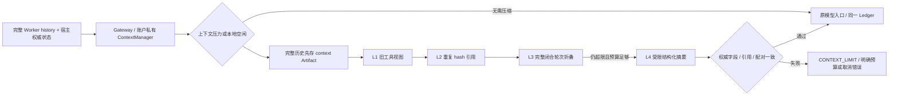

# P5A：ContextManager、L0–L4 与记忆契约

日期：2026-10-21。基线 `fb4c73461c4900f9128d011fd6dcf194f5926beb`，开始时工作区干净。范围只含 P5A，停止在持久化/重启恢复、真实 RAG、UI 之前。P4.1 历史证据为 325 passed/1 skipped，本阶段另行真实回归；未自动提交或推送。

## 核查与修改位置

已读现有 `orchestration/{loop,model,runtime,budget,contracts,coordinator,context,tools}.py`、`semantics/{recipes,contracts,service}.py`、orchestration 文档、ADR-006/007。沿用原 DAG、Loop、Registry、ArtifactStore、取消和账本，未另造调度/恢复框架。

| 文件 | 本轮改动 |
|---|---|
| `orchestration/context.py` | 扩展原 L0 计量，增加每 Worker ContextManager、闭合批次验证、分级视图、归档与指标 |
| `orchestration/context_contracts.py` | SourcePin/MetricBinding/P3Reference、AuthoritySnapshot、ContextSummary、CompressionStats |
| `orchestration/memory.py` | 受限提示 DTO、MemoryStore 接口、审阅/时效/版本/撤回检查及有界内存实现 |
| `orchestration/model.py` | Gateway 按账户适配 ContextManager；摘要和主模型共用调用入口/账本 |
| `orchestration/budget.py` | 原账本增加原子 reserve_batch、已知未发出 follow-up 释放及 ticket 上界检查 |
| `orchestration/coordinator.py` | Worker 注册私有 ContextManager，固定当前原问题；宿主可注入版本元数据和经审阅 MemoryStore |
| `orchestration/tools.py` | Schema 带 context ref，固定 read_context 工具，所有权/分页/JSON 输出限额 |
| `orchestration/contracts.py` / `runtime.py` | context 工件类型与脱敏压缩指标字段 |
| `config.py` / `.env.example` | 压缩阈值/保留批次/空闲/摘要开关；默认 Worker 4 轮不变，显式配置上限为 20，仍受总账本限制 |
| 测试和开发脚本 | `test_context_engineering.py`、`test_context_boundaries.py`、`test_context_postgres.py`；`scripts/measure_context_views.py` |
| 文档 | 本文件、ADR-008、AGENTS、README、architecture、roadmap、orchestration、机器验证 JSON |

没有修改历史迁移、P1/P2/P3 实现、SQLGlot/SQL 查询实现、MCP Server/Client、依赖声明或 uv.lock，也没有修改 LangGraph/site-packages。

## 权威边界

| 内容 | 权威来源 / 处理 |
|---|---|
| 当前用户目标和限制、原始 Schema、安全规则 | 保留原 System/Human 前缀；另以 AuthoritySnapshot 固定当前问题/任务，不可隐式截断 |
| Task/Plan/dependencies/unresolved | RunState 和宿主 Envelope；Worker 仅拿当前任务及必要依赖引用，不获得整份共享状态 |
| Dataset/source/semantic/metric 版本、时间/单位/政策 | 宿主 SourcePin/MetricBinding 精确快照；request/context/hash 必须一致 |
| P3 verified Evidence/Verification | 仅投影已通过原 P3 验证的数据引用，保留 request/Evidence/Verification hash，不重新计算或修改 verdict |
| P4 Artifact、原 AI/Tool 消息 | 原有内存 ArtifactStore 与 Worker canonical transcript，压缩只投影副本 |
| 权限、预算、取消 | 原 Registry/MCP 服务端、Gateway/Ledger、Cancellation 句柄；不从摘要或 Memory 重建 |
| 老旧观察、重复检索/Schema 展示、闭合轮次 | 可减少模型视图；原件先归档、可按实际引用读回 |
| Memory | 非权威提示；受 scope/version/时效/审阅限制，不承担 Checkpoint 或 Registry 职责 |

AuthoritySnapshot 序列化后固定，读取返回独立副本，避免嵌套 Pydantic 可变字段导致冻结失效。业务定义的不可计算/缺字段状态照样保留；摘要不能靠删掉 missing/unresolved 来自称完成。旧 SaaS 查询没有虚构 Dataset 版本；上传范围仍只来自可信宿主的真实 MCP 会话，ContextScope 描述不授予数据库访问权。

P3 指标主路径独立保留，本阶段只测试其引用与定义的上下文投影，**未实现 P6B 报告桥接**；P4.1 的指标 completion=blocked 规则不变。

## 分级策略与协议



- **L0**：沿用 P4.1。真实工具合法输出先进入有界内存 ArtifactStore，再向模型反馈预览/ref，SQL 行不交给模型心算。没有先裁再保存。
- **L1**：只替换旧闭合批次中的非权威工具反馈正文，保留实际 Artifact/context refs、行数/截断/空检索等关键元数据和 tool_call_id；无引用的错误信息不按普通观察裁剪。
- **L2**：相同实际 Artifact hash 保留最新完整观察，旧重复反馈替换为去重引用/归档指针，AI/Tool 消息仍成对存在。
- **L3**：L1/L2 仍不足时，将完整旧 assistant+全部 tool 结果批次折叠为结构化归档引用；默认保留最近两批，至少一批。当前任务/业务定义/活跃 refs 自动再注入。已验证依赖本来就只传紧凑 refs，不引入其他 Worker 的原文或再建子 Agent 总结服务。
- **L4**：前三层后仍超限才调用受限 Summarizer。它只能选择已有 turn ID；goals、constraints、unresolved、scope、完整指标定义/时间/单位、P3/P4 refs、archive/hash 必须与宿主逐字段一致。多余权限/verified/自由事实字段、错误 ID 或丢失关键字段一律拒绝。非通用自由文本摘要，不能据此宣称语义总结质量已测。

完整原 AI/Tool 关联始终保留在 Loop；L3 的 provider 视图只移除**整批已闭合**消息。未结算调用、重复 ID、孤儿/错绑 ToolMessage、额外 System 角色明确拒绝。压缩后旧 ID 仍在原历史中，因此不能重复使用。原安全/用户/Schema 前缀过大时，直接 CONTEXT_LIMIT。

`read_context` 只读本任务实际清单和 run/task/plan 匹配的归档、Schema，或 RAG 本任务已经取得的文档；RAG 文档按 document_id 定位分页。它不接受路径、不读其他任务、不向 SQL 模型提供结果行、不直接连接数据库。完整归档可由可信宿主 `read_archive(ref)` 校验读取；模型分页输出在 JSON 编码后仍受配额限制。源缺失或存储满先失败，不输出假装完整的摘要。

## 预算、容量与 Memory

摘要与后续主调用在同一父子 Ledger 原子预留两份预算。后续最大输入由固定字段与最多 8 个最长合法 decision ID 的视图计算，不占用整个 provider window。只有确定未发出的 follow-up 才释放；已发出但失败/取消/usage 不可知保留保守 charge。重复结算/释放明确拒绝，不叠加 SDK、Loop、图重试。

ArtifactStore 仍为每 Run 16 MiB/96 工件，归档共享该配额。ContextManager 使用现有消息/工具 Schema/UTF-8 字节+128 的保守估算，预留最大输出；这不是 tokenizer 或实际费用。Trace 只记尺寸、等级、压缩次数、摘要 usage、耗时和引用 ID，不记录 Prompt/SQL/行/文档正文。显式本地导出包可能含完整敏感历史，继续保存在忽略目录，不应上传。

MemoryEntry 包含 created_at、expires_at、source_ref/source_version、owner/scope/worker、validity/invalidation。允许的内容只有枚举偏好、经审阅术语定义引用、决策引用；定义/决策自身也带版本。无任意正文、raw rows、凭据、权限或模型写接口。`put_reviewed` 必须显式 reviewed；当前内存实现最多 64 条/64 KiB，召回至多 8 条。每次模型视图读取重新检查来源版本、引用版本、TTL、scope/worker、撤回。偏好以 Human 数据层注入，不改 System 安全或业务定义。

这是可供未来持久实现遵守的 MemoryStore 协议；当前实例仅在进程内存在。Memory 不复制 Metric/Schema Registry，不承担运行状态、账本或 Checkpoint，更不支持进程重启恢复。

配置：

| 环境变量 | 默认 / 含义 |
|---|---|
| DATAPILOT_CONTEXT_COMPRESSION | true；关闭时保留 P4.1 原字符/Token 拒绝路径 |
| DATAPILOT_CONTEXT_TRIGGER_RATIO | 0.8；本地压力阈值，不是供应商承诺 |
| DATAPILOT_CONTEXT_KEEP_BATCHES | 2；L3 至少保留 1 批 |
| DATAPILOT_CONTEXT_IDLE_SECONDS | 300；空闲触发本地旧观察处理，不代表 provider cache TTL |
| DATAPILOT_CONTEXT_ALLOW_SUMMARY | true；仍必须通过上下文/父子预算预检 |

**缓存支持：unverified。** NativeTransport 仍为原 ChatOpenAI 异步适配器，没有私有 cache-edit 字段，未进行真实供应商 Prefix Cache 实验；本地冷/热计时不能证明缓存命中或省费。

## 独立参考与来源

实际阅读 Mini 固定缓存提交 `0b452360866433fde0dc77cd37ada9d303546592` 的 [agent.py](https://github.com/Windy3f3f3f3f/claude-code-from-scratch/blob/0b452360866433fde0dc77cd37ada9d303546592/python/mini_claude/agent.py#L957)（压缩/大结果先存）、[memory.py](https://github.com/Windy3f3f3f3f/claude-code-from-scratch/blob/0b452360866433fde0dc77cd37ada9d303546592/python/mini_claude/memory.py#L235)（清单/按需召回）、[docs/07-context.md](https://github.com/Windy3f3f3f3f/claude-code-from-scratch/blob/0b452360866433fde0dc77cd37ada9d303546592/docs/07-context.md)。只借鉴分级、引用和按需召回概念，未复制其文件/Shell 工具、自由摘要或权限模式。

另通过 Web 阅读 how-claude-code-works 的 [上下文章节](https://github.com/Windy3f3f3f3f/how-claude-code-works/blob/main/docs/03-context-engineering.md)、[Memory 章节](https://github.com/Windy3f3f3f3f/how-claude-code-works/blob/main/docs/08-memory-system.md)，主要借鉴投影视图与 Memory/执行状态分离。访问日期 2026-10-21；GitHub API 固定提交请求受到 403 限流，本轮未核实该仓库 SHA，链接明确为 main。这些是非官方研究，不把其对私有机制的推测当官方事实；没有复制第三方源码/提示词，归属规则仍见 third-party-references.md。

## 真实运行与实验

以下表格保留 P5A 最初无 Key 的历史验证，不代表当前凭据状态。2026-10-21 随后完成 DeepSeek 非思考模式真实 A/B：20 次模型调用、75,304 tokens、16 组执行通过；L3 总 Token 减少 75.12%，L4 计入摘要后减少 32.21%，但 L4 的本样本估算费用与时延增加。完整范围、负面结果、缓存差异和同 Run 内存限制见 [真实压缩实测](p5a-live-context-ab.md)。合成输入估算与真实供应商 Token 分开保留。

使用 Python 3.11.16、LangGraph 1.2.16、现有 uv.lock。uv 本机路径为 `D:\develop\Python310\Scripts\uv.exe`。命令均在仓库根目录执行：

```powershell
$env:PYTHONUTF8='1'
$env:UV_CACHE_DIR=Join-Path (Get-Location) '.cache/uv'
uv run --locked --offline pytest -m 'not integration and not live' -q --tb=short -p no:cacheprovider --basetemp=artifacts/p5a/local-release --junitxml=artifacts/p5a/local-release.xml
$env:DATAPILOT_RUN_DB_TESTS='1'
$env:DATAPILOT_RUN_LIVE_TESTS='0'
uv run --locked --offline pytest -q --tb=short -p no:cacheprovider --basetemp=artifacts/p5a/release --junitxml=artifacts/p5a/release.xml
uv run --locked --offline python scripts/measure_context_views.py --output artifacts/p5a/context-metrics-release.json
uv run --locked --offline ruff check .
uv run --locked --offline ruff format --check .
git -c core.safecrlf=false diff --check
```

实验脚本使用显式测试合成夹具，不查询业务库、不调用供应商；需要开发依赖。输出只能写入本仓库 artifacts/ 下的新文件，重复执行请换文件名。原始 Token 维度、压缩等级、次数、摘要额外用量、耗时、原历史是否不变及 source loss 标记均输出 JSON。

| 真实运行类别 | 原样统计 / 结果 |
|---|---|
| 最终全量，启用真实 PG | **372 passed, 1 skipped in 94.42s (0:01:34)** |
| 不含 integration/live | **322 passed, 51 deselected in 6.63s** |
| 新增本地/协议文件 | **45 passed in 2.75s**，包括真实 SDK + HTTP Mock |
| 全量内真实 PG/MCP | **50 项通过**，其中本阶段新增 **2 项**长 Schema/SQL 循环对照 |
| 新增 PG + P4.1 PG 专项 | **7 passed in 12.54s**；另已包含在最终全量 |
| Ruff / 格式 / whitespace | `ruff check .`、`ruff format --check .`、`git diff --check` 均通过 |
| 真实模型 API | **1 skipped**，本地缺模型/API 凭据，未发生供应商推理调用 |
| 原有保护 | 0001/0002/0003、SQL/MCP、P1/P2/P3、原 Loop/RunState、依赖声明/锁文件未改 |

JUnit `artifacts/p5a/release.xml` 为 373 tests、0 failures、0 errors、1 skipped；本地统计与源码保护来自实际执行，见 [机器验证](research/p5a-validation.json)。Python 3.13/远端 CI 本轮未运行，不套用历史 CI 成绩。

合成组件实验实际结果（估算为 UTF-8 字节+128，**不是实际供应商 Token**）：

| 场景 | 输入估算前 → 后 | 该请求压缩次数 | 额外摘要调用 | 组件耗时 |
|---|---|---|---|---|
| 12 批工具反馈，L1/L2 | 32,990 → 14,887 | 1 | 0 | 5.863 ms |
| 12 批长观察，L3 | 46,190 → 9,472 | 1 | 0 | 5.962 ms |
| 前三级不足，L4 | 16,538 → 6,801 | 1 | 1 | 2.880 ms |

三组原 canonical history 均未变，完整工件/归档仍存在，`irreversible_source_loss=false`；模型视图明确为 lossy，不能保证模型在减少观察后回答质量不变。L4 的模拟 usage 为摘要 30、总 60，只用于账本测试。实际付费 API 调用为 0，真实模型 Token 为 0，供应商费用/缓存效果未测；毫秒数只反映本地组件，不能外推真实服务延迟。

真实 CLI 另执行了 `python -m datapilot.cli ask '查询客户总数' --mode fake --json` 和 `'计算2025-10收入'`：真实 PG/MCP、各两次 Fake 决策、0 压缩事件；前者得到 240 且 completion completed，后者 SQL 执行成功但 completion blocked/P3_VERIFIED_EVIDENCE_REQUIRED。原始 JSON 在 `artifacts/p5a/cli-count.json`、`cli-revenue.json`，不冒充真实 LLM E2E。

开发中有负面用例暴露摘要内 Metric 版本不一致会抛 P3 异常类别；已在 DTO 边界修正为明确的摘要拒绝/CONTEXT_LIMIT，未放松 P3 校验。分页输出另增加 JSON 编码后的限额验证。两类边界均有回归用例。没有删库、重 Seed、删除 Volume 或扩张 Reader 权限。

## 故障覆盖与限制

- 实际 Worker Loop 连续 11 次工具反馈再决策；压缩开/关的确定性任务引用相同，原消息不改。真实 MCP/PG 的 11 次 Schema 反馈后查询得到 240，开/关均只执行一次 SQL。
- 重复 Schema/文档、12 批旧观察、超大正文、冷却上下文、归档分页、JSON 转义后限额；原值/hash 不变，半批调用不能删除。
- 摘要篡改权限/verified、目标/约束/unresolved、来源/Metric 版本、CNY/时间右开边界、P3/P4 引用、未知 decision ID 都拒绝；引用缺失/非法哈希、配额满不伪造成功。
- 同 Run 两 Worker 同时压缩，预算共享而私有上下文不串扰，跨任务归档即使被放进伪清单也拒绝；Trace 顺序连续。
- 摘要取消与未知 usage、不足两次调用的预算、父子并发争用、未发出预留释放、原重复结算测试；Memory 审阅/时间/版本/scope/worker/失效均有反例。
- Native LangChain 异步 HTTP Mock 验证摘要→原工具协议及 usage，不能当真实 LLM 推理。真实 API/Token 费用、Prefix Cache 收益、生产模型任务质量均未实测。

风险：保留权威字段不证明任意自然语言语义摘要正确；L4 因此限制为摘取式，可压缩收益有限。固定安全/目标/版本很多时仍可能 CONTEXT_LIMIT；归档会增加内存复制与共享配额开销。Memory 只保存受限提示且须宿主审阅，不是通用知识库。P3 指标报告桥接和真实 RAG 未实现，Gate C 仍未完成。当前停止在 P5A，P5B 需用户另行确认。
