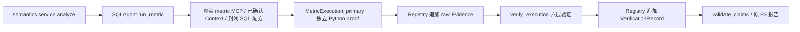
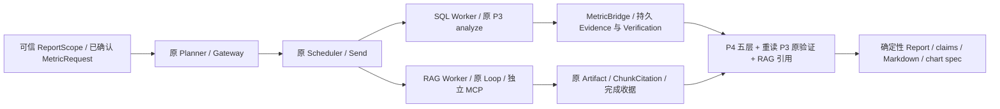

# P6B：跨来源可验证的 SaaS 报告

本轮基线 fb44a77。P6A 真实检索与 P5B 持久恢复已验收；只推进 P6B，不做 UI/Langfuse、P11 降级或缓存，也不自动提交。原有 docs/codex-prompts-v2.4.md 用户修改保留。

## 两条实际链路与缺口




原 P4 report 只有引用包；即使五层检查 passed，完成 Gate 仍阻断缺 P3 verified 证据的指标问题。原 Artifact SHA 不是 Evidence/Verification ID。新增最小桥接保存 P3 请求、最小 Context、原 Evidence/Verification 的 ID/hash/verdict、query/result hash、精确 value、可信 source snapshot 和验证观察时间，验证失败不携带可发布数字。

## 实现决策

可信宿主显式提供 ReportScope：已确认版本的 MetricRequest、独立 DatasetScope、可选一个文档检索目标及与指标目标的关联。自然语言 Planner 只能为这些目标生成同名 SQL/RAG 任务与一个 report，不能创建新口径、版本、脚本或授权。缺定义/单位/覆盖范围返回 unavailable，确认仍在已有宿主入口完成。

SQL 指标走原 P3 配方和独立复算，作为可信服务操作纳入原 Journal；Registry 身份只存在非模型宿主服务中，不进入 Worker ToolRegistry 或 MCP 环境。RAG 继续原自主 Worker Loop。Report 无任意 SQL/计算/文件工具，确定性生成 claim 与图表并独立复核全部引用。原 SQL 小问题路径不启用 ReportScope，保持不变。

P4 编排判定、P3 数值验证和 RAG 来源/相关性分别保留。报告相关性只作背景，不证明因果；RAG 检索成功不等于业务结论成立。Report 可读取终态不足依赖并显式产出受限结果，不能把这些依赖升级为 passed。



Analysis 复用 P3 封闭 SQL 与独立原始列投影/Decimal 复算，而不是额外让模型再算一次数字。原 P4 `analysis` 的 sum/ratio 功能保留，但普通 Analysis 结果单位未确认，不能自动变为 P3 metric。没有为 Agent 数量另建无必要任务。Report 不调用生成模型，不接受自由文本数值/因果断言；Planner 和真实 RAG 的模型调用仍统一经过原 Gateway/预算。

## 最小契约与代码位置

| 契约/接口 | 位置与责任 |
|---|---|
| ReportScope / DocumentGoal | reporting/contracts.py；宿主绑定 owner、原目标、1–6 个已确认 MetricRequest、最多一个文档目标及指标关联；总 DAG 最多 8 个任务且受现有更严配置限制 |
| MetricBridge | reporting/contracts.py；完整请求、最小 Context、源/语义/指标 hash，Evidence/Verification ID/hash/原 verdict、query/result hash、Decimal 文本/单位、验证观察时间 |
| ReportService.compute / refresh | reporting/service.py；复用 P3 analyze，受控 MCP 重读原 Evidence/Verification；不添加新 SQL 模板或第七层业务自评 |
| get_verification | semantics/repository.py、runtime/mcp_server.py/mcp_client.py；Dataset/version 预过滤，只读，原表 grants 已足够；模型工具不获得 Registry 写身份 |
| ReportClaim / ChartSpec | reporting/contracts.py；metric/context/unavailable 区分，图表只引用 verified MetricBridge；不渲染新 UI |
| BusinessCompletion / CrossSourceReport | reporting/contracts.py；版本化业务状态、未确认 claim、缺证据、受限结果、授权 Scope 和 Markdown |
| Coordinator / reporting.adapter | 原固定 StateGraph/Send 与五层 Verifier，按依赖调度/局部重试；只在桥接验证后解除原 P3 缺失 Gate |

ReportScope 不是从文件名猜出的业务确认，也不是模型工具参数。Dataset/Metric/Semantic 版本不存在或未确认时无法计算；已有确认中缺金额存储单位、映射、覆盖范围时沿用 P3 unavailable。宿主须用原 P1/P2/P3 流程审阅，模型无 confirm/approve 工具。`durable --report-scope` 最多读取 256 KiB，恢复时须重新提供一致范围。

图表是带数据和来源的可显示规格，不是未验证图片。每个 point 引用同一精确 MetricBridge，图表 unit 必须与 metric 相等；context 中保留金额 minor/major、货币、paid/churn/feature/null 策略，request 中保留右开时间窗口或 as_of。原 query SQL 和完整结果留在有界私密 P3 Evidence，按 ID 经 MCP 读取；公开 Trace 不输出 SQL/行/文档正文或向量。

## 跨来源关联与完成判定

文档引用先过 P6A 的原件/跨度/行号/source/version/chunk/index/model hash 及宿主 goal 相关性验证，再核对绑定的 Dataset/version 与指标目标；通用 SaaS 文档必须由宿主显式 allow_saas。在已授权候选上，Report 用封闭指标主题词作额外背景关联约束；它不是任意自然语言蕴含或因果判定器。要求的最少来源数、原文条件与不足收据继续生效，多次检索的工件可合并去重但不丢原 Artifact ref。

文档是引述数据，不能扩大工具权限、确认指标、覆盖单位/版本或授予 verified。已知指令式注入片段不进入报告背景；这只是附加过滤，不是完整 Prompt Injection 检测器。强边界仍为只读 scoped MCP、独立 Worker 工具集和确定性报告。RAG 的 complete 仅代表检索任务完成；报告可以保留已验证数字，同时将缺背景/未证因果标为 partial。

| execution_status | business_completion | 用户可见结果 |
|---|---|---|
| succeeded | completed | 所有宿主必需 goals 已覆盖；数字 P3 verified，文档仅作已定位的背景 |
| succeeded / unavailable | partial | 有已验证事实，但缺匹配文档、未满足检索要求或因果结论未验证；保留受限事实和缺口 |
| unavailable | unavailable | 例如 MRR 配方缺失、单位/字段未确认；无未经核实的数字/图表 |
| failed / cancelled | blocked | 权限、来源、证据、预算或执行被阻断；即使部分 SQL 成功也不能升级整个报告 |

`verified_goals` 表示该类目标契约通过；文档目标通过不会把其引述变成 P3 数值或因果事实。P4 源验证失败会进入失败 dependency_statuses，即使 TaskResult.status=succeeded 也不向报告传播该源。局部 Replan 保持同一有界 Plan，不再请求模型生成全量计划；仅重试安全且失败的就绪源，passed/unavailable 源引用重用，权限/证据/unknown-outcome 不重试。

## 持久化与未来契约

复用官方 Saver、原 ArtifactStore/Journal。P3 操作 issued 后状态不确定则阻断重发；已提交的 metric Artifact 重用，不重新生成 Evidence 或结算。恢复重新检查 Scope、Dataset/Metric/Semantic/source pin、P3 持久 ref/hash/verdict 与 RAG chunk/version/hash。新增可选 Artifact 字段为 None 时不进入序列化，保持旧 Artifact 哈希兼容。

报告定义独立 execution_status 和 business_completion（completed/partial/unavailable/blocked），显式列出未确认 claim、缺失证据及可显示受限结果。每个指标/图表均绑定时间、单位、过滤条件、版本、Scope hash、P3 ref 与验证时间；文档保存原 chunk refs。该契约仅为未来 P11 Cache 提供输入，不实现降级/缓存、SLA 或新 Verifier 引擎。

`verified_at` 是宿主重新核对持久验证记录的观察时间，不是修改原 P3 verdict 的时间。可信授权 Scope、原件快照/hash、Semantic/Metric 版本、规则/计算版本、时间/过滤/单位、P3 verification refs 和 RAG chunk refs 都保留在结构化报告/图表及原 Evidence 中；相似度和成功 SQL 不能替代这些条件。当前没有 TTL 命中、缓存服务、自动降级或供应商切换。

## 复现入口

先按 [恢复部署](recovery.md) 和 [RAG 链路](rag-pipeline.md) 准备现有 PG17/pgvector、独立角色/迁移 0005、官方 Saver 和固定本地 Embedding 缓存。不要重复 Seed 或删除 Volume。以下测试只处理仓库合成文件，显式脚本模型决策，无付费 API：

```powershell
$env:PYTHONUTF8='1'
$env:DATAPILOT_RUN_DB_TESTS='1'
uv run --locked pytest tests/test_cross_source_report.py -q
uv run --locked pytest tests/test_cross_source_postgres.py -q
```

五个正例在忽略的 `artifacts/p6b/` 输出 `case-<metric>.json`（真实值/引用/脱敏 Trace）、`report-<metric>.md`、可信合成 `scope-<metric>.json` 及 `rag-scope.json`。准备数据和确认来自原 P1–P3 fixture 流程，不能对真实上传自动套用这些映射。可用 `scripts/report_recovery_probe.py start <新 UUID> artifacts/p6b/scope-paid_invoice_revenue.json --rag-scope artifacts/p6b/rag-scope.json` 重放显式脚本决策；它执行真实 PG/MCP/检索，不能称为真实模型分析。标准宿主入口为 `datapilot durable start/resume --report-scope ... --rag-scope ...`，所有业务确认仍由宿主提供。

## 验证记录

2026-10-22 实际执行；基线 `fb44a77f09a3dbd9a5c7e4fa8e859c06b87f1a05`。结构化证据、JUnit SHA、原 P3 六层记录、版本/hash、RAG chunk refs、用量类别和案例时延见 [p6b-validation.json](research/p6b-validation.json)。本节及 JSON 为推送前的本地验收快照：记录生成时尚未提交/推送，不能作为后续 GitHub CI 的当前状态。推送后的 CI 以对应提交的 Actions 记录为准。

| 真实执行命令（仓库根目录） | 实际结果 |
|---|---|
| `DATAPILOT_RUN_DB_TESTS=1 .venv/Scripts/python.exe -m pytest -q --tb=short --basetemp artifacts/p6b/full-py311 --junitxml artifacts/p6b/full-py311.xml` | Python 3.11.16：541 passed / 1 skipped，801.05 s；含原 P0–P6A 真实 PG 回归 |
| `DATAPILOT_RUN_DB_TESTS=1 .venv/Scripts/python.exe -m pytest tests/test_cross_source_postgres.py -q --tb=short --basetemp artifacts/p6b/post-review-pg --junitxml artifacts/p6b/final-p6b-pg.xml` | 最终 P6B 真实 PG/本地 Embedding/MCP：18 passed，240.49 s |
| `.venv-313/Scripts/python.exe -m pytest -m 'not integration' -q --tb=short --basetemp artifacts/p6b/post-details-py313 --junitxml artifacts/p6b/final-py313-local.xml` | Python 3.13.15：415 passed / 127 deselected，9.84 s；不声称该轮运行了 PG |
| `.venv/Scripts/python.exe -m pytest tests/test_cross_source_report.py tests/test_orchestration.py -q --tb=short --basetemp artifacts/p6b/final-local-details --junitxml artifacts/p6b/final-report-local.xml` | 本地桥接/编排：47 passed，3.71 s |
| `.venv/Scripts/ruff.exe check .` / `format --check .`；`git diff --check` | 全部通过；192 个文件格式检查通过 |

表中 `DATAPILOT_RUN_DB_TESTS=1` 表示环境变量；PowerShell 写法为 `$env:DATAPILOT_RUN_DB_TESTS='1'`。唯一 skipped 是需要新授权的真实模型 opt-in 用例。全量回归后只补充本阶段 unavailable 的可读缺失详情及最终 completion Trace 投影；最终 18 项真 PG 与 415 项本地回归覆盖这些补充。没有重复执行付费实验。

| 独立合成经营案例 | P3 Gold 与独立 literal SQL 对照 | 最终业务状态 | 观察到的单次 Run 耗时 |
|---|---|---|---|
| 2025-10 已付账单收入 + 收入/MRR 口径文档 | 300 CNY | completed；不等于 MRR | 8.531 s |
| 期初客户队列净流失 + 口径文档 | 0.400000000000 ratio，2/5 | completed | 8.453 s |
| 期初订阅合同流失 + 取消/降级文档 | 0.666666666667 ratio，4/6 | completed | 8.156 s |
| 2025-10 产品使用事件量 + 使用量限制文档 | 35 events | completed；不等于活跃用户数 | 8.157 s |
| 2025-10-31 活跃订阅 + 时点/历史要求文档 | 4 subscriptions | completed | 8.422 s |

五例均读取真实合成 XLSX→PG 数据，并摄取三份新的合成 Markdown，执行真实 CPU 神经 Embedding、pgvector 和独立 MCP；原 RAG fixture 没有冒充检索。Gold literal SQL 不调用 P3 compile_sql 或独立复算函数；收入右开边界/paid/CNY、客户重订与订阅计数、事件时间/数量均有独立对照。它们是五个固定业务案例，不是 ≥50 任务基准或企业真实经营数据。

每个正例是 3 次脚本模型决策/45 个脚本 usage Token，**不是供应商实际 Token**；本阶段真实 LLM Run=0、付费 API 调用=0，供应商输入/缓存 Token 与费用未测量。上述时延包含受控模型脚本、MCP/PG 和本地检索，没有真实模型推理，不推算生产 p95 或节省比例。

反例实际验证：MRR、未确认指标、缺金额单位/映射返回 unavailable；因果目标、使用量引用账单文档返回 partial；不匹配的来源/版本/hash、伪造 Evidence、错单位/数值/图表/报告正文不能成为 verified 报告。恶意指令文档的检索任务可以完成，但报告丢弃指令背景并保持 partial；RAG 尝试调用 SQL 写工具被 TOOL_FORBIDDEN 阻断。没有把背景引述当成因果事实。

跨进程故障覆盖 P3 持久化后 Journal 未提交、metric/report 已提交而 Checkpoint 未前进、Worker 后暂停与重复 resume；恢复前后的 P3 ID/body hash/数量/verdict 保持一致，RAG refs 与模型用量不变。未知窗口报 RECOVERY_UNCERTAIN，不生成第二份 P3 证据；Metric/scope 变更拒绝恢复。另有局部恢复测试确认 passed/unavailable 源只执行一次、失败的就绪源只重试一次，Planner 仅调用一次。

开发中实际暴露并修复了嵌套 Scope hash 序列化、未确认缺失码大小写、报告依赖只看执行状态等问题；Gold SQL 重复列名被原结果验证器正确拒绝，已修正测试 SQL；最初数据库未运行时仅启动现有 Docker，未 reset/reseed/删卷。完整概要保留在结构化记录。最终健康检查：PG 17.11、pgvector 0.8.6、迁移 0005、240 customers；原迁移、依赖锁、P5A Context/Memory 与 P6A 历史实验文件均未改变。用户原有 v2.4 Prompt 修改 SHA 也已核对保留。

## 修改文件范围

新增 `src/datapilot/reporting/{contracts,service,adapter,__init__}.py`、两个 `test_cross_source_*.py`、三份合成 Markdown、`scripts/report_recovery_probe.py`、本说明、ADR-012 和结构化验证记录。现有 `orchestration/{contracts,coordinator,model}.py`、`persistence/session.py`、`state.py`、`runtime/mcp_{client,server}.py`、`semantics/repository.py`、`cli.py` 仅接入桥接/只读引用与原持久执行；`tests/test_mcp_protocol.py` 只增只读工具的集合断言。同步 AGENTS、README、architecture、roadmap、recovery；不修改旧业务配方/六层规则、历史迁移或依赖。

## 未完成项与风险

- P6B 没有新增真实模型实验授权；脚本决策验证工程链路，不证明 DeepSeek 自主规划/检索/解释的质量或稳定成功率。P6A 历史 Smoke、Token 和 CI 记录保持原样，不计为 P6B 实验。
- 可信宿主仍需显式提供已确认 MetricRequest、文档范围及两者关联；不自动确认新上传的映射/货币/时间/口径，也不声称已证明任意自然语言问题与这些 goals 完全等价。
- 报告为受限确定性事实与引用背景；只支持现有 P3 指标、每指标独立单位的 bar 规格，不新造 MRR/趋势/因果配方，不输出未经复核的建议数字。RAG 相关性与封闭主题词是保守背景约束，不是通用事实蕴含判定；注入样式过滤也不宣称覆盖所有攻击。
- P3 Registry 与 Journal 没有全局事务；未知结果需宿主对账，不能自动清除 uncertain 或盲目重试来提高成功率。旧 Dataset 物理表的应用层不可变与可信 owner 边界不等于数据库 WORM。
- 本地单用户原型；没有 UI/Langfuse、生产多租户、长期 Memory 后端、P11 降级/缓存/路由或 SLA。完整保留集、≥50 任务基准与 Claude Code 产品对照属于 P7，未提前实施。

本轮停在 P6B，不自动 commit/push，也不进入 P6C/P7/P11。
