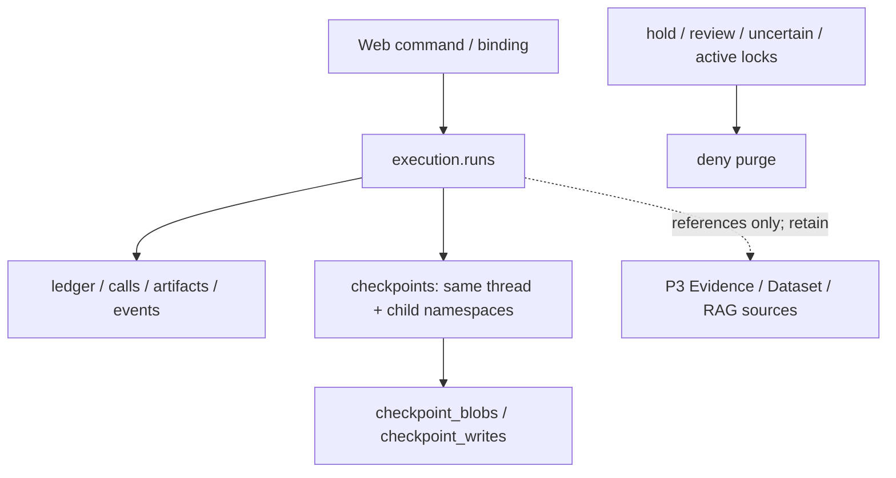

# 数据地图与最小保留策略（P6C）

清理采用显式维护 CLI，默认仅 dry-run；启动 Demo 不自动清理，不删除用户现有记录。真实隔离 PostgreSQL 用例已执行，最终验证命令和结果见 [P6C 交付](product-demo.md)。

| 数据 | 存储 / 权威 | 访问主体与浏览器边界 | 保留 |
|---|---|---|---|
| 上传原件/确认 | 私密本地对象目录 + Web 元数据 | 宿主 Ingest；浏览器仅画像/Schema，不返回行样例 | 被 Dataset 引用时保留，不随 Run 清理 |
| 业务/上传数据表 | PG saas/uploads | scoped MCP reader；无写/DDL；浏览器仅已验证聚合 | 不由 Run 维护删除 |
| P3 Evidence/Verification | catalog 追加历史 | Registry 宿主；报告读取走 scoped MCP | 独立保留，不由 Run 清理 |
| P4 Artifact/预算/调用/Trace | execution | 原 runtime + 宿主 owner/TTL 检查；无原文下载端点 | 过期且安全终态可整 Run 清理 |
| 官方 Checkpoint/Blobs/Writes | checkpoints | 专用基础设施身份；不对 UI 公开 | 同 thread 的父子 namespace 一致删除；全局 migration 保留 |
| RAG 原件/向量/索引 | PG rag | 独立 ingest/reader；正文/向量不进公开 Trace | 被授权来源独立保留，不随 Run 删除 |
| OTel/本地导出 | 默认关闭，显式私密 JSONL | 只允许脱敏 DTO；无远程默认发送 | 独立人工保留；导出失败不影响任务 |
| 前端缓存 | Streamlit 服务端 UI 状态/HTTP cookie jar | 只存会话/选择/有限响应，不是权威身份或 Checkpoint | 刷新可丢弃，任务由 PG 恢复 |



## 保留与权限

宿主 Run 默认 TTL 24 小时，可配置 60 秒至 7 天；执行元数据与 Web 绑定均须过期才可清理。会话有效期 8 小时，上传预览采用宿主 TTL。过期首先拒绝读取；这不等于已经物理删除。原件、孤立上传、过期会话、Dataset/P3/RAG 和本地 OTel 导出目前独立保留，没有自动级联清理；这是 P10B 的运维边界。

| 身份 | 相关权限 | 禁止 |
|---|---|---|
| datapilot_web | Web session/upload/grant/outbox 的 SELECT/INSERT/UPDATE | 业务表、Checkpoint、执行记录 DELETE、DDL |
| datapilot_runtime | 原 execution 和官方 Saver 读写 | DELETE、DDL、业务表访问 |
| MCP reader / upload_reader / rag_reader | 原只读 grants + 服务端 scope | 写入、DDL、维护工具 |
| datapilot_maintenance | 指定 execution/Saver 表 SELECT/DELETE；保全与审计、幂等 tombstone 的最小写权限 | DDL、业务表/Dataset/P3/RAG 删除、全局 checkpoint_migrations 删除 |

维护计划只列 Run ID、行数和 hash，不打印 payload。它检查已审计的官方 Saver v9、最新根状态、工件 hash、账本、原 Run 锁/派发锁/维护锁、保全、人工审核与 issued/uncertain 调用。执行再次检查同一计划，使用同一 SERIALIZABLE 事务删除该 thread 所有 namespace 的三张 Saver 表及 execution 依赖；任何失败整体回滚。幂等请求保留去内容的 tombstone，避免旧键重新发起付费运行；审计仅保留计划 hash、Run hash、时间和计数。

## 显式命令

在仓库根目录运行，DSN 只在忽略的 `.env` 内。对示例变量替换为宿主确认的 Run ID；不要在开发验收中对原库执行 purge。

```powershell
uv run --locked datapilot-web retention $runId
uv run --locked datapilot-web retention $runId --hold on --reason 'review required' --reviewed
uv run --locked datapilot-web retention $runId --hold off --reason 'review completed' --reviewed
# 仅在审阅 dry-run 输出后，显式使用本次 plan_hash：
uv run --locked datapilot-web retention $runId --execute --reviewed --confirm-hash $planHash
```

没有 Web 清理端点、定时自动删除或模型维护工具。活动、暂停、等待审核、预算未结算、未知调用、保全、跨 Run 引用、版本不符均 fail-closed。测试专门创建 `datapilot_retention_test_<随机后缀>` 新数据库；测试中的过期、注入、删除及回滚只涉及这些隔离记录，并保留隔离库供审计，不 Drop 原数据库或 Volume。详见 [ADR-014](adr/0014-execution-retention.md)。
