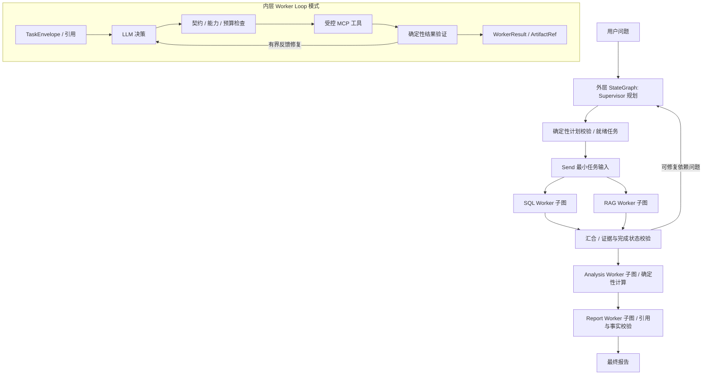

# LangGraph 与 Mini Claude Code 架构研究

研究日期：2026-10-21。本轮只增加研究文档与离线探针，生产代码、数据库 Schema、依赖锁和 Day 1 验收范围保持原状。文中的“拟采用”是后续开发方案，不代表功能已经落地。用户已允许直接复用 Mini 的子 Agent 权限和预算实现；后续可通过薄适配接入，不把“必须重写”作为限制，但仍须满足全局预算、MCP 权限和许可证要求。

版本说明：本文件保留首轮框架研究及其测试记录。后续 v2 产品设计、动态导入例外、实际 PG 回归与现行实施顺序以 [架构](architecture.md)、[ADR](adr/0001-runtime-harness.md)、[路线图](roadmap-v2.md) 和 [规划审计](planning-audit-v2.md) 为准；下文 Day 2–7 是历史映射，不是当前排期。

## 1. 研究范围与证据

两个仓库均可访问，已获取真实源码；结论来自实现和小范围运行验证，不只来自 README。

| 项目 | 固定版本/提交 | 核查范围 |
|---|---|---|
| LangGraph 官方仓库 | tag `1.2.16`，`41c9c22fdc83d68a2859d0c9a2b627c8615a792f` | StateGraph、Send/Command/interrupt、Pregel 调度/重试/写入、Checkpoint、Store 接口、PostgreSQL Saver 初始化和相关测试位置 |
| Mini Claude Code | `main` 快照 `0b452360866433fde0dc77cd37ada9d303546592` | `python/mini_claude/` 的 Agent Loop、工具注册/执行、子 Agent、压缩、Memory、权限、预算、MCP 和会话保存 |

本机锁定安装为 LangGraph **1.2.16**、langgraph-checkpoint **4.3.0**。7 个关键已安装源文件与官方 tag 按换行规范化后的 SHA256 一致，详见 [源码清单](research/source-manifest.json)。这不是对全部依赖的供应链审计。

Mini Claude Code 自述是教学重实现，不能据此推断 Anthropic Claude Code 的私有实现。本轮未安装、运行其 Agent、Shell、文件工具或第三方测试，也未验证其模型供应商兼容性。LangGraph 只运行了本项目编写的 5 项离线 API 探针，没有运行上游完整测试集。

源码永久链接与函数位置见 [源码参考索引](source-reference-index.md)。引用和后续代码复用规则见 [第三方归属说明](third-party-references.md)。

## 2. 能力对照与取舍

| 能力 | LangGraph 源码能力 | Mini Python 实现 | DataPilot Pro 取舍 |
|---|---|---|---|
| 任务状态/依赖 | StateGraph、条件边、superstep、状态 channel/reducer | Agent 内循环、工具委派；未见同等业务 DAG Runtime | 外层 StateGraph；业务层只维护任务依赖与完成条件 |
| 动态并发 | Send、自定义任务输入、并发上限、reducer | 连续安全读工具分组 `asyncio.gather` | 跨 Worker 用 Send；工具并发由受控工具策略决定 |
| 局部推理循环 | 节点/子图可表达循环，本身不规定业务 LLM 协议 | 模型响应→工具调用→反馈→再次推理 | 借鉴 Loop 结构，用 Worker 子图承载 |
| 工具注册 | 可集成工具，但非数据库授权系统 | 字典 Schema、全局 dispatcher、延迟工具激活 | 固定 Registry + Pydantic + MCP Server 再授权 |
| 子 Agent | 子图、独立输入/输出、Command.PARENT | 新建 Agent，输入任务，返回文本及 Token 增量 | 采用任务契约和结果回传；调度/恢复交给 LangGraph |
| 上下文 | 输入 Schema、State/channel、运行上下文 | 工具结果限长、旧结果替换、摘要、外部落盘 | DTO 隔离、ArtifactRef、证据原文保留、摘要仅作索引 |
| 持久化/恢复 | Checkpointer、pending writes、子图恢复、interrupt | JSON 会话保存；不能等同完整执行检查点 | 官方 Checkpointer；不另建通用恢复引擎 |
| Memory | BaseStore 命名空间接口，与 Checkpoint 分离 | 项目目录文件、标题清单、LLM 选择相关文件 | 业务证据走 PG+pgvector；偏好/摘要与业务证据分层 |
| Permission | interrupt/Command 是暂停控制流，不提供用户授权 | 模式、规则、人工确认和子 Agent 模式传播 | 服务端能力白名单、角色/租户隔离；必要审批单独设计 |
| Budget | 步数、并发和重试控制；不等同供应商费用账本 | 可选 max_turns/max_cost、内存计数、固定价格估算 | 复用现有预留逻辑，后续增加并发/持久账本 |
| Verification | 状态校验/执行机制；业务正确性由应用提供 | 工具反馈与模型继续推理 | 确定性 SQL/指标/证据/终态校验独立于 LLM |
| MCP | Runtime 不要求某一传输实现 | 手写 JSON-RPC/stdio、动态加载命令 | 保留官方 MCP Python SDK、固定 Server 与工具集合 |
| Trace | 运行事件、节点与检查点可关联 | 终端显示、会话与计数 | 接入 run/task/attempt/tool span，后续 OTel 或 LangSmith |

## 3. 核心架构理解

### 3.1 LangGraph：状态执行与恢复的所有者

`StateGraph` 将节点的 PartialState 更新写入 channel；并行写同一字段需要明确 reducer。底层 `Pregel` 的 Plan→Execution→Update 意味着同一 superstep 中，兄弟任务看不到彼此尚未提交的状态更新。因此依赖管理应先计算就绪任务，再用 Send 扇出，等这一轮结果合并后再调度后继。

`Send` 可以传入不同于全局 State 的任务参数，适合 SQL/RAG 的最小输入隔离；它不会自动决定业务 DAG 的合法性。Supervisor 的计划仍须通过确定性检查：任务 ID 唯一、Worker 类型允许、依赖存在、无环、任务数/重规划次数受限。

`Command` 可同时更新状态和选择后继，也可用于恢复 interrupt。它不删除已存在的静态边；离线探针实际观察到静态边和 `goto` 路径都执行。动态路由节点不能再配置一条意外的无条件业务出口。

Checkpoint 记录图执行状态与任务写入；成功兄弟任务的 pending writes 可在失败恢复时复用。子图默认可继承父 checkpointer。它们都不等于外部模型请求或业务副作用的 exactly-once：请求已发送但结果未持久化时，恢复仍可能重复调用，预算和幂等策略必须覆盖这一窗口。

### 3.2 Mini Python：可读的内层 Harness 参考

`Agent.chat()` 进入 Anthropic 或 OpenAI Loop；模型返回工具调用时，权限检查后执行工具，按 tool_call_id 回填结果，继续推理，直到普通回答或预算结束。OpenAI 路径先做压缩、流式模型调用和 usage 累计，再判断工具轮次/成本，连续允许并发的读工具会分组执行。Anthropic 路径还存在流式期间提前启动只读工具的分支。

适合借鉴的是“决策—受控执行—反馈—有限修复”的闭环，而不是整个 Coding Agent 工具面。以下观察是对固定快照的静态源码核查，不是漏洞利用测试：

| 主题 | 实际实现观察 | 对经营分析系统的改造 |
|---|---|---|
| Tool Registry | `tools.py` 定义 JSON Schema 和 handler 分发表；延迟激活改变模型看到的定义。`_execute_tool_call` 未独立检查工具是否属于当前 `custom_tools`；`custom_tools or tool_definitions` 还会把空列表回退为默认全集 | 区分“展示给模型”与“允许执行”；执行前按 Worker 身份查 Registry、严格验参，Server 再检查能力 |
| Fork-Return | `_execute_agent_tool` 创建新 Agent，传入新任务，返回最终字符串；并非 OS fork，也未复制完整父历史 | TaskEnvelope→WorkerResult；任务 ID/版本、证据引用和错误类型结构化，父子预算共享 |
| 子权限 | `_child_permission_mode` 对 plan/auto 保持模式，其余返回 bypassPermissions | 可以复用其模式传播；内部 bypass 只影响交互确认，外层绑定的 MCP 能力仍取父能力与任务能力的交集 |
| 子预算 | 创建子 Agent 的路径未传递父 max_turns/max_cost；父在子返回后累计 Token | 可以保留局部计数与返回方式；统一 LLM adapter 在调用前预留运行总额度，不以返回后累计代替总预算限制 |
| Context Compaction | 限长→替换陈旧结果→空闲时微压缩→LLM 摘要；大结果落到用户目录文件 | 引用替代大结果；原始证据可追溯，禁止把任意文件读取变成模型工具 |
| Memory | 项目路径哈希分目录；标题清单经 LLM 选择最多 5 个候选文件，带异步预取与会话字节限制 | 不是向量 RAG；只借鉴“清单→选择→按需注入”，证据检索仍用 pgvector |
| Permission | deny/allow 规则与多种交互模式、Shell 正则；部分配置来自项目文件 | 不把项目可编辑文件当授权根；禁止 Shell，不以正则替代 SQL AST/DB grants |
| Budget/Retry | 成本由固定系数估算；预算在模型响应后检查；应用 `_with_retry` 与 SDK 默认重试可能叠加 | 按调用前预留控制；固定一个重试所有者；摘要/规划/子任务同样计费 |
| Session/MCP | JSON 保存会话；MCP 手写协议，Server 启动环境继承宿主环境，工具调用路径未见统一单次超时 | 不移植协议或会话恢复；保留官方 SDK、环境最小化、逐调用超时 |

其摘要、Memory side-query 等辅助模型调用还需要单独审计计费覆盖；不能因主 Loop 有计数就声称所有调用均受一个预算约束。当前 DataPilot 已关闭模型 SDK 隐式重试，不能在融合时退回叠加重试。

## 4. 拟采用的两层执行结构

这是依赖结构示例。Supervisor 只创建问题真正需要的任务，不强制每次都经过四个 Worker。SQL 和 RAG 只有在没有相互依赖时才并发；Analysis 可以依赖多个 SQL 结果，Report 只能消费已验证的产物。

**外层职责**：规划、任务依赖、Send 调度、合并结果、完成条件、有限重规划、全局失败/暂停。它使用 LangGraph 的持久状态与恢复，不自己实现工作线程队列、通用事件日志回放或 checkpoint 引擎。

**内层职责**：基于当前任务调用 LLM、验证决策、执行已授权工具、验证反馈、有限局部修复、返回结构化结果。建议表达为 LangGraph Worker 子图，细分 `decide → validate → execute → verify → repair/finish`，利用父 checkpointer 保存节点边界。避免把漫长模型/工具 while 循环藏在一个不可分割节点里。Day 1 现有 SQL while 循环只允许一次修复，暂保留；后续按真实恢复需求渐进拆分。

子图有独立状态/输入输出契约；与外层字段不一致时需显式适配。继承父 checkpointer 不表示可把所有父 State 传入子图。`Command.PARENT` 只用于明确的结果出口，避免每个 Worker 任意跳转外层节点。

### 4.1 契约与状态草案

| 契约/状态 | 关键字段 | 约束 |
|---|---|---|
| TaskEnvelope | run_id、task_id、plan_version、worker、objective、dependency_refs、output_contract、budget_ref | 由服务端补充可信身份；模型不能选择 tenant/凭据/权限；不含全局消息历史 |
| WorkerState | task、phase、attempt、proposal、feedback、artifact_refs、error、usage_refs | 仅当前任务；保留模型调用与工具调用关联；不保存连接/SDK/秘密 |
| WorkerResult | task_id、plan_version、status、evidence_refs、artifact_refs、error、usage_refs | 成功须通过对应 Verifier；文本“已完成”不能改变终态 |
| EvidenceRef | source_id、source_version、locator、content_hash、query/tool_call_id | 能定位真实源；摘要不能代替原始证据 |
| 外层 State | tasks、依赖、results、plan_version、run_status、replan_count、budget_ref | 大数据存引用；客户端和连接在运行上下文中注入 |

并发结果按 `(task_id, plan_version, attempt)` 合并：重复相同结果幂等接受，冲突明确失败，不用无条件 list append 让恢复生成重复证据。时间戳和完成顺序不应改变业务结论；原始数据顺序有意义时单独显式排序。TypedDict 描述 channel，Pydantic 验证边界，两者职责不同。

### 4.2 Worker 权限矩阵（拟实现）

| Worker | 可用业务工具 | 不允许 |
|---|---|---|
| SQL | Schema 探索、只读业务查询 | RAG 写入、DDL/DML、任意 SQLAlchemy/psycopg 直连 |
| RAG | 受限文档检索、来源读取 | SQL 自由查询、任意文件读取、文档摄取管理 |
| Analysis | 已验证 ArtifactRef 上的确定性聚合/统计/图表数据 | 任意 Python 代码执行、网络访问、LLM 心算 |
| Report | 读取指定已验证证据与图表引用 | 执行业务查询、重新计算指标、直接发布到外部系统 |

工具按身份授权，由 MCP Server 强制执行；给模型少量工具定义只能减少误调用。若多个 Worker 共用一个进程内 Client，Server 不能信任模型传来的 `worker="sql"`；应使用绑定能力的会话/独立 Server 实例等可验证身份，具体传输与认证在 Day 3/5 验证。后台摄取、迁移、Seed 不属于模型工具。

## 5. Harness 模块的融合方案

### 5.1 Context 与 Compaction

1. 构造上下文前先按任务/权限筛选；隔离不依赖事后摘要。
2. 大型查询结果由 MCP 结果契约生成受控 ArtifactRef，模型只看列、行数、统计、截断标记和必要样本。后续计算读取原始产物，不能拿预览行计算总体指标。
3. 历史工具结果可替换为带来源/版本/哈希的引用；保持 tool_call_id 配对，不截断 JSON、金额或安全规则。使用 Token 上限与整体输出体积上限。
4. 仍超长才生成摘要；摘要保留目标、已确认事实对应引用、未解问题和限制，且摘要模型调用计入预算。确定性校验不能证明摘要语义完全无误，关键数字必须从源重新解析。

Mini 的用户目录落盘和任意 read_file 不移植。产物只能由服务端管理、按 run/tenant 限权、限制大小并有保留期；哈希用于完整性，不提供授权。

### 5.2 Memory 与 RAG

短期执行状态放 Checkpoint；跨运行的用户偏好/经审核指标定义是单独的 Memory；运营文档、反馈、发布记录等业务证据进入 PostgreSQL+pgvector。业务 RAG 需要租户范围、文档版本、来源定位、Embedding 模型/维度过滤与撤回策略，不能用 Mini 的 cwd 哈希当租户隔离。

LangGraph BaseStore 是可选 Memory 接口，不因框架提供 Store 就再建立一套与 pgvector 竞争的证据库。当前没有选择或验证 Store 的生产适配器。自动提炼的长期记忆不能自行升级成事实或修改权威指标口径。

### 5.3 Budget、重试与恢复

拟将现有 RunBudget 发展为可持久化、可原子预留的运行级账本。模型/工具调用前预留次数、Token/最大输出和时间额度，完成后按 usage 结算；usage 未知时保留预留并标明不完整。覆盖 Supervisor、Worker、SQL 修复、子任务、摘要和 Memory 辅助调用。可直接复用 Mini 的子 Agent 局部预算/计数代码，即使其局部上限未配置，也必须通过统一模型调用入口受运行总预算约束。金额估算按供应商/模型/计价版本保存，不把固定倍率当真实账单。

并发 Saver 和预算账本不是天然同一事务；预留—发送—持久化之间的崩溃窗口需用调用 ID、未知结果状态和保守结算处理，不能承诺绝对不重复计费。最大图步数、LLM 调用预算、SQL 尝试数和工具时限分别控制不同风险，不能只设 recursion_limit。

| 错误类别 | 负责层与动作 | 边界 |
|---|---|---|
| SQL AST/权限拒绝 | 工具/Verifier 硬拒绝 | 不重试、不通过审批放宽工具权限 |
| 可修复 SQL 编译错误 | SQL Worker 传入清理后的错误，最多修复一次 | 与当前 Day 1 行为一致 |
| 短暂网络/服务错误 | 在明确幂等节点配置 RetryPolicy 或工具层重试，二选一 | 统一尝试预算，SDK 隐式重试保持关闭 |
| 超时/取消 | 工具清理连接和事务，标记超时；由策略决定一次局部重试或失败 | 取消不证明外部服务从未执行 |
| 缺失依赖/证据不足 | 外层 Supervisor 有界重规划 | 已成功任务按版本复用；不重做整个分析 |
| 不可恢复错误/预算耗尽 | 确定性终态与具体限制 | 不让 LLM 自评无限循环 |

LangGraph RetryPolicy 处理符合条件的异常；节点若正常返回 `status=failed`，不会自动触发同样的异常重试。业务失败 DTO、基础设施异常、GraphInterrupt 应明确区分，不能全部捕获后报告为 MCP 连接错误。当前 `run_question` 的宽泛异常包装是未来细分错误归属的改造点。

### 5.4 Checkpoint 与数据库权限

Day 1 `.compile()` 没有 checkpointer。本轮 InMemorySaver 探针只证明单进程恢复语义，不证明进程崩溃或 PostgreSQL 持久恢复。

官方源码快照的 `langgraph-checkpoint-postgres` 为 **3.2.0**，要求 checkpoint `>=4.3.0,<5`，但该适配器**尚未安装、锁定或集成测试**。后续 async 图优先验证 AsyncPostgresSaver；其 psycopg 连接要求与现有 SQLAlchemy 业务连接不同。`from_conn_string` 使用 autocommit、dict_row 等设置，不能直接塞入任意 SQLAlchemy 连接。

拟设独立执行元数据 schema/角色，只允许 Harness 服务端访问；这是非模型基础设施通道，不向 Worker 暴露，也不使用 MCP reader/admin 凭据。全部**业务数据库**查询继续经过 MCP。Saver 的表名在迁移中不带 schema，隔离应验证专用连接的 search_path 和 grants，不虚构 `schema=` 参数。

**待决策的迁移冲突**：官方 Saver `setup()` 会执行自身版本化 DDL；当前 AGENTS 要求 Schema 只经 Alembic。Day 4 引入前必须形成明确决策：保留业务/rag 全部由 Alembic 管理，并选择将官方元数据迁移受控接入 Alembic，或经用户确认后给独立元数据 schema 增加显式运维初始化例外。前者需验证库迁移升级与许可证，后者需更新约束。当前不运行 `setup()`，不更改已有规则，绝不在请求/Worker 内自动建表。

### 5.5 Interrupt 与 Permission

默认只读查询不增加人工审批。后续确需人工确认时，在独立策略节点调用 interrupt；服务端验证操作者身份、tenant/run/task、过期时间、审批内容摘要和允许的动作，再用同一 thread_id 恢复。Command(resume=...) 本身不是授权证据，不能直接接收模型生成的批准。

interrupt 恢复从节点入口重跑，本轮实测入口执行两次。中断之前应是纯计算或幂等行为，外部发布等副作用放在批准后的独立节点。当前没有外部发布需求，也未实现认证审批接口。

## 6. 主要冲突与改造顺序

| 冲突/风险 | 解决方案 | 阶段 |
|---|---|---|
| Agent 内循环与图恢复粒度冲突 | Worker 子图按模型/工具节点分界，继承父 checkpoint；不移植 JSON 会话恢复 | Day 2/4 |
| Mini 自行委派与外层 DAG 双重调度 | 委派只能请求外层登记任务；Worker 不启动隐藏的递归 Agent 调度器 | Day 2 |
| 并行状态覆盖/恢复重复 | 任务版本化 reducer、冲突检测、无序完成一致性测试 | Day 2/4 |
| Prompt/工具展示被误当权限 | MCP 强制能力、可信身份、SQL AST 与 DB grants 多层限制 | Day 2/3/5 |
| SDK/Loop/图三层重试乘积 | 每类错误一个重试所有者，统一尝试上限和 Trace | Day 4 |
| 子任务/摘要绕过内存预算 | 调用前共享预留、账本恢复、未知 usage 保守处理 | Day 4 |
| Compaction 丢失事实和证据 | 原始产物与引用独立，摘要不作数值来源，恢复后验证 source_version | Day 3/4 |
| Saver 自带迁移与 Alembic 冲突 | 先确定元数据迁移所有权，再隔离角色并真实 PG 测试 | Day 4 前置 |
| Mini 手写 MCP 与现有 SDK 混用 | 保留当前锁定 SDK、逐调用超时和环境白名单 | 持续约束 |
| Memory 与 RAG 重叠/越租户 | Checkpoint/偏好/业务证据分层，检索前授权、源版本和撤回 | Day 3/4/5 |

## 7. 首轮研究的阶段映射（已由 v2 Gate 路线图取代）

- **Day 2**：四 Worker 契约与最小子图，实际任务 DAG、Send 调度；验证循环/缺失依赖拒绝、最小上下文、任务冲突、无依赖并发、依赖未完成不提前启动。
- **Day 3**：真实 pgvector 检索/来源引用、受控计算工具、按 Worker 能力鉴权；数值只经确定性工具，越权工具和不存在证据必须拒绝。
- **Day 4**：先解决迁移所有权，再锁定/安装官方 PG Saver；真实 PostgreSQL 测试同进程恢复、重启恢复、并行局部失败、子图、interrupt 重放、预算耗尽/未知 usage/并发预留。不得以 InMemorySaver 替代持久化验收。
- **Day 5–7**：接口身份与租户隔离、Trace 关联、30–50 个独立经营分析任务评测、Demo 与失败案例。记录模型/工具/验证/恢复成本，区分 Fake 与真实模型表现。

本轮离线基线的 **5/5** 真实结果见 [探针结果](research/langgraph-baseline-results.json)，复现命令与后续 Fork 门槛见 [LangGraph Fork 研究计划](langgraph-fork-research-plan.md)。没有证据表明当前需求必须修改 Runtime 内核；先用原版完成业务基线。

## 8. 本轮实际验证记录

2026-10-21 在当前 Windows / Python 3.11.16 / uv.lock 安装环境真实执行：

| 命令（仓库根目录） | 实际结果 |
|---|---|
| `.\.venv\Scripts\python.exe docs/research/langgraph_baseline.py --output docs/research/langgraph-baseline-results.json` | 5 项探针通过；详见生成的 JSON |
| `.\.venv\Scripts\python.exe -m pytest -m 'not integration and not live' -q` | **49 passed, 11 deselected in 4.72s** |
| `.\.venv\Scripts\ruff.exe check .` | All checks passed |
| `.\.venv\Scripts\ruff.exe format --check .` | 49 files already formatted |

源码索引中的 GitHub 提交/文件/51 个唯一行号入口已与本地固定快照逐项核对；新增文档的本地文件链接均存在，7 个规范化源文件哈希再次一致。格式检查发现的一处探针长字符串已修正后重新运行检查。

本轮没有运行真实 PostgreSQL 集成、真实模型 E2E、Mini 上游测试或 GitHub CI。49 项测试包含 Mock 与现有真实 MCP 无数据库协议测试，不能将其报告为 49 项真实数据库或模型测试。业务实现、迁移、锁文件与数据库均未改动。
