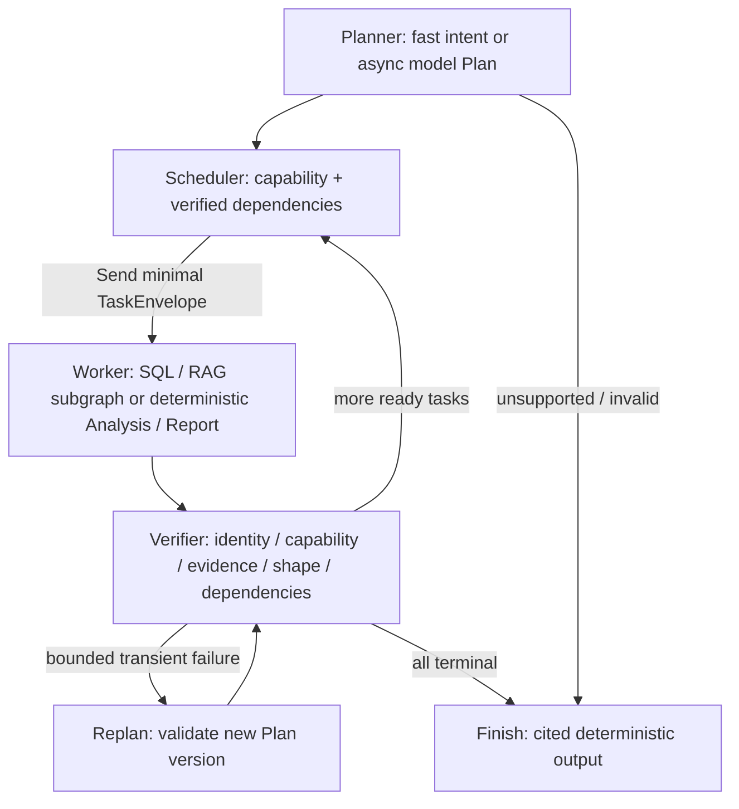

# P4 / D9–D10：双层执行与动态任务编排

本阶段把 `ask` 的固定四节点链改为经过实际测试的动态任务 DAG。保留原单 SQL 查询、编译修复、真实 MCP/PG 与 P3 独立指标入口；不扩展为生产多租户、长期 Memory/Checkpoint、真实 RAG 或 LangGraph Fork。

## Mini Python 源码理解与独立接口

实际阅读了本地研究快照 `.cache/framework-research-20261021/mini-claude-code/python/mini_claude/`，固定提交 `0b452360866433fde0dc77cd37ada9d303546592`。不是仅凭 README 推断，也没有运行上游 Shell/文件工具。上游是教学实现，不代表 Claude Code 私有架构。

| 已读源码位置 | 可借鉴概念 / 观察到的限制 | DataPilot 独立实现接口 |
|---|---|---|
| [agent.py:1711–1860](https://github.com/Windy3f3f3f3f/claude-code-from-scratch/blob/0b452360866433fde0dc77cd37ada9d303546592/python/mini_claude/agent.py#L1711) | OpenAI Loop 把 assistant 与 tool_call_id 反馈接续；预算中止也补齐反馈。输入 JSON 解析失败用空对象的处理不直接采用 | `build_worker_loop()`、`LoopState`、`WorkerContext`、`Gateway.invoke()`；严格拒绝参数错误，所有退出路径维护配对 |
| [agent.py:1371](https://github.com/Windy3f3f3f3f/claude-code-from-scratch/blob/0b452360866433fde0dc77cd37ada9d303546592/python/mini_claude/agent.py#L1371) | 新建子 Agent，执行独立 prompt 后把文本和 Token 增量返还；没有本项目需要的持久 DAG | `TaskEnvelope → TaskResult`，父 Ledger 原子预留、取消信号共享，返回经过引用检查的结构化结果 |
| [subagent.py:123](https://github.com/Windy3f3f3f3f/claude-code-from-scratch/blob/0b452360866433fde0dc77cd37ada9d303546592/python/mini_claude/subagent.py#L123) | 按类型选择独立工具配置；空/默认工具选择的语义需要审慎 | `CAPABILITIES` 与每个任务的 `ToolRegistry`；空能力真的为空，不回退全工具 |
| [tools.py:32](https://github.com/Windy3f3f3f3f/claude-code-from-scratch/blob/0b452360866433fde0dc77cd37ada9d303546592/python/mini_claude/tools.py#L32)、[589](https://github.com/Windy3f3f3f3f/claude-code-from-scratch/blob/0b452360866433fde0dc77cd37ada9d303546592/python/mini_claude/tools.py#L589)、[670](https://github.com/Windy3f3f3f3f/claude-code-from-scratch/blob/0b452360866433fde0dc77cd37ada9d303546592/python/mini_claude/tools.py#L670) | 工具定义、权限判定、执行 dispatch 分离，deny 优先；通用 Coding Agent 的权限模式/工具不直接成为分析系统权限 | `ToolDefinition.schema()`、严格 SQLArguments/SearchArguments、执行白名单、真实 MCP 服务端权限；没有 Shell/任意文件/DDL 工具 |

本轮接口和代码独立设计，没有直接复制实现或提示词，因此没有新增 vendored 源码。仍保留 [来源/许可证说明](third-party-references.md)。LangGraph 的 StateGraph/Send/Command 通过现有锁定依赖调用，底层源码与版本不改。

## 外层拓扑与状态



每个逻辑 Run 只有一个 Coordinator；固定外图与共享内图各编译一次。新计划只改数据，禁止模型生成图节点、工具注册或可执行表达式。调用者不要把同一 Coordinator 当多个 Run 并发复用；新的 Run 使用新的私有账本/工件/取消上下文。

| 契约 | 关键不变量 |
|---|---|
| TaskSpec / Plan | task_id 唯一、依赖存在/无重复/无环、任务类型与操作有限；绝不允许权限/凭据/预算/任意代码字段 |
| TaskEnvelope | 宿主补 run/plan/task、父 ID、能力、子预算和只来自已验证依赖的 refs；不是模型可填写的授权对象 |
| TaskResult | 明确 succeeded/failed/unavailable/cancelled/blocked、错误类别、实际子 usage、refs、尝试数；新版本复用显式 reused_from |
| VerificationResult | identity/capability/evidence/shape/dependencies 五项有序检查，passed 不带错误；业务指标仍另走 P3 六层验证 |
| RunState | TypedDict；Plan、版本化结果/验证 map、控制步骤、终态与原单 SQL 兼容投影；不含连接、密钥、消息历史或工具句柄 |

Plan DTO 最多 12 个任务，默认宿主进一步限制 8 个。Scheduler 每波默认最多派两个，后继仅在依赖通过验证后的 superstep 获得 Send；不会先启动所有 Worker 再让它们等依赖。结果 key 为 `plan_version:task_id`，重复同内容幂等，冲突立即失败。

Replan 最多一次（可配置上限三次），只对可重试暂时性失败开放。新 Plan 重新做完整验证，能力全集固定；只复用定义未变、已验证的无依赖源任务。派生任务重新生成；不变的引用须存在且 hash 一致。权限、输入、预算和验证失败不能借重规划绕过。

## 内层 Worker 与工具

`decide → tools → decide / END` 是编译后的 LangGraph 子图。外层 Send 只传 Envelope；子图消息、工具对象和调用历史保持任务局部。Runtime context 中 WorkerLimits 只有轮次/尝试/超时，模型 Gateway 仅保留必要模型限额，凭据不进入 State/消息/Trace。

- SQL：宿主先经允许的 MCP 工具读取 Schema（Trace 中 worker_bootstrap），降低简单查询轮次；模型随后调用 query_database，再读取结构化反馈并返回真实工件 ID。SQL 编译错误最多修复到 max_sql_attempts，安全拒绝立即终止。数据库仍由真实 MCP SDK、SQLGlot、固定 saas Reader grants、只读事务、超时/行数/字节限制保护。
- RAG：只允许 search_documents，输入 query≤512 字符/top_k≤5；输出含 document/source/version/text hash，单文档≤4096 字符。默认没有可用真实后端；只有宿主显式提供检索接口时才有该能力。当前用 fixture 验证调度/Loop，不声称真实 Embedding/向量检索已交付。后续真实后端必须通过受控 MCP 接入。
- Analysis：无模型、SQL 或检索句柄，仅消费已验证依赖的完整 QueryResult。首版固定 Decimal sum/ratio，列必须存在，ratio 分母非零、禁止 float 心算、结果有限且有配额；单位标为 unconfirmed，不冒充已确认的 Revenue/Churn 定义。
- Report：无模型和业务工具，仅把实际依赖工件组成引用包；最终确定性展示表格、来源、计算和引用。完整自然语言业务报告 Agent 属于 P6。

每次 assistant 的全部 tool_calls 都对应一个 ToolMessage，保留原 call ID；同轮/跨轮重复 ID 或无 ID、非法参数、错误工具立即失败，不用 `{}` 代替解析错误。拒绝或取消时剩余调用会获得明确未执行反馈。模型只能返回本任务实际获得的工件引用，不能用自由文本报告伪造正确性。

## 预算、取消、错误与 Trace

`BudgetLedger` 在同一锁下先检查父子全部账户，再预留调用次数和最坏输入/输出 Token；settle 一次且只能一次。Unknown usage、请求失败或取消保留保守 charge，不声称零费用。Planner、Worker、Replan 都走 Gateway；真实模型 `ainvoke`，SDK 不叠加重试。Fake 只产出决策/SQL，逻辑调用照样受限、真实 Token 明确为零。

默认 root：8 次调用/18,000 tokens；子：最多 4 次决策，不得超过父限额。外层控制步骤默认 20，Worker 轮次另有限额。默认 8 tasks/2 并发/1 replan/2 SQL attempts。简单已知 SQL 意图 fast plan 不调用 Planner LLM，Worker 查询与引用确认两次决策即可完成；复杂两源 + 引用包的 fixture 示例为五次决策。预算上限不是实际必用次数。

取消信号由父传给所有 Worker、模型和工具等待；协作取消返回 cancelled，外部 asyncio task.cancel 继续抛 CancelledError，同时清理待决预算和工具配对。远端已收到的 HTTP/数据库请求可能仍执行到服务器超时，不能承诺撤销供应商费用或物理终止全部服务器工作；查询仍然只读。

错误类别为 permission/input/plan/budget/cancelled/model/tool/verification/internal，外层不再把所有异常包装成 MCP_CONNECTION_ERROR。SQL 编译修复归内层；短暂工具失败可触发一次外层 Replan；安全拒绝强制不可重试。

Trace 记录 sequence/run/plan/task/node、调用 ID、状态/错误码、Worker/模型/工具时延、证据 ID 与预算快照。usage 为累计快照，不能把 root 和 child 相加计算总耗用。Trace 不记录完整问题、SQL、参数、文档原文、凭据；工件含业务原文时只能在显式可信本地导出包中查看。ArtifactStore 每 Run 最多 16 MiB/96 工件，Trace 最多 1024 事件；工具/模型反馈还有独立限长，超限失败而非无声丢弃证据。

P4 工件 ID 是 SHA256，携带实际来源/SQL/结果/父引用/任务版本，可通过 `digest(artifact)` 复核。它们是本次执行工件，不是 P3 持久 Evidence UUID；`include_artifacts=True` 或 CLI `--json` 导出完整包，否则生命周期随 Run 结束。未实现 PG Saver、持久预算、跨进程取消/恢复或历史引擎重放；不能用本阶段 Trace bundle 冒充 Checkpoint。

## 运行示例

```powershell
uv run --locked datapilot ask '查询客户总数' --mode fake --json
uv run --locked datapilot ask '查询客户总数，并计算2025-10收入' --mode fake --json
uv run --locked python scripts/trace_orchestration_demo.py --output artifacts/p4/my-two-sql.json
uv run --locked python scripts/trace_orchestration_demo.py --with-rag-fixture --output artifacts/p4/my-rag-fixture.json
```

输出文件要求是仓库 artifacts/ 内的新文件，避免覆盖历史 Trace。两个脚本示例都实际查询 PostgreSQL/MCP，决策为 Fake；第二个检索部分明确 fixture。普通 ask 不启用 RAG 替身。Live 模式沿用已有环境变量，现要求供应商兼容原生 tool calling；本阶段没有真实 API 验收，HTTP Mock 仅证明协议与异步实现。

测试与实际结果见 [P4 交付](p4-delivery.md)。根目录开发约束、路线图和 ADR-006 一同限定停止点：只完成 D9–D10，不将 Gate C 的持久恢复/真实跨来源能力提前称为完成。
