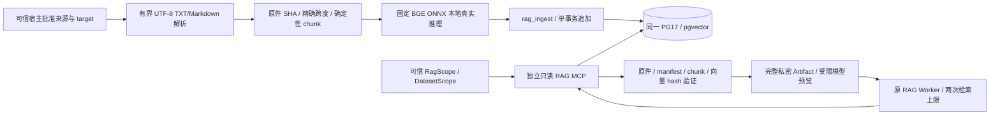

# P6A：授权文档摄取与真实 pgvector 检索

本阶段基于 cdccf28/P5B，用原 RAG Worker、ToolRegistry、MCP SDK、Artifact 与官方 Checkpoint 接入真实文档链路。首发是可信本地单用户 SaaS 原型，不是生产多租户服务；不实现 P6B 综合报告、UI 或长期 Memory。决策见 [ADR-010](adr/0010-scoped-rag.md)，实际测试见 [交付记录](p6a-delivery.md)。

## 已有接口与本次补充

| 既有能力 | 本次使用方式 |
|---|---|
| RetrievalTools.search(query, top_k) / Document / SearchResult | 增加真实 MCP 实现和可选 citation/usage 字段，保留 fixture 回归；不创建第二套 Worker |
| ToolRegistry / assistant-tool ID / Loop / Gateway | 原始协议、预算/取消、L0–L4 不变；真实 MCP adapter 规定每任务最多两次检索，默认外层 Replan 仍有界 |
| P2 DatasetScope | Dataset 必须指定版本；CLI 摄取与宿主会话经既有 Dataset MCP 确认 ready 版本，RAG 进程不继承 Upload Reader |
| P3 Evidence / 六层 Verifier | 不改 Registry；候选文档仅证明出处与内容完整性，不变成 verified 经营指标 |
| P5B Durable / Journal / ArtifactStore | RAG scope、index/source pin 进入运行身份；原工具结果/模型调用去重、工件保全与 unknown/uncertain 规则继续生效 |

新增 `rag/contracts.py`、`parsing.py`、`models.py`、`storage.py`、`mcp.py`、`cli.py` 与 Alembic 0005。原 rag.document_chunks 是历史占位表，不承担新链路、不删除、不修改 0001–0004。



## 解析、切块与资源边界

只接受显式列举的常规 `.txt` / `.md` 文件，UTF-8 或 UTF-8 BOM；不猜旧编码。正文作为纯文本：Markdown/HTML 标签、外部链接与恶意指令都不执行/不渲染/不下载。拒绝 PDF、HTML 文件、Office/宏文件、ZIP、二进制控制字节、符号链接、重复名称和非法名称。没有万能解析器，也不把 PDF 当作有页码的文档。

| 项目 | 默认 / 上界 |
|---|---|
| 来源文件数量 | 默认 16；Limits 允许最多 32 |
| 单文件 / 单批原始字节 | 256 KiB / 1 MiB |
| 解析时间 / chunk 数量 | 3 秒协作式检查 / 总计 1024 |
| chunker | unicode-window-1；192 字符、32 重叠；可配置 64–256 字符 |
| Embedding | 每批最多 1024 段，内部 batch=16；单段/查询最多 512 tokens，拒绝静默截断；本地推理 30 秒协作式检查 |
| 查询 / top_k | 1–512 字符 / 1–5；默认 top_k=3 |
| 查询事务 | READ ONLY、statement_timeout 默认 2 秒（最少 1 ms）、lock_timeout 500 ms |

时间限制是有界输入上的协作检查，不宣称操作系统级 CPU/内存沙箱。原 Worker 轮次、根/子预算、工具超时、上下文与 Artifact 配额仍生效。既有长历史 fixture 可以保留多轮回归；真实 adapter 的检索次数限制来自宿主代码，文档或 fixture 标记不能授予权限。

`start/end` 是移除 UTF-8 BOM 后原文的 Unicode 字符偏移，右开区间；CRLF 不归一化。line_start/line_end 从 1 开始，page 明确为 null。原始字节 SHA、解码文本 SHA 与片段 SHA 分开；源更新只改变新版本。

## 固定模型与索引语义

使用 BAAI/bge-small-zh-v1.5 的 Qdrant ONNX 转换，Git revision `46fbe35fd4374a00fee7de77dfddaeb6dd6a2c59`，512 维，CLS pooling + L2 normalization，固定中文 query prefix。实现 recipe 为 `cls-l2-query-prefix-1/ort-1.31.0/tokenizers-0.23.3`，ONNX Runtime 1.31.0 和 tokenizers 0.23.3 由 uv.lock 固定。

- model_optimized.onnx：94,781,076 字节；SHA256 `1294ea4b6331115a353d81f96b85e8c8d7fdcc284453d5b2fab5b016230aad38`。
- tokenizer.json：439,125 字节；SHA256 `48cea5d44424912a6fd1ea647bf4fe50b55ab8b1e5879c3275f80e339e8fae26`。

只做 CPU 推理，不训练模型；Embedding 不需要 API 凭据。缓存位于仓库 `.cache/rag-models/<revision>/`，不提交权重。下载只在显式 model-fetch 运维命令发生；MCP 不自动联网，也不接受任意模型、路径、URL 或 Python 自定义模型代码。文件缺失/hash 错误明确 EMBEDDING_NOT_READY，绝不替换为随机向量。未来更换模型必须产生新 ModelSpec/index，不能混用不同向量空间。

同一 PG17 中 `public.vector(512)` 存储归一化向量，P6A 使用 `pg-cosine-exact-1` 精确 cosine 排序，再按 chunk_id 稳定处理平分；scope 普通索引先限制 corpus/index/document。没有 ANN/HNSW 近似召回承诺，也没有独立 Qdrant/FAISS 服务。默认 score>=0.55 只是宿主可调整的未校准过滤阈值，**不是事实置信度或真实性证明**；不足 top_k 就返回实际数量。

模型/推理方式参考 [BGE 官方模型卡](https://huggingface.co/BAAI/bge-small-zh-v1.5)、[固定 ONNX 转换](https://huggingface.co/Qdrant/bge-small-zh-v1.5/tree/46fbe35fd4374a00fee7de77dfddaeb6dd6a2c59)、[ONNX Runtime Python](https://onnxruntime.ai/docs/get-started/with-python.html)；精确检索依据 [pgvector 0.8.6](https://github.com/pgvector/pgvector/tree/v0.8.6)。本项目独立编写接口与查询，不复制第三方 Agent 框架源码。

## 存储、版本与授权

Alembic 0005 建立四张追加式表：

| 表 | 内容 |
|---|---|
| rag.corpora | corpus UUID 与固定 owner / SaaS 或 Dataset/version target |
| rag.sources | 版本化原件 BYTEA、source/document ID、字节/文本 SHA；不存任意源文件路径 |
| rag.indexes | corpus/index_version 与完整 ModelSpec/chunker/文件版本/片段定位 manifest |
| rag.chunks | 参数化写入的片段、span、vector(512) 与 float32 向量 SHA |

source_id 绑定 corpus+文件名，document_id 绑定 source_id+原件 SHA，chunk_id 绑定 document/span/chunker/片段 SHA；index_version 为完整 manifest SHA。原件、清单和批量向量在同一 PostgreSQL 事务提交；中途失败整体回滚。相同输入幂等；新内容/文件集合/chunker/model 得到新索引，旧原件和索引保留。没有隐式 latest/current 选择或物理删除。Corpus 的 Dataset/version 不重绑定；数据集升级需新的 Corpus。

rag_ingest 仅 SELECT/INSERT 新四表，rag_reader 仅 SELECT，两者均无 CREATE/UPDATE/DELETE/角色继承或 saas/uploads/Checkpoint 权限。MCP RAG profile 仅注册 health/get_rag_manifest/search_documents；模型看到 search_documents/read_context 与宿主本地完成控制 submit_rag_result。控制工具不是 MCP 写入。SQL profile 不继承 RAG DSN，RAG profile 不接受 SQL/Upload Reader DSN，没有 SQL 查询工具。

RagScope 是可信宿主 API：owner、CorpusPin、明确的 DatasetScope、SaaS 授权和 score 阈值；模型参数仅 query/top_k。CorpusPin 的 document_ids 必须完整匹配批准的索引快照，避免授权部分文件时泄露同快照其他元数据；需更小集合时用独立 Corpus 或重新批准的文件子集索引。拒绝缺失/额外/跨数据集/错误版本的授权清单。空 scope 明确 no_authorized_documents；合法范围无召回为 no_matches；越权报 DOCUMENT_NOT_AUTHORIZED。

运行前由真实 MCP 新会话复核 Dataset/version；RAG Worker 的 ContextScope 含当前 Dataset/source pin，固定前缀另带 scope hash/index versions。恢复身份含 rag_scope 和新鲜 source pin；Checkpoint/Memory/摘要不能替宿主补回丢失授权。旧 scope 是本地宿主明确再授权，不是生产撤权/RLS 系统。

## 引用验证和故障

每次预检从原件快照重算 source/text/span hash、字符/行号，并核对 manifest SHA；查询时校验持久 vector SHA 和片段 SHA。MCP 客户端再次按可信 scope/index/文件列表验证 citation、chunk/hash/版本、top_k 和可用状态；原 Coordinator 在 Verifier/Finish/Resume 复查，不接受模型自报引用。

Document 保留旧字段，并添加 ChunkCitation：corpus/index、source/document/chunk IDs、原件/片段 SHA、字符/行范围、模型/chunker/retriever 版本和 score。为兼容旧 read_context，Document.document_id 是“返回片段 ID”（等于 chunk_id），citation.document_id 才是版本化完整文档 ID。SourceId 与 DocumentId 均可回到原件快照；不能把它们冒充 P3 Evidence/Verification ID。

完整文本/引用先进入私密 Artifact；原 L0 只向模型提供必要预览/ref，read_context 保持 task/run/version 权限与输出上限。公开 Trace 不含正文、向量、SQL 或密钥，私密 Checkpoint/Artifact 仍按 P5B 管理。本地显式 query/JSON/answer 会向已授权用户显示检索片段，不应公开分享原始工件。

已确认的 PG statement timeout 是回滚后的 RAG_QUERY_TIMEOUT，可在原有有界策略下重试。未知 MCP 超时/断连继续按 P5B uncertain 停止，不重发、不清零预算；并行、审批、取消和工具调用关联沿用原 Runtime，没有新增无限循环。只读查询可重试不等于能确认任意外部操作从未执行。

## 部署与可运行 Demo

已有数据库保留数据，只增量部署，不重新 Seed：

```powershell
$env:PYTHONUTF8 = '1'
uv sync --locked
uv run --locked python scripts/configure_local.py --add-rag-roles
uv run --locked datapilot db-init
uv run --locked datapilot migrate
uv run --locked datapilot rag model-fetch
uv run --locked datapilot health
$corpusId = [guid]::NewGuid().ToString()
uv run --locked datapilot rag ingest --corpus $corpusId --saas --reviewed --file tests/fixtures/rag/onboarding.md --file tests/fixtures/rag/billing.md --file tests/fixtures/rag/release.md --output artifacts/rag-demo-scope.json
uv run --locked datapilot rag query --scope artifacts/rag-demo-scope.json --query '哪些措施有助于提升顾客续订意愿？' --top-k 2
$runId = [guid]::NewGuid().ToString()
uv run --locked python scripts/rag_recovery_probe.py start $runId artifacts/rag-demo-scope.json --pause
uv run --locked python scripts/rag_recovery_probe.py resume $runId artifacts/rag-demo-scope.json
```

Fake 只控制 LLM 决策，Embedding、源文件、PG/vector、MCP 是真实的；不声称 Fake 的问答质量是实际供应商效果。上传数据集用 `--dataset ID --dataset-version N` 替代 --saas，ID/version 来自已有 P2 ready Dataset。每次 --output 使用新的仓库 artifacts/ 文件，不覆盖旧授权。跨进程故障脚本为 `scripts/rag_recovery_probe.py`，仅供宿主测试。

真实模型入口为 `datapilot durable start RUN_ID --question '问题' --rag-scope artifacts/rag-demo-scope.json --mode live`，会消费 API 额度。最初两次 DeepSeek smoke 分别因最终交付格式、检索次数上限失败，历史负结果保留；后续定向修复采用 submit_rag_result 与一次 Stop Hook 纠正，真实搜索仍最多两次。最新测试和单次有界实测记录见 [完成协议交付](rag-completion-repair.md)。

### 检索任务验收

授权且相关、满足可支持数量/范围要求的片段可完成检索；不要求每个子任务独立证明最终经营结论。原文引用词定位与语义同义检索均支持，非空/hash 有效/模型搜索分数均不能单独 complete。语义相关性在隔离 MCP 内按宿主原始目标与固定 BGE 独立计算，goal SHA/score 返回并绑定原工件；不由模型参数赋权。当前 0.55 阈值是启发式，非充分语义或因果证明。

空检索 unavailable，非空但不足 insufficient，检索 complete 的收据仍 `business_conclusions_verified=false`。只有相关 chunk 在确定性答案中展示，其余候选仍保留完整私密 Artifact。原 P3/外层 Gate 继续阻止未验证指标结论；不借本阶段新增综合业务报告。

## 已知边界

仅有小型合成中文语料验证，非独立 SaaS benchmark。短查询可能因阈值返回空；早期“客户上手”查询即发生此现象，未降低阈值伪造召回。没有 PDF/HTML 解析、OCR、混合检索、重排、ANN 优化或模型训练。存在源码/权重可用性、冷启动和同步 CPU 推理开销；本轮不据此承诺省费或吞吐。

local owner/scope 与角色隔离不是生产 RLS；管理员不在防篡改威胁模型内。旧源/索引不自动清理；保留/加密/运维按后续明确授权的 P6C/P10 处理。P3→P4 可信业务报告桥接留给 P6B，P6A 结束即停止。
