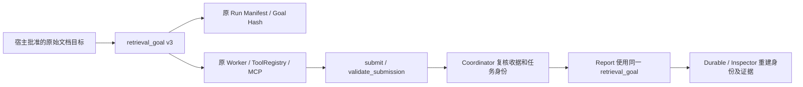

# P7 Phase 2C.3：宿主目标否定、穷尽性与完成安全修复

2026-10-30，**PASS（本轮有界安全修复与定向回归）**。

ex073 类明确否定全量遍历的请求已在新测试中正常完成；ex074 类穷尽语料请求，在没有穷尽证明时不能获得成功收据或业务 completed。BGE、Qwen 都经过真实 PG/MCP、Worker、Report 与恢复验证。另有独立 Report 反例证明：即便真实相关片段、事实和 Hash 都正确，上游声称 succeeded 也不能替代全语料覆盖证明。

这不改变 Phase 2C.2 的 **BLOCKED、75/200 observed、125 not_run**，不是旧任务重评分或新的 Embedding 优势证明。当前可准备**另行授权的新独立非付费业务验证**；不具备直接切换生产或自动开展 DeepSeek Live 的资格。

## 1. 根因和实际信任链

原始采集包只读审计另存于 `artifacts/p7/host-goal-safety-v3/original-failure-audit-r2.json`，没有改原包或历史库。

| 历史问题 | v2 行为 | 根因 | v3 新输入的判定 |
|---|---|---|---|
| ex073：不要遍历全部文档，只说明已确认的审批角色 | unsupported=true，unavailable | 量词直接匹配，未识别否定的作用范围 | bounded_facts；实际完成还须全部 Required Facts/Source/Citation 合法 |
| ex074：逐篇检查语料，一份也不能漏 | unsupported=false，真实引用后 completed | 漏掉“逐篇/不漏一份”及其集合目标 | exhaustive_collection；没有穷尽证明，unsupported=true |

ex074 原 Run `7464c7d3-8d29-51cf-8fd8-e3f3fb50e3e4` 的引用物理正确，并非伪造 Source/Citation。原 Inspector 的验证没有发现尚未被解析到的全量目标，因此不能以它证明目标充分。历史报告仍保留 completed，原失败和分数均不改写。



具体入口保持原状：`Coordinator` 构造任务 Goal；`ToolRegistry` 绑定原问、限制工具并校验提交；`Coordinator.verify` 再校验收据；`ReportSession.build` 重新使用同一 Goal；`run_durable` 和 `inspect_run` 在 Manifest 中写入/重建整个 Goal，原 `Backend.authorize` 比较 Hash。模型改写搜索词、返回文档、摘要和 succeeded 都不是权限或目标来源。

四个层次独立：

| 层次 | 能证明什么 | 不能代替什么 |
|---|---|---|
| Physical Citation Validity | 授权 Source/version/chunk/span/hash 和引述真实 | 相关性、事实齐全、穷尽性 |
| Required Fact Coverage | 宿主预确认的有限事实有对应原件依据 | 尚未确认的事实或全部语料 |
| Goal Sufficiency | 当前受支持、边界明确的目标满足原要求 | 任意自然语言意图的完整理解 |
| Business Completion | 所有必需目标、P3、引用及因果限制满足 | 模型自评或单个成功工具调用 |

因果分析仍允许 RAG 完成有限事实检索，再由 Report 保留未验证因果。集合穷尽性属于检索目标本身，不能用“找到相关背景”替代；本轮没有把全部业务结论证明前置给 RAG。

## 2. 先登记反例，再修改产品

公开新集合：[host-goal-requirements-v3.json](../../tests/fixtures/rag/host-goal-requirements-v3.json)。60 条语言/范围安全 Dev：30 bounded、21 exhaustive、9 ambiguous，覆盖中英文、所有权、指定事实、否定/双重否定、逐篇/每份、无遗漏和混合表达。每条固定原问、预期类别、unsupported、Scope、Required Source/Fact、条件性完成资格、预期状态及理由。

它是用于修复的公开回归集，**不是封闭独立 Holdout**。真实证据不足、缺 Required、越权、P3、因果、恢复另由 PG 测试矩阵覆盖，不能把 60 条解析用例都称为真实业务 E2E。

| 登记项 | SHA256 |
|---|---|
| 60 条固定输入/Gold | `666ee5e6849d0ebfc7e4895e5bde85fbecbca6c8a1a1a721a64ad1ae620ecb1a` |
| 最终产品源码 | `b1954ee196b65e72fd16e7969a3aa50d8ad2bd9ddb8e4432ca57372fcad29e83` |
| 最终运行/测试闭包清单 | `7d0270dc8668851c541a5a40c8855419bc021312e0223ace441e9f95505a5bf5` |

`preregistration.json`、`scoring-registration.json` 在产品修改前登记输入、预期及测试代码 Hash；旧 v2 实际运行基线为 **24 failed / 36 passed**，`before-py311.log/.xml` 和逐条完整旧 Goal 保留。新增的作用范围反例和恢复旧“内容”守卫的反例，也分别先登记/运行失败，再修复；没有改动原 60 条 Gold。

## 3. 最小改动及新增内容的必要性

唯一产品改动：[rag_completion.py](../../src/datapilot/orchestration/rag_completion.py)。

- 用 `requirement_class` 替换原二值 `exhaustive_requirement`，仍是同一个宿主入口中的有界确定性语法。按集合对象、已确认事实、分句和否定作用范围判定；保留正向并列要求，双重否定不被当作简单取消。无法确定范围的已识别表达返回 ambiguous。
- 保留原集合对象及安全守卫，加入逐篇/逐份、无遗漏和 knowledge base 等表达；“所有权/所有者”和已确认的有限事实不等同于整个集合。
- `requirement_policy=host-goal-requirements-v3`，新增宿主字段 `requirement_class` 进入原 Goal Hash。原 `unsupported_reason` 增加 `exhaustiveness_not_attested` / `goal_scope_unresolved`，用于可追溯拒绝原因。
- **没有新增完成状态机或完成资格布尔真值**：继续复用 `unsupported_requirements`，Completion 与 Report 的现有共同守卫。bounded 仅是范围分类，不是授权或自动完成；快照、时间、来源数量等独立限制仍生效。

其余修改均为测试与交付：

| 文件 | 作用 |
|---|---|
| `tests/test_host_goal_requirements.py` | 原 v2 回归输入/Gold 不变，只更新当前策略身份断言 |
| `tests/host_goal_probe.py` | 原测试子进程增加固定 v2 身份夹具和既有 fault cut-point；不接入生产工具 |
| `tests/test_host_goal_postgres.py` | 仅处理预期硬退出 91 的空 stdout；意外退出/正常空结果仍失败 |
| `tests/test_host_goal_safety_v3.py` | 预登记范围判定、版本 Hash、作用范围及原 Worker 完成拒绝测试 |
| `tests/test_host_goal_safety_postgres.py` | 复用原摄取、Scope、Probe、Report、Durable、snapshot 的真实集成矩阵 |
| `tests/fixtures/rag/host-goal-requirements-v3.json` | 新公开反例和新合成文档 |
| `tests/fixtures/rag/host-goal-v2-identity.json` | 从保留的修改前函数生成两种 Profile 的精确 v2 Goal，用于新隔离库的旧身份测试；不是生产回退 |

没有修改 Report/P3、Embedding、0.55 阈值、Top-k、预算算法、Journal、Ledger、Durable、迁移、权限或 Prompt 模板；没有第二套解析服务、Scheduler、MCP 或 Verifier。

## 4. 新旧身份与兼容代价

整个 Goal（类别、原问 Hash、策略、阈值、来源数量、unsupported 等）进入原 Manifest 和 Receipt Hash。新 Run 绑定 v3；新 v3 暂停/跨进程恢复/重复恢复保持报告、调用和预算一致。

新隔离库内构造的精确 v2 Manifest/Receipt 在 v3 恢复时返回 **RECOVERY_IDENTITY**，原快照、调用、工件和预算不变。没有访问真实历史库来构造旧运行，没有改写旧 Hash、自动迁移或规则回退。

**部署影响仍需明确告知：旧 RAG Run 不能在不兼容的新策略下继续恢复或重新发布。** 已保存的旧原件/报告不变；后续迁移或保留旧部署需独立决策。本轮未部署、重启 UI/API 或切换默认模型。SQL-only 没有新增 RAG Goal 字段。

## 5. 真实 PG/MCP 与最终源码一致性

新库 `datapilot_test_host_goal_safety_v3_20261030` 位于原隔离测试实例。只执行原迁移至 0008 与 runtime-init，无 Seed、旧库写入、全局角色变更或删卷。最终实查 PostgreSQL 17、pgvector 和迁移身份，见机器记录。Qwen 固定 `qwen3-cuda-fp16-v1`，实际模型由原独立 3.11 环境运行；“宿主 Python 3.13 通过”不表示换成了另一套 Qwen 解释器。

两模型均验证：

- 普通事实、明确否定全量要求：真实证据齐全时 completed。
- 缺一项事实、缺 Required 来源：partial；事实无依据：unavailable。
- 穷尽语料、双重否定、歧义、“全部内容”：不产生成功完成收据、不发布 completed。
- 真正相关且 Hash 正确的授权片段，在伪造上游 succeeded 条件下仍被 Report 独立拒绝。
- 因果证据不足：partial；金额只从原 P3 verified Bridge 发布，Decimal/单位正确。
- owner、IndexVersion、Profile 错绑：拒绝；旧 v2 身份恢复拒绝。
- 新 v3 跨进程/重复恢复复用原结果、工件和预算。
- 故意中断的工具调用：RECOVERY_UNCERTAIN，不新增调用或释放未知预算。

决策均为相同脚本，工具执行/Embedding/数据库/验证/持久化是真的，**不是 DeepSeek 自主多轮能力评测**。

| 执行集 | Python 3.11 | Python 3.13 |
|---|---:|---:|
| 最终源码非集成定向回归 | 405 passed | 405 passed |
| 初始 v3 真实安全矩阵 | 32 项全部覆盖通过，分 14+1+17 保存 | 12 passed / 20 deselected |
| 最后“内容”守卫及身份恢复补验 | 6 passed / 28 deselected | 6 passed / 28 deselected |
| 既有 SQL-only/P3、引用/补充、部分证据、原问 unknown 回归 | 6 passed | 6 passed |
| 直接 Report 第二道守卫，BGE/Qwen | 2 passed | 2 passed（与上一行合存为 8 passed） |

共 **72 次 PG/MCP pytest 通过记录**，其中包含恢复子集复验，不是 72 条独立经营任务；初始两次测试接线失败另行保留。最终库为 60 Runs、60 Ledgers、105 Artifacts；原 ArtifactStore 已只读重验 105 个工件。179 条脚本模型调用 complete，170 条工具 complete，7 条工具 uncertain 为故障注入的保守保留结果，无 issued 调用。

P3 共 19 份 Evidence/Verification，17 verified、2 合法 unavailable，逐条原 DTO/Body Hash 检查通过，未将 unavailable 改为 verified。调用/预算、旧身份和 unknown 约束由原运行/Inspector 及快照检查承担，没有另写预算校验引擎。

最后一行“内容”词表修补与前一草案不同，因此不把早期所有 PG 执行冒称为最终源码重跑：`goal-equivalence-after-content-guard.json` 对**先前 66 个问题 × 两种 Goal Policy**逐项比较，Goal 完全一致；最后补跑受影响路径、版本恢复和既有兼容性，并在最终源码执行双版本 405 项。`implementation-delivery.json` 的 789 文件清单固定交付身份。

## 6. 失败历史全部保留

| 记录 | 实际结果及处理 |
|---|---|
| 旧 v2 新反例基线 | 24 failed / 36 passed，未改 Gold |
| 首版 v3 | 6 failed / 177 passed；修正英文已确认事实与“知识库”误匹配 |
| 补充作用范围/已知文档边界 | 6 failed；保留正向前缀、有限事实修饰语必须修饰事实而非文档 |
| 原“内容”守卫核对 | 3 failed / 1 passed；恢复原 v2 集合对象，追加实际 PG 反例 |
| `safety-pg311.*` | 14 passed / 1 failed；预期退出 91 无 JSON，测试辅助函数误解析空串 |
| `safety-pg311-r2.*` | 1 passed / 1 failed；637.4500000000000000 与 637.45 错按字符串比较，改为精确 Decimal，未动 P3/Gold |
| 首个故障 Run 的手工审计 | 一次 CLI 复连因身份不一致安全拒绝；未绕过 Manifest。使用原显式 Settings + NoModel 最终确认 Inspector unknown=true/no report、Runtime RECOVERY_UNCERTAIN，调用/预算/工件不增加 |

还有一次不存在测试文件路径导致 0 tests、早期 Ruff 长行提示、只读审计未限定迁移表 Schema，均为接线/审计问题，最终已校正。第一次将 Inspector 的结构化 unknown 返回误标为成功的审计输出保留，以 `original-unknown-final-verification.json` 明确更正；从未据此发布报告。没有隐藏产品失败、删除有效测试或放宽业务断言。

## 7. 完整性、工件与可复现入口

历史七套 Seal 共 **1872 个路径**核验无意外差异，包括原 921 和 Phase 2C.2 的 951。原 Seal、Gold、Scorer、日志、成绩、100 条旧问题和 125 not_run 不变。四个当前源码/测试路径的授权差异由修改前精确快照验证，不把它们说成当前文件字节未改变。没有对历史数据库进行新的全量逐行审计，也没有写入或重放历史数据库。

主要工件在 `artifacts/p7/host-goal-safety-v3/`：

- `before/`、`baseline-v2.json`、`preregistration.json`、`scoring-registration.json`。
- `extra-before.*`、`content-before.*`、`content-guard-registration.json`、`report-boundary-registration.json`。
- 所有中间/最终 JUnit、日志与 `tmp-*` 原件、Scope/Run 配置及输出。
- `implementation-*.json`、逐文件 `.patch`、`goal-equivalence-after-content-guard.json`。
- `database-final-audit.json`、`historical-integrity-final.json`、`original-unknown-final-verification.json`、`result-seal.json`。
- [机器交付记录](p7-host-goal-exhaustiveness-safety-v3.json)：逐条新 Goal、全部测试计数、SHA、数据库及历史审计。

复现入口（仓库根目录；实际执行的标签和完整命令见 JSON）：

```powershell
.venv\Scripts\python.exe -m pytest tests/test_host_goal_safety_v3.py tests/test_host_goal_requirements.py -q
.venv-313\Scripts\python.exe -m pytest tests/test_host_goal_safety_v3.py tests/test_host_goal_requirements.py -q
# 真实 PG 入口自动绑定本轮新测试库；必须使用新的未用结果标签，不重跑初始化
.venv\Scripts\python.exe artifacts/p7/host-goal-safety-v3/pytest_run.py <新标签> tests/test_host_goal_safety_postgres.py --maxfail=1
git diff --check
```

完整的 405 项集合和实际已执行标签见 JUnit/JSON；不需要为了核对交付重复执行。私密数据库配置仅在忽略目录，不将 DSN、密钥或原始完整采集公开。Ruff、format、JSON、Markdown 本地引用与 Diff 检查完成；完整 pytest、远端 CI、Linux/Docker 性能重验和付费模型均 NOT_RUN。

## 8. 剩余风险与下一步边界

- 有限中文/英文语法不是完整 NLU。多层否定、指代、未覆盖语言、Unicode 混淆、很长修饰语仍需新的独立验证；已识别的歧义不被自行缩小为有限事实。
- 实际 PG 主输入以中文新问题和双语原件为主；英文范围规则有公开单元覆盖，不冒称广泛英文/跨语言业务盲测已完成。
- 当前没有可信全语料枚举/穷尽证明引擎；即使 Source Recall、Required Coverage、字面引用全通过，也不能宣称穷尽性。
- 新 v3 在有限事实证据满足时可用；这不证明 Chat-first 的任意自然语言到受审查目标映射都完整，也不替代原 Registry 确认。
- 旧 RAG Run 的身份恢复限制是明确兼容代价，没有静默回退。

因此：ex073 类误拒、ex074 类错误完成和真实引用/完整目标的边界在本轮受测范围内已修复验证；v2/v3 安全隔离；最终受测运行中没有新的 False Completion。可进入**新的、另行授权的非付费独立业务质量验证**，仍不建议生产切换或自动 Live。

下一轮应新建并预登记 Dev/封闭 Validation，覆盖否定/量词/来源范围的未见组合、中英文及跨语言、缺事实/干扰、SQL+RAG、因果和权限；冻结最终源码/Prompt/模型/版本/评分，再观察结果。不能续跑 Phase 2C.2 的 125 个 not_run，不能把当前修复回归当成新的独立 A/B 收益。

接续 Prompt：

> 读取 AGENTS.md、本报告和同名 JSON，保留全部未提交修改。Phase 2C.3 已完成有界安全修复；当前默认 BGE、无付费调用、无提交推送。先核对 implementation-delivery.json 与结果 Seal。只在负责人新的明确授权下准备下一独立验证，不重跑旧 Phase 2C.2、不更改其 Gold/Scorer/状态，不自行切换模型、开启 Live 或进入 Gate 3。旧 v2 身份不兼容应继续 RECOVERY_IDENTITY。
