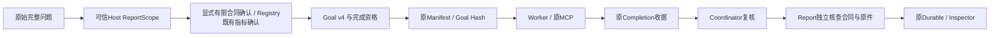

# P7 Phase 2C.5：可信目标范围确认与完成资格

2026-10-30，**PASS（有界工程验收）**。不是新的业务质量Benchmark、完整自然语言理解证明、生产发布或Live准入。

本轮将“没有被分类器拒绝”与“已确认有限目标”分离。公开安全合同60项通过；最终Python 3.11/3.13定向回归各552 passed；真实PG/MCP在3.11覆盖26个唯一测试项，3.13重点4项通过。BGE默认不变、Qwen仅显式测试，没有付费调用、部署、commit/push或Gate3。

原Phase2C.4仍为 **BLOCKED、21/200 observed、179 not_run、Validation 0/160**，没有续跑、重评或修改原记录。

## 1. 审计与设计决定

决策见[ADR-018](../adr/0018-trusted-goal-scope.md)。实际链路保持：



| 审计问题 | 实际结论 |
|---|---|
| 什么默认bounded | v3的有限否定语法未命中时回退bounded，包括未知集合表达；该分类本身不代表许可 |
| 哪些字段表示可信合同 | Host传入ReportScope、Dataset/MetricRequest及原问；但旧purpose/已批准任务候选未明确记录完整目标范围等价确认 |
| 什么只表示解释 | requirement_class、unsupported_requirements、minimum_sources、相似度；不确认集合边界 |
| 能复用什么 | Registry确认指标口径/版本和窗口；DocumentFact确认具体引述；CitationPolicy限定来源；原Host/Scope/Manifest承担完整合同的可信输入边界 |
| 旧Completion检查什么 | 原问Hash、任务/工件身份、授权、相关性与来源数，没有独立的正向范围确认 |
| 旧Report是否独立 | 独立校验事实与物理来源，但Goal分类与上游共用，不能纠正共同的范围遗漏 |
| Worker能否缩小原问 | 改写只影响查询，不改宿主Goal；Original-query-first及512字符、两次搜索限制保持 |
| 如何持久绑定 | 完整Goal进入原Manifest与Receipt.goal_sha256；ReportScope进入原报告授权Hash |
| 影响哪些恢复 | 语义改变的旧RAG Goal拒绝恢复/重新发布；SQL-only/P3没有RAG Goal的路径保持 |
| 如何防止全拒 | 显式确认的有限事实、指定来源、否定全量要求及已确认指标均有正例；缺少确认不是自动推导成已批准 |

原fr002采集包已用原Collector密钥只读验签。它的Source与引用真实，收据semantic_retrieval、报告completed；v3未识别集合前置条件，局部条款不能证明材料齐备。证据在本轮`original-fr002-readonly-audit.json`；没有修改旧包、重新执行旧Run或重评分。

## 2. 最小契约及信任来源

ReportScope增加可选`goal_scope_attestation`，仅包含：

| 新字段 | 必要性 |
|---|---|
| basis=`host-reviewed-finite-contract-v1` | 固定确认类型与版本，拒绝模型自评等来源 |
| confirmation_ref | 已完成宿主范围审查的可追溯引用；不是独立人工签名 |
| contract_sha256 | 绑定完整ReportScope，排除本字段自身以避免循环Hash |
| rag_scope_sha256 | 绑定owner、Dataset/版本、Corpus/Document/IndexVersion和原授权限制 |

合同Hash覆盖完整原问题、文档子目标、MetricRequest/窗口、Required Facts及其引述/引用、CitationPolicy、因果和部分结果等策略。`finite_contract_hash`只计算身份；`confirm_finite_scope`由可信Host在已确认完整原问与有限合同等价后显式记录已有决定，可复用完全相同的确认对象。它**不解析或证明任意自然语言等价**，不调用LLM、不创建Registry、签名服务或审批状态机。

没有新建表、通用Verifier、Scheduler、Journal或预算状态。确认不是数据授权，也不把raw Evidence、事实confirmation_ref、执行审批、高分或存在一份Source变成完整目标证明。模型工具和Web候选参数没有此确认接口，公开测试也不冒称人工签名。

原Requirement分类保留；新版本为`host-goal-requirements-v4`。新增两个派生Goal字段：`scope_attestation`与`completion_eligible`。未被语法拒绝但没有确认的目标，仍可能被分类为bounded，**完成资格为false**。本轮诊断中的原始分类仅48/60符合语义Gold，未假装修复了全部歧义表达；另外12项由未确认状态独立阻断。

唯一原生无外部确认例外是现有严格完整匹配的“定位包含指定字面词的片段”合同；证明来自封闭有限语法，不能携带额外集合目标。组合报告不能用较窄的字面子目标自动证明完整原问。

明确有限文档合同仍需全部Required Source/Fact/Citation满足；新确认不解除穷尽、最新/全局快照、缺事实或因果限制。原SQL-only/P3复用Registry确认与MetricRequest，不要求重复确认指标定义。

## 3. Completion、Report、恢复

- Completion的原提交验证增加正向完成资格检查；缺确认时只能按实际空/非空检索使用unavailable/insufficient。原收据结构仍为rag-submit-v1，Goal Hash包含新确认，不增加第二套收据。
- Coordinator按可信Scope重新生成Goal，验证收据、来源任务/版本和原Journal；模型不能用搜索词改变确认。
- Report重新校验完整合同Hash、RagScope Hash及原来源/引述，不相信上游succeeded、Receipt自述或100%局部事实。无确认返回`goal_scope_not_attested`；独立P3 verified仍可显示，但整体目标不completed。
- Manifest和Inspector使用相同新身份。确认后改变原问、子目标、Dataset、Required Facts、来源、owner、Profile或IndexVersion均失败关闭。改变报告自述不能替代可信Host Scope。
- 旧v3身份在新规则下返回RECOVERY_IDENTITY；不迁移旧Hash、不重签旧报告、不静默回退。新v4跨进程/重复恢复保持报告、调用、预算、工件一致。
- 非Report库调用者可显式提供`rag_task_scope`这一相同可信ReportScope合同，仅用于有限检索任务；与reporting互斥，不产生持久权限入口。Durable仍只用原report_scope和Manifest，不新增恢复机制。

## 4. 公开输入、基线与所有修订

原公开集合[60条v1](../../tests/fixtures/rag/trusted-goal-scope-v4.json)在产品修改前登记。它是公开安全开发/单元合同，**不是独立Holdout或60条真实Embedding业务任务**。

最初测试Target夹具缺owner，60项在进入报告断言前失败；原日志保留。仅修正测试接线、产品仍为v3时，实际基线 **42 passed / 18 failed**：12个未确认集合目标、6个缺确认的有限目标仍可能被错误完成。

之后语义审查发现首版部分领域问题配了通用占位条款，不能当对应业务的语义Gold。未覆盖原输入或结果；另建[修订版60条r2](../../tests/fixtures/rag/trusted-goal-scope-v4-r2.json)，逐题提供相关条款。问题、预期类别/确认状态/资格/报告状态及判分条件均不变，逐项差异和parent SHA在`semantic-fixture-revision.json`。此修订不是按Embedding表现调参；产品和PG原件均未改变。

修订输入另用保留的v3 Goal/Report投影代码对照，仍42符合/18不符合。**这次投影发生在产品修改后**，仅是保留代码对修订单元DTO的只读执行，不冒充更早运行、历史Run或完整旧Runtime。产品修改前的原始JUnit另行保留。

r2的有限事实、显式Source、否定/双重否定、跨团队材料、未知指代/先决条件、全量/无遗漏、多来源、缺事实和英文/混合表达等60项最终通过。预期状态为30 completed、4 partial、26 unavailable。Registry指标、Scope篡改、伪造报告、权限和版本由额外测试及真实PG矩阵覆盖，不把脚本Host确认选择的成功率当自然意图理解准确率。

本轮Host确认均为公开合成测试决定，**没有独立人工盲审或生产批准**。不能用Gold的completed标签在以后质量评测中自动填写确认：后续必须先独立固定真实宿主确认流程/输入，再冻结Gold和评分。

## 5. 实际修改与最小性

七个产品文件，本轮相对开始快照约113行新增/7行删除；没有扩大到Web/UI、Embedding、P3或数据库迁移：

| 文件 | 修改作用 |
|---|---|
| reporting/contracts.py | 一个4字段DTO、可选Scope字段、两个小函数；None继续省略，旧SQL-only投影兼容 |
| orchestration/rag_completion.py | v4身份、正向资格及合同/RAG Hash检查；分类/阈值/原证据规则不变 |
| orchestration/coordinator.py | 沿原Worker/Verifier转交同一Scope；非Report库调用者使用同一合同，不新建执行器 |
| orchestration/tools.py | Original Query仍校验原问及固定检索语义；确认由父层核查且进入原Goal Hash，不让工具参数授予确认 |
| reporting/service.py | 独立重建资格、保持P3和部分结果、明确缺确认原因 |
| persistence/session.py、inspection.py | 只把原Scope转交既有Manifest重建，不改Journal/Ledger/Saver算法 |

测试新增三个文件：`test_trusted_goal_scope.py`、`test_goal_scope_integrity.py`、`test_trusted_goal_scope_postgres.py`；新增两版公开输入及固定v3身份夹具。九个既有测试/帮助文件只适配当前版本身份和显式合成合同确认：完整合同发生修改后重新确认，保留原Source/Fact/因果/预算断言；旧未确认合同的期望改为更保守的unavailable原因。没有修改旧Gold JSON、Scorer或删除反例。

每项实际字节SHA和Diff在`round-delta.json/.patch`。重复的是不同边界处的独立身份核验，不是第二套自由文本分类；不同测试修改后的合同需要分别确认，不能用一个自动批准夹具掩盖变更。

## 6. 定向回归与真实PG/MCP

新库`datapilot_test_trusted_goal_scope_v4_20261030`；PostgreSQL17.11、pgvector0.8.6、迁移0008。复用原隔离实例、角色和初始化流程，无Seed、全局角色变更、旧库写入或清理。

| 最终覆盖 | 真实结果 |
|---|---|
| Python3.11，修订输入与最终产品源码定向单元/合同集 | 552 passed |
| Python3.13，同集 | 552 passed |
| PG/MCP，3.11宿主，BGE及Qwen | 26个唯一测试项通过，分三段复用4+8+14个成功记录 |
| PG/MCP，3.13宿主，BGE重点恢复/旧身份/unknown/P3 | 4 passed，22 deselected |

3.11首段在4项通过后因穷尽请求空召回返回unavailable、测试误写必须insufficient而停；只修正新测试对空/非空的合法收据预期。第二段8项通过后，新测试将进程内BusinessCompletion DTO当JSON字典读而失败；只修正类型读取。原失败JUnit/日志/测试快照保留，没有改产品或业务Gold。最后一段14 passed、12 deselected；已通过项不重复，全26项唯一覆盖闭合。不能把原两次测试失败删除后写成一次全绿。

真实链路覆盖：

- 可信有限事实和否定全量目标→completed；缺Required Fact→partial。
- 未确认材料边界、要求先界定集合、缺穷尽证明→不完成。
- **6个已保存Run有超过原0.55 Goal阈值的真实引用**，范围未确认时仍为unavailable/partial，证明高分/真实引用不能代替确认。
- 真实P3金额637.45 CNY，八份Evidence/Verification均verified；与未确认文档目标组合时整体partial，SQL-only正常completed。
- owner、IndexVersion、Profile错绑拒绝；缺少/篡改确认、伪造成功报告、版本/事实/来源变化均拒绝。
- 新v4跨进程与重复恢复一致；固定v3 Goal测试记录恢复返回RECOVERY_IDENTITY。它们是本轮新建的兼容性记录，不是重放真实历史Run。
- issued工具故障恢复返回RECOVERY_UNCERTAIN，调用与工件未重发、账本未清零。

Qwen固定原独立3.11 CUDA环境；3.13宿主的重点PG为BGE，**没有重跑3.13宿主Qwen PG**。模型决策为脚本/Fake，Embedding、PG、MCP、报告和持久化真实；没有验证DeepSeek自主行为。

完整pytest、远端CI、Linux/Docker重验、浏览器和付费Live均NOT_RUN。

## 7. 持久化与历史完整性

新库只读审计：28 Runs/28 Ledgers、175 Calls、51 Artifacts、512 Events；82条脚本模型调用和90条工具调用complete。另有**3条工具uncertain**来自BGE311/Qwen311/BGE313的显式故障测试，按原规则保留，未盲重发。模型预算pending=0，不等于工具未知状态被解决。51个工件、Manifest、账本Hash与DTO均有效，8份P3验证均verified。

旧2222路径的完整性记录未改写；本轮将其封存与Phase2C.4合并复核 **3324个唯一路径**，没有意外差异。授权新源码/测试变更的原字节都在before快照；已有v2→v3差异沿原归档验证，不谎称当前源码仍等于旧版本。

未访问或重写旧业务/评测数据库，不声称新做了历史DB逐行审计。原Pilot14/16、15/16，C2.2的75/200、125 not_run，C3有界PASS及C4的21/200、179 not_run、STOP/失败/21个Run原始记录均保留。

最终实现清单`implementation-final-r2.json` SHA256：`dbba75bc460e840cf5c7331e6df6fbf10c467645e99eda44d5d143015efc57a8`。早期final候选保留；补强Web参数负例及Metric版本/窗口绑定后，最终两版本各552项通过。产品代码自PG开始保持不变；之后仅修正单元文件格式，AST一致记录保留，没有为格式重复运行测试。

Goal源码新SHA：`6dc25f624ccdabc81b4951d6c6bd9e0a495271eb9c16b56499ac525952371cab`；原v3 `b1954ee196b65e72fd16e7969a3aa50d8ad2bd9ddb8e4432ca57372fcad29e83`原件保留。结果封存在本轮目录`result-seal.json`；[机器记录](p7-trusted-goal-scope-attestation.json)包含计数、JUnit SHA、逐项Diff和历史路径核验。

## 8. Gate、限制和下一阶段

| Gate | 本轮判断 |
|---|---|
| A No False Completion | PASS，登记的未确认/不支持目标与篡改反例均不完成 |
| B No Over-Rejection | PASS，显式有限合同、指定来源及原Registry指标正常；不把缺确认的旧入口冒称已确认 |
| C Identity/Recovery | PASS，新v4复用、旧v3拒绝、unknown保守处理 |
| D Legacy Trust Boundaries | PASS，本轮选定BGE/P3/Citation/Partial/Original Query/预算和持久化回归；不是完整全仓/跨平台验收 |

明确回答：

1. **fr002类型还会错误completed吗？** 无可信确认时，本轮反例不能；未知表达即使仍分类bounded也没有完成资格。错误/恶意的可信Host若虚假背书，仍可能误确认，Hash不能证明任意自然语言等价。
2. **有限目标能正常完成吗？** 能，确认后的有限事实、指定来源和原Registry指标正例实际通过；未满足事实/引用条件仍不能完成。
3. **可信依据是什么？** 显式Host审查记录引用、完整合同Hash、RAG Scope物理版本，以及独立Registry/P3事实；不是模型的“我已理解”。
4. **Completion与Report都核验吗？** 两者从可信输入重建并检查资格/身份，Report再独立核对原件和事实；收据自述不能覆盖缺确认。
5. **新旧Run隔离吗？** v4确认进入原Manifest/Goal Hash，旧RAG身份失败关闭，没有迁移；SQL-only保留。
6. **有新的过度拒答吗？** 登记的已确认有限目标没有；但旧调用者未提供新确认的语义RAG会保守返回unavailable。**现有Web没有新增范围确认UI或自动确认桥接，本轮未验证浏览器，不能承诺Web零影响。** 执行审批不被误当作范围证明，部署前需明确宿主接入和历史恢复代价。
7. **下一轮独立非付费验证的工程前提？** 显式可信合同路径具备；需负责人另行批准新输入/Host确认流程和独立冻结，确认记录必须先于评分且不由Gold标签自动产生。本轮不启动新A/B、不续跑179项，不申请或执行Live。

下一阶段建议独立评测宿主范围确认的正确性、未确认目标的用户提示与实际接入，再以新身份做非付费质量验证。不要继续堆关键词、降低阈值，或把当前60项公开修复用例当独立泛化成绩。

## 9. 复核入口与接续Prompt

所有原始记录在`artifacts/p7/trusted-goal-scope-v4/`：preregistration、before快照/基线、两版公开输入差异、corrected-input-v3-projection、unit-frozen-py311/313、scope-pg311/r2/r3、scope-pg313、database-final-audit、real-score-cannot-attest-scope、historical-integrity-final、round-delta和最终Seal。私密环境与Collector密钥不进入公开Trace或Git。

已有结果优先只读，不重复初始化或覆盖标签。正常定向入口示例：

```powershell
.venv/Scripts/python.exe -m pytest tests/test_trusted_goal_scope.py tests/test_goal_scope_integrity.py -q
.venv-313/Scripts/python.exe -m pytest tests/test_trusted_goal_scope.py tests/test_goal_scope_integrity.py -q
git diff --check
```

PG必须显式绑定新的隔离测试环境；本轮`pytest_run.py <新的结果标签> ...`拒绝覆盖旧JUnit，不能指向演示/历史库。本轮验收已结束，不需要再执行这些命令。

NEXT SESSION PROMPT：先读取本报告、机器记录、ADR-018与result-seal，保留全部未提交修改。Phase2C.5完成有界工程验收，默认BGE不变、未调用付费模型。确认原Phase2C.4仍STOP，严禁续跑179 not_run或另一配对臂。当前可信Host显式确认路径已通过；Web确认UI/自动接入、任意自然语言范围等价和新独立质量验证未实现或未验证，不能自动填确认或根据Gold授予资格。任何新修复/评测/Live须负责人另行授权，不部署、不提交推送、不进入Gate3。
